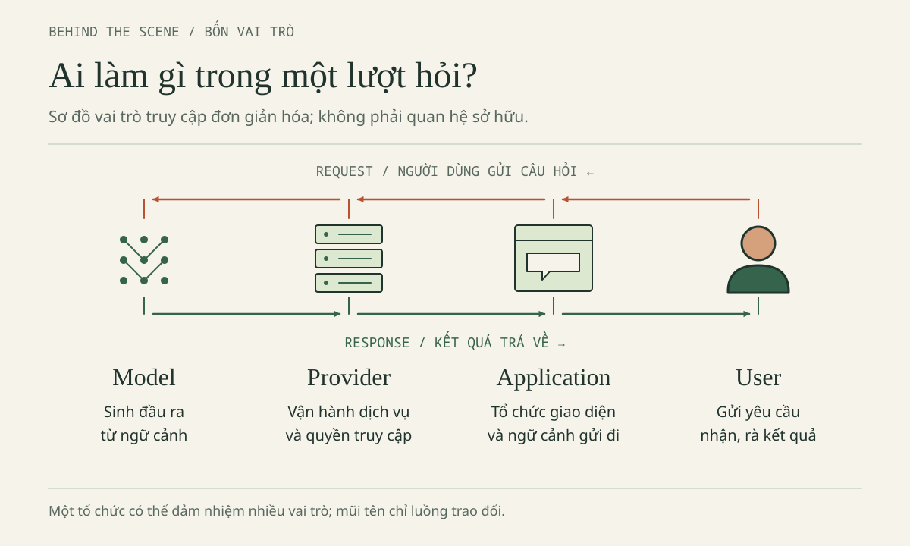
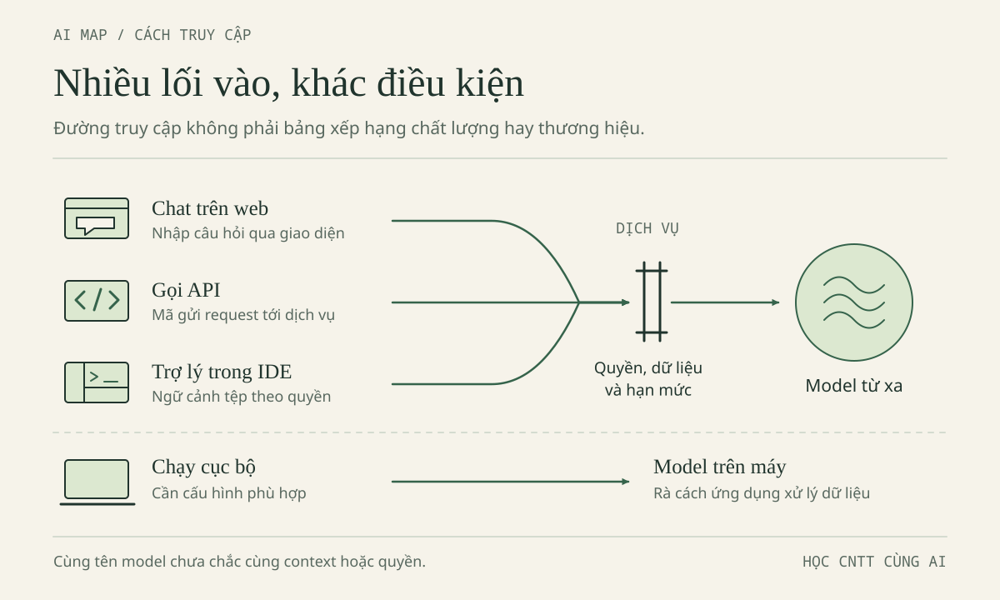
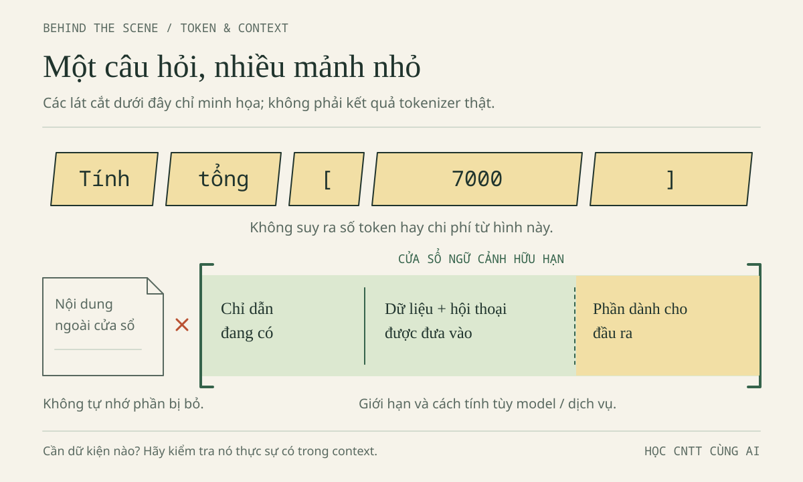

# CHƯƠNG 1 · AI TRONG HỌC TẬP: VAI TRÒ, CÁCH HOẠT ĐỘNG VÀ GIỚI HẠN

Lời giới thiệu đã nêu mạch năm bước **Hiểu → Dùng → Giữ vững → Có trách nhiệm → Chọn**, giới thiệu Minh, Lan và bài tập ViSinhVien với ba khoản chi giả. Chương này là bước *Hiểu*: trước khi gõ câu hỏi đầu tiên, người học cần biết AI giúp được gì, không giúp được gì, "AI" đang mở trên màn hình gồm những thành phần nào, và phía sau một câu trả lời có gì. Toàn bộ chương làm được bằng giấy và bút.

Nhân vật, hội thoại và ba thẻ trả lời trong chương là *tình huống hư cấu*; thông tin về dịch vụ AI được ghi theo mốc 29/10/2026 và *chưa kiểm chứng* độc lập.

**Sau chương này, người học có thể:**

- Nêu ba vai trò hợp lý của AI trong học tập; phân biệt dùng AI để học với dùng AI để né học.
- Gọi đúng tên model, provider, application, producer trong một lượt dùng AI; ghi "chưa xác định" khi thiếu bằng chứng.
- Viết một prompt đủ context cho một lỗi nhỏ; giải thích token và context window ở mức khái niệm.
- Chuyển một câu trả lời tự tin của AI thành câu hỏi kiểm chứng.

## Tình huống mở đầu

Minh, sinh viên năm nhất đang học C++, ghi ba khoản chi giả: Cơm trưa 35000, Xe buýt 7000, Vở ghi 18000. Tổng phải là 60000 VND. Chương trình tính tổng của Minh lại in ra 42000; vòng lặp dùng điều kiện `i < n - 1` với `n = 3`.

Minh dán đoạn mã vào ba ứng dụng AI khác nhau, kèm cùng một yêu cầu: "Hãy gợi ý một bước để tự tìm lỗi, chưa viết lại cả chương trình." Ba câu trả lời, rút gọn, như sau.

> **Thẻ A.** Khi `n = 3`, chỉ số của khoản Vở ghi là bao nhiêu? Hãy thay chỉ số đó vào điều kiện `i < n - 1` và tự quyết định xem vòng lặp có cộng khoản này không.

> **Thẻ B.** Vòng lặp thiếu một lượt. Cứ đổi thành `i <= n`; như vậy sẽ cộng đủ và luôn an toàn. Không cần thử thêm vì lỗi này rất đơn giản.

> **Thẻ C.** Điều kiện đang bỏ phần tử cuối. Hướng sửa là `i < n`, không phải `i <= n`. Chương trình chưa được chạy thử; hãy kiểm tra danh sách rỗng, một khoản và ba khoản sau khi tự sửa.

Cả ba đều là AI. Vì sao chúng trả lời khác nhau, và Minh nên bắt đầu học từ thẻ nào? Hãy ghi lựa chọn và lý do trước khi đọc tiếp; cuối mục 1.3, chúng ta chấm lại ba thẻ.

## 1.1. Vai trò của AI trong học tập: giúp được gì, không giúp được gì, đâu là lạm dụng

Mục này trả lời câu hỏi đứng trước mọi câu hỏi kỹ thuật: nên để AI làm phần việc nào trong quá trình học, và phần việc nào phải giữ lại cho người học. Câu trả lời được rút ra từ ba thẻ A, B, C và ba khoản chi 35000, 7000, 18000.

### Ý chính 1 — Ba vai trò hợp lý và hai mặt của công cụ

Học là quá trình thay đổi hiểu biết và kỹ năng của chính người học. Vì vậy, một vai trò của AI chỉ hợp lý khi sau lượt dùng, người học hiểu hoặc làm được nhiều hơn trước. Có ba vai trò đáp ứng điều kiện đó.

**Gia sư giải thích.** AI giải thích một khái niệm theo nhiều cách, đổi ví dụ khi người học chưa hiểu, hoặc đặt câu hỏi gợi mở thay vì đưa ngay đáp án. Thẻ A làm đúng việc này: không sửa hộ mà hỏi chỉ số của khoản Vở ghi. Minh phải tự trả lời, nên người hiểu vòng lặp là Minh.

**Người phản biện.** Sau khi tự làm xong, người học nhờ AI tìm chỗ thiếu: ca kiểm thử chưa nghĩ tới, điều kiện biên bị bỏ sót. Thẻ C làm việc này khi nhắc kiểm tra danh sách rỗng, một khoản và ba khoản. Thứ tự rất quan trọng: *làm trước, nhờ phản biện sau*.

**Trợ lý cho việc lặp.** Định dạng lại bảng, đổi tên biến đồng loạt, sinh dữ liệu giả: những việc tốn thời gian nhưng không tạo ra hiểu biết mới. Nếu việc đó chính là mục tiêu của bài học (bài đang dạy vòng lặp mà nhờ AI viết vòng lặp), thì nó không còn là "việc lặp".

Ba vai trò có chung một điểm: AI nằm cạnh người học, không nằm thay chỗ người học.

| AI thường làm tốt | AI thường làm kém hoặc không thể làm |
| --- | --- |
| **Tốc độ**: phản hồi sau vài giây, thử được nhiều cách hỏi | **Sai mà vẫn tự tin**: thẻ B khẳng định `i <= n` "luôn an toàn" trong khi cách sửa đó truy cập ngoài danh sách |
| **Diễn đạt**: giải thích lại cùng một ý ở nhiều mức | **Thiếu ngữ cảnh**: chỉ biết điều đã được gửi; quên dán mã thì AI đoán |
| **Gợi ý**: nêu nhiều hướng giải, nhiều ca thử | **Không chịu trách nhiệm**: bài nộp mang tên người học |

Quy tắc phân công rút ra từ bảng: giao cho AI phần mà **kết quả kiểm tra được nhanh** (ca thử, định dạng, gợi ý hướng đi); giữ lại cho người học phần mà **hiểu biết và trách nhiệm không thể chuyển giao** (quyết định cuối, giải thích, kiểm chứng).

### Ý chính 2 — Dùng AI để học và dùng AI để né học

Cùng một công cụ, cùng một bài toán, có thể dẫn tới hai kết quả khác hẳn nhau. Minh tự cộng ba khoản trước, thấy chương trình thiếu đúng 18000, rồi nhờ AI gợi ý một bước. Sau đó Minh tự sửa cận vòng lặp, thử ca rỗng, một khoản, ba khoản, và giải thích được vì sao `i < n` đúng còn `i <= n` thì không. Đây là *dùng AI để học*. Cách làm khác: dán mã, nhận bản sửa hoàn chỉnh, chép vào bài và nộp. Chương trình in đúng 60000, nhưng khi được hỏi "vì sao vòng lặp dừng ở chỉ số 1", người học không trả lời được. Đây là *dùng AI để né học*.

Điểm khác biệt không nằm ở việc có dùng AI hay không, mà ở chỗ **ai đã suy nghĩ**:

| Tiêu chí | Dấu hiệu dùng đúng | Dấu hiệu lạm dụng |
| --- | --- | --- |
| Thứ tự | Tự thử hoặc tự dự đoán trước, rồi mới hỏi | Hỏi ngay khi vừa đọc đề |
| Mức trợ giúp | Xin gợi ý từng bước | Xin bản hoàn chỉnh rồi chép nguyên |
| Kiểm chứng | Tự chạy, tự đối chiếu với 60000 | Tin lời "đã đúng", không chạy |
| Giải thích | Nói lại được bằng lời riêng | Không giải thích được dòng mã vừa nộp |

Một phép thử nhanh: sau khi dùng AI, nếu người học tự lần ra được tổng từng bước (35000, rồi 42000, rồi 60000) và chỉ ra bước nào bị bỏ, thì hiểu biết đã thuộc về người học. Nếu không, kết quả đúng chỉ là mượn. Ngoài ra, mỗi học phần có thể quy định riêng về mức được dùng AI.

Từ đây rút ra nguyên tắc mà cả cuốn sách sẽ nhắc lại: **AI hỗ trợ, người học quyết định.** Người học *đặt mục tiêu* (nêu việc cần làm, giới hạn mức trợ giúp, chọn dữ liệu được gửi), *kiểm chứng* (không dùng kết quả chưa có bằng chứng) và *chịu trách nhiệm* (mọi dòng trong bài nộp phải giải thích được). Trong hình dưới đây, người dùng đứng ở cả hai đầu của một lượt hỏi: giao việc đi và kiểm tra kết quả về; các ô còn lại được gọi tên ở mục 1.2.



### Thử ngay (10 phút)

Mục tiêu: tự áp bảng dấu hiệu vào ba tình huống giả định. Với mỗi tình huống, ghi một trong ba lựa chọn **dùng đúng**, **lạm dụng** hoặc **cần hỏi giảng viên**, kèm một câu lý do.

1. Lan nhờ AI viết trọn phần lưu dữ liệu vào `localStorage`, dán vào bài và nộp mà chưa đọc mã.
2. Đề bài ghi "sinh viên tự làm", nhưng Minh muốn nhờ AI giải thích một thông báo lỗi khó hiểu của trình biên dịch.
3. AI báo "đã chạy test và tất cả đều đạt"; Lan ghi vào báo cáo như kết quả của chính Lan mà không chạy lại.

Ghi lại ba lựa chọn, ba lý do và tiêu chí nào trong bảng đã quyết định.

### Gợi ý đối chiếu

Lý do hợp lý phải gọi tên được ít nhất một tiêu chí: thứ tự, mức trợ giúp, kiểm chứng, giải thích hay quyền quyết định. Khi câu chữ của đề bài chưa đủ rõ, lựa chọn đúng không phải là suy diễn theo hướng có lợi. Lời "đã chạy test" của AI chưa phải bằng chứng. Nếu cả ba lý do đều chỉ nói "vì có dùng AI", cần đọc lại bảng dấu hiệu.

### Tự tìm hiểu thêm

- **Câu hỏi mở:** Trong học phần đang học, việc nào là "mục tiêu của bài" nên phải tự làm, việc nào là "việc lặp" có thể giao cho AI? Giảng viên có đồng ý với cách chia đó không?
- **Từ khóa tra cứu:** AI literacy, academic integrity, productive struggle.
- **Trong Sổ tay thực hành:** [Mục 1.1](../chapters/chapter-01.md#muc-1-1) có đủ năm tình huống tự đánh giá kèm lời giải, bảng dấu hiệu sáu tiêu chí và ba nghĩa của nguyên tắc.

## 1.2. Nhận diện công cụ AI: model, provider và ứng dụng (AI Map)

Câu "đang dùng ChatGPT" chỉ nêu tên sản phẩm đang mở, chưa nói model nào xử lý yêu cầu. Mục này giúp người học gọi đúng tên từng thành phần của một lượt dùng AI, và dám ghi "chưa xác định" khi thiếu bằng chứng.

### Ý chính 1 — Bốn câu hỏi: model, provider, application và producer

Hãy nhìn lại con số 42000. Ta có 35000 + 7000 = 42000; phải cộng thêm 18000 mới được 60000. Vậy 42000 là tổng trung gian đúng của hai khoản đầu; nó chỉ thành sai lệch khi yêu cầu là cộng đủ ba khoản. Với `n = 3`, các chỉ số hợp lệ là 0, 1 và 2; điều kiện `i < n - 1`, tức `i < 2`, khiến vòng lặp dừng trước khoản Vở ghi. Thẻ A giữ đúng yêu cầu gợi ý một bước nên là nơi bắt đầu học. Thẻ C sửa đúng và nói rõ chưa chạy, phù hợp để đối chiếu sau khi tự sửa. Thẻ B phải bị loại: `i <= n` cho phép chỉ số `n` nằm ngoài danh sách, trong C++ là hành vi không xác định.

Ba thẻ không cho biết "AI nào tốt hơn", vì chưa biết phía sau mỗi thẻ là gì. Cần tách bốn câu hỏi.

**Model** là mô hình tính toán đã được huấn luyện để xử lý đầu vào và tạo đầu ra. Các tên như GPT, Claude hay Gemini có thể chỉ một họ mô hình, chưa phải một phiên bản cụ thể. **Provider** là bên cung cấp đường truy cập đến model: tiếp nhận yêu cầu, xác thực và áp điều kiện sử dụng; provider có thể tự vận hành model hoặc chỉ là trung gian. **Producer** là bên xây dựng, huấn luyện hoặc phát hành model; producer và provider có thể là một tổ chức, nhưng không bắt buộc. **Application** (ứng dụng) là nơi người dùng thao tác: trang chat, ứng dụng trên điện thoại, trợ lý lập trình; ứng dụng chọn thông tin gửi đi, giữ lịch sử và hiển thị bản sửa. **User** (người dùng) đặt mục tiêu và kiểm tra kết quả.

| Vai trò | Câu hỏi phải trả lời | Cách ghi nếu thiếu bằng chứng |
| --- | --- | --- |
| Model | Thành phần nào tạo đầu ra? Định danh nào được công bố? | "Chỉ biết họ model, chưa xác định phiên bản" |
| Provider | Ai cung cấp đường truy cập cho ứng dụng? | "Chưa xác định provider" |
| Application | Đang thao tác ở phần mềm nào? | Ghi tên quan sát được, không suy ra model từ tên ứng dụng |
| Producer | Ai phát triển hoặc phát hành model? | "Chưa đủ dữ kiện"; không gán cho nhóm viết giao diện |

Một ví dụ điển hình là Claude qua Amazon Bedrock: Anthropic phát triển Claude, còn AWS cung cấp đường truy cập qua Bedrock. Vì vậy, nhãn "hỗ trợ Claude" trên một ứng dụng không tự chứng minh ứng dụng kết nối trực tiếp tới Anthropic. Tương tự, "mở ứng dụng Gemini", "gọi Gemini API" và "chọn một model thuộc họ Gemini" là ba việc khác nhau.

### Ý chính 2 — API, key và các đường truy cập

**API** (*application programming interface*) là giao diện để các phần mềm giao tiếp với nhau theo quy tắc xác định. Khi dùng ứng dụng chat, Minh gõ câu hỏi và gửi đi; khi dùng API, một chương trình chuẩn bị request theo định dạng dịch vụ quy định và có thể chỉ định model. API không phải một model mới, cũng không phải "bộ não tải về máy". **API key** là thông tin xác thực để dịch vụ nhận biết quyền truy cập. Có key không có nghĩa là sở hữu model, có quota vô hạn hay được miễn phí.

Một lưu ý an toàn: không đưa key thật vào chat, ảnh chụp màn hình, nhóm lớp hay kho mã công khai; không nhúng key vào JavaScript phía trình duyệt. ViSinhVien không cần key. Nếu nghi key đã lộ, việc đầu tiên là thu hồi key ở dịch vụ, không phải xóa dòng khỏi tệp; quy trình đầy đủ ở [Hồ sơ 01 của Sổ tay](../chapters/chapter-04.md#muc-4-1).



Các đường truy cập trong hình không phải bậc thang thứ hạng: API hay agent không mặc nhiên "cao cấp" hơn chat. Luồng giản lược là **người dùng → ứng dụng chuẩn bị thông tin → provider tiếp nhận → model tạo đầu ra → ứng dụng hiển thị → người dùng kiểm tra**. Một ứng dụng cài trên máy vẫn có thể gửi dữ liệu lên đám mây.

Hệ quả quan trọng: **cùng câu hỏi không đồng nghĩa với cùng đầu vào**. Cùng một câu Minh gõ có thể được gửi kèm lịch sử, tài liệu, chỉ dẫn hệ thống hoặc công cụ khác nhau; một ứng dụng được cấu hình đóng vai gia sư, ứng dụng khác ưu tiên sinh mã. Vì thế ba thẻ khác nhau chưa chứng minh ba model khác nhau. Khi điều tra, Minh làm ba bước: **ghi nhãn ứng dụng, chế độ và model → liệt kê context và công cụ → ghi rõ phần chưa biết**. Nếu giao diện chỉ hiện nhãn "Tự động", chỉ được ghi "chưa xác định model xử lý lượt này".

### Thử ngay (10 phút)

Mục tiêu: điền bản đồ vai trò cho một ứng dụng giả định, chỉ bằng giấy. Ứng dụng "Gia sư ViSinhVien" tự mô tả là "dùng Gemini API" nhưng không công bố model cụ thể.

1. Kẻ bốn dòng: Model, Provider, Application, Producer. Điền từng dòng; chỗ nào chưa có bằng chứng, ghi đúng cụm "chưa xác định" kèm lý do.
2. Thay phần mô tả bằng "hỗ trợ Claude". Điền lại và gạch chân những dòng vừa thay đổi.

Ghi lại hai bản đồ và một câu: thông tin nào mất đi khi mô tả đổi từ "Gemini API" sang "hỗ trợ Claude"?

### Gợi ý đối chiếu

Dòng Application phải là tên quan sát được, không phải tên model. Dòng Provider ở bản đồ thứ nhất chỉ được ghi theo tự mô tả, chưa xác minh, vì ứng dụng có thể đi qua trung gian. Dòng Model chỉ biết họ, chưa biết phiên bản. Nhóm viết ứng dụng không phải Producer. Ở bản đồ thứ hai, số ô "chưa xác định" phải nhiều hơn.

### Tự tìm hiểu thêm

- **Câu hỏi mở:** Với ứng dụng AI đang dùng nhiều nhất, có tìm được tài liệu chính thức ghi rõ model và provider không? Nếu chỉ có nhãn "Tự động", điều đó ảnh hưởng gì khi phải khai báo việc dùng AI trong bài nộp?
- **Từ khóa tra cứu:** model card, model provider, API key, inference endpoint.
- **Trong Sổ tay thực hành:** [Mục 1.2](../chapters/chapter-01.md#muc-1-2) có phân tích đầy đủ ba thẻ, lời giải bài nhận diện và ví dụ phân biệt các sản phẩm cùng họ tên; chế độ Ask và Agent được cụ thể hóa ở [Bài thực hành 01](../chapters/chapter-02.md#muc-2-1).

## 1.3. Phía sau một câu trả lời: prompt, context và token (Behind the Scene)

Lan từng yêu cầu "Làm app ví sinh viên chuyên nghiệp" và nhận về đề xuất thêm đăng nhập, máy chủ, đồng bộ thanh toán, sai hẳn phạm vi bài tập. Minh viết "sửa vòng lặp này" nhưng quên dán mã. Mục này giải thích vì sao hai câu hỏi đó thất bại, và một câu trả lời được tạo ra từ gì.

### Ý chính 1 — Prompt là lời giao việc, context là thông tin thực sự được nhận

**Prompt** là yêu cầu hoặc chỉ dẫn đưa cho hệ thống. **Context** (ngữ cảnh) của một lượt là toàn bộ thông tin hệ thống thực sự nhận được: prompt, phần lịch sử được chọn, tài liệu, mã nguồn và kết quả của công cụ. Prompt là một phần của context. Một tài liệu đang mở trên màn hình chưa chắc đã nằm trong context của model.

Một prompt đủ dữ kiện có năm thành phần:

1. **Mục tiêu trước triệu chứng.** "Cộng tất cả khoản hợp lệ" cho biết 42000 có phải kết quả sai hay không; riêng câu "ra 42000" thì chưa đủ.
2. **Phần mã nhỏ nhưng liên quan.** Với lỗi cận vòng lặp, cần khai báo dữ liệu, kiểu của biến tổng và vòng lặp.
3. **Kết quả mong đợi cạnh hiện tượng quan sát.** Ba khoản phải cho 60000, chương trình cho 42000; nếu chưa chạy, ghi rõ đó là dự đoán.
4. **Ràng buộc và mức trợ giúp.** Số tiền là số nguyên VND, tối đa 500 khoản, cần gợi ý trước.
5. **Cách kiểm tra.** Đề nghị nêu test và bằng chứng, thay vì yêu cầu "chắc chắn 100%".

Câu "Hãy đóng vai chuyên gia hàng đầu" không thay thế được mã nguồn và kết quả mong đợi. Ràng buộc quan trọng nhất của ViSinhVien là **hợp đồng dữ liệu**: mỗi khoản có `amount` là số nguyên, lớn hơn 0 và không quá 1000000000; tối đa 500 khoản; danh sách rỗng hợp lệ, tổng bằng 0. Tổng lớn nhất 500 × 1000000000 = 500000000000 VND vượt xa miền của kiểu số nguyên 32 bit (khoảng 2,1 tỷ), nên bản C++ dùng `long long`. Trong JavaScript, kiểu `Number` biểu diễn chính xác các số nguyên tới 9007199254740991, nên tổng này vẫn chính xác; nhưng chuỗi `"7000"` không phải số 7000, và ô nhập trên trang Web trả về chuỗi. Sửa cận vòng lặp không tự giải quyết việc xác thực dữ liệu. Minh và Lan giữ một bản brief chung ghi hợp đồng này và chỉ thay dòng "việc lần này" ở mỗi lượt.

### Ý chính 2 — Token, context window và ba hoạt động không thay thế nhau

**Token** là đơn vị dữ liệu mà hệ thống xử lý. Một từ có thể được tách thành nhiều token; dấu câu, mã nguồn, ngôn ngữ và bộ tách token (*tokenizer*) đều ảnh hưởng tới số lượng. Không có quy tắc "một từ tiếng Việt bằng một token", nên đếm từ không cho biết số token; quy token thành chi phí là việc của Chương 5.



**Context window** (cửa sổ ngữ cảnh) là giới hạn lượng thông tin được xử lý trong một lần, do từng dịch vụ quy định. Cửa sổ lớn không bảo đảm mọi chi tiết đều được dùng chính xác. Lan từng dán toàn bộ lịch sử trao đổi, gồm cả yêu cầu backend đã bị loại; bản brief hiện hành bị chìm giữa thông tin hết hiệu lực. Một hội thoại dài còn có thể bị ứng dụng cắt bớt hoặc tóm tắt, nên "đã nói từ đầu" không bảo đảm thông tin còn trong context. Cách làm phù hợp: giữ brief hiện hành, hàm liên quan, dữ liệu giả và ghi chú phần đã thay đổi.

Ba hoạt động sau thường bị gộp làm một. **Huấn luyện** (*training*) là điều chỉnh tham số của model bằng dữ liệu; **suy luận** (*inference*) là dùng model đã có để tạo đầu ra từ đầu vào; **tìm kiếm web** (*web search*) là truy xuất thông tin qua công cụ nối Internet, nếu sản phẩm có và lượt đó thực sự dùng. Khi Minh gửi ba khoản chi, hệ thống dùng chúng trong context của lượt đó; điều này không chứng minh model vừa được huấn luyện lại, nhưng cũng không đồng nghĩa "không lưu dữ liệu", vì lịch sử chat và log là chuyện riêng của từng sản phẩm. Một câu hỏi về thông tin thay đổi theo ngày không tự kích hoạt tìm kiếm web.

**Hallucination**, thường gọi là ảo giác AI, là hiện tượng nội dung sai hoặc không có căn cứ được trình bày như thể đúng: "JavaScript tự lưu mọi biến vào localStorage", hay lời "đã chạy test" trong khi hệ thống chỉ đọc văn bản. Cách ứng phó không phải yêu cầu "đừng sai", mà chuyển sự tự tin thành câu hỏi kiểm chứng. Minh hỏi: những chỉ số nào được duyệt, ca một khoản cho kết quả gì, câu nào chỉ là dự đoán. Nếu công cụ khẳng định đã chạy, cần có lệnh, dữ liệu, đầu ra và môi trường thực thi. Với trích dẫn: **khoanh vùng nhận định → mở nguồn → tìm đoạn hỗ trợ → kiểm tra phạm vi và ngày → ghi giới hạn**; không tìm được căn cứ thì ghi "chưa xác minh". Giờ hãy chấm lại ba thẻ ở đầu chương theo ba câu: kết luận có đúng không, cách giúp có đúng yêu cầu không, có bằng chứng đi kèm không.

### Thử ngay (10 phút)

Mục tiêu: viết lại câu "sửa vòng lặp này" của Minh thành một prompt đủ năm thành phần, và chọn đúng context.

1. Trong năm thứ sau, chọn những gì sẽ gửi kèm: bản brief, hàm tính tổng, ba khoản giả, một bản sao kê ngân hàng thật, một bài giảng không liên quan. Ghi lý do loại từng phần bị loại.
2. Viết prompt không quá tám dòng theo khung:

```text
MỤC TIÊU: …
MÃ LIÊN QUAN: (dán phần nhỏ nhất đủ hiểu)
KỲ VỌNG: … · QUAN SÁT: … (ghi rõ nếu chưa chạy)
RÀNG BUỘC: … · MỨC TRỢ GIÚP: …
CÁCH KIỂM TRA: …
```

Ghi lại: danh sách context đã chọn và prompt hoàn chỉnh.

### Gợi ý đối chiếu

Context đủ để kiểm tra nhưng không lộ dữ liệu: có brief, hàm và ba khoản giả; không có sao kê thật, không có tài liệu gây nhiễu. Prompt phải nêu 60000 cạnh 42000, nói rõ tổng là số nguyên VND, xin gợi ý một bước và yêu cầu test. Prompt chỉ có "sửa giúp" và lời tôn xưng vẫn thiếu dữ kiện dù dài.

### Tự tìm hiểu thêm

- **Câu hỏi mở:** Ứng dụng đang dùng có cho biết lượt vừa rồi dùng bao nhiêu token và có dùng tìm kiếm web hay không? Nếu không, kết luận nào về "AI đã biết gì" là chưa có căn cứ?
- **Từ khóa tra cứu:** tokenizer, context window, inference, hallucination, retrieval.
- **Trong Sổ tay thực hành:** [Mục 1.3](../chapters/chapter-01.md#muc-1-3) có bản brief đầy đủ của ViSinhVien, bảng sáu ca kiểm tra theo hợp đồng dữ liệu và lời giải bài chọn context; chi phí tính từ token ở [Mục 5.1](../chapters/chapter-05.md#muc-5-1).

## Tóm tắt chương

- AI hợp lý khi đóng vai gia sư giải thích, người phản biện hoặc trợ lý cho việc lặp; giao cho AI phần kiểm tra được nhanh, giữ lại phần hiểu biết và trách nhiệm.
- Dùng để học khác dùng để né học ở chỗ ai đã suy nghĩ: **AI hỗ trợ, người học quyết định.**
- Một lượt dùng AI có model, provider, application, producer và user; thiếu bằng chứng thì ghi "chưa xác định".
- API và key là đường truy cập, không phải bộ não tải về; cùng câu hỏi không đồng nghĩa cùng đầu vào.
- Prompt là lời giao việc, context là thông tin thực nhận; token và context window hữu hạn.
- Sự tự tin của câu trả lời không phải bằng chứng; hãy chuyển nó thành câu hỏi kiểm chứng.

**Ba câu để tự kiểm.** Nhãn "tích hợp Claude" đã đủ để xác định provider và phiên bản model chưa? Danh sách rỗng có vi phạm điều kiện `amount > 0` không, và có cần tạo một khoản bằng 0 để biểu diễn nó không? Đếm số từ tiếng Việt có đủ để biết số token của một prompt không?

## Cầu nối sang chương sau

Hiểu vai trò, giới hạn và cách AI hoạt động mới là bước đầu; điều còn lại là biến hiểu biết đó thành thao tác. Chương 2 · Điều khiển quá trình làm việc với AI hướng dẫn giao việc rõ, kiểm bằng bằng chứng và nhận thay đổi có chủ đích, bắt đầu từ chính khoản 18000 bị bỏ sót.

## Tài liệu tham khảo

Thông tin về model, đường truy cập và API cần tra lại tại thời điểm áp dụng; nguồn về giá và ưu đãi sinh viên ở Chương 5.

- [Anthropic — Models overview](https://docs.anthropic.com/en/docs/about-claude/models/overview): họ model và định danh phiên bản.
- [AWS — Claude in Amazon Bedrock](https://aws.amazon.com/bedrock/claude/): ví dụ producer và provider khác nhau.
- [Google — Gemini API docs](https://ai.google.dev/gemini-api/docs): API, xác thực và cách chỉ định model.
- [Google — Gemini overview](https://gemini.google/overview/): lớp ứng dụng mang tên Gemini.
