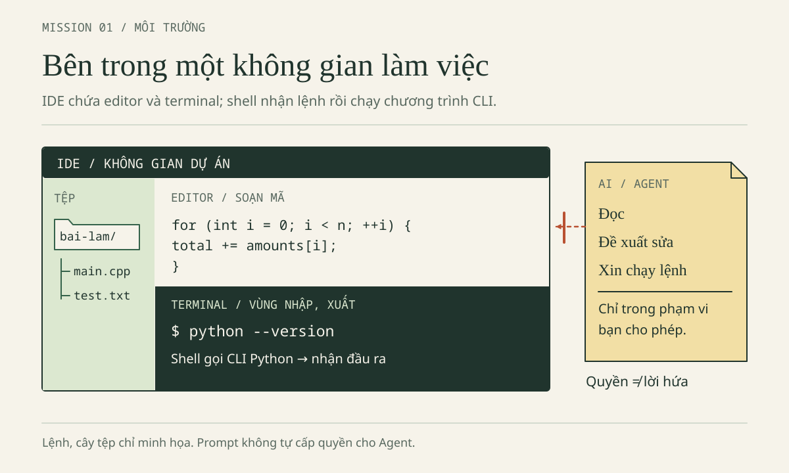
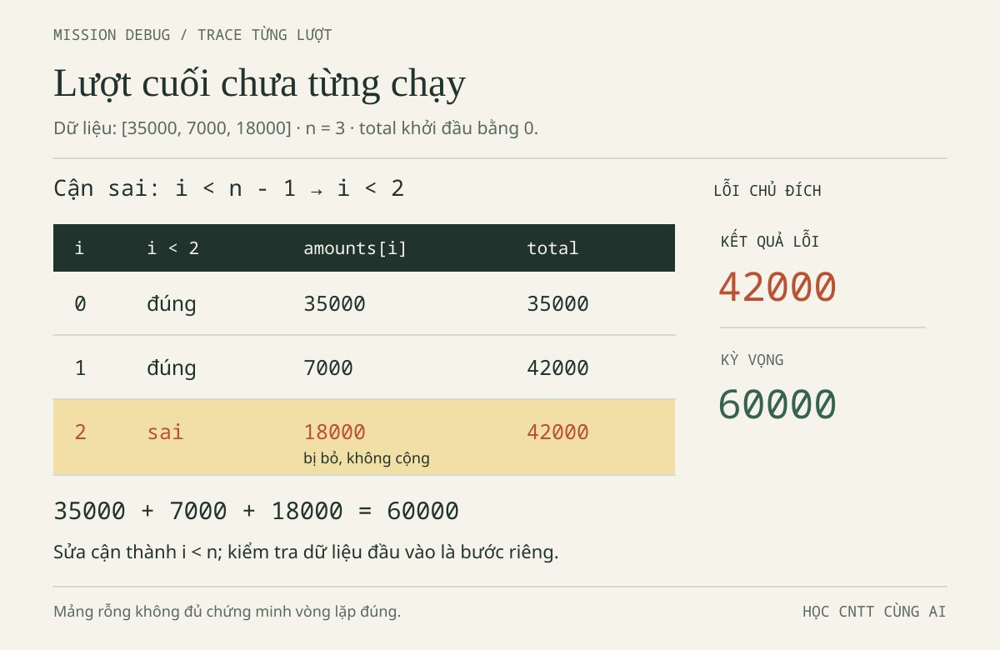
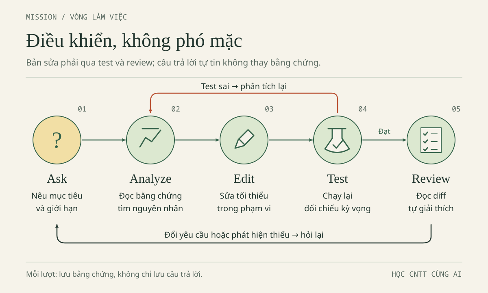

# CHƯƠNG 2 · TRỞ THÀNH NGƯỜI ĐIỀU KHIỂN AI

Minh đã biết không nên chọn câu trả lời chỉ vì nó tự tin. Nhưng chương trình C++ vẫn hiện **42000**, trong khi ba khoản trên giấy cộng thành **60000**. Lan mở bản Web để cùng kiểm tra: bảng đã có đủ ba khoản, tổng đúng; khi thử nhập `35000abc`, cô muốn biết chương trình thực sự từ chối ở đâu. Một trợ lý lại đề nghị cài thêm thư viện để “xử lý tiền chuyên nghiệp”. Lần này, hai bạn không hỏi “AI nào giỏi nhất?” mà hỏi: **việc gì cần làm, công cụ được làm đến đâu, bằng chứng nào đủ để nhận kết quả?**

**Bổ sung biên tập — hành trình, nhân vật và mọi hội thoại trong chương là tình huống HƯ CẤU**, không phải log tài khoản Qoder, benchmark hay khảo sát TLU. Minh năm nhất học C++; Lan năm hai học OOP/DSA/Web/CSDL. Hai phiên bản ViSinhVien phục vụ học tập, chưa nối với nhau. Không nhập thông tin sinh viên thật, tài khoản, sao kê hay bí mật vào mã hoặc hội thoại.

Dữ liệu xuyên suốt là Cơm trưa **35000**, Xe buýt **7000**, Vở ghi **18000**, đơn vị VND nguyên. `42000` đúng cho hai khoản đầu, sai nếu là tổng cuối cả ba. Khoản hợp lệ nằm trong **1–1000000000**, tối đa **500 khoản**, rỗng tổng **0**; tổng cực đại **500000000000**.

Bảy Mission đi từ môi trường đến nghiệm thu. Dự kiến hai buổi 90 phút, cộng thời gian đọc sâu và làm lại; đây không phải chuẩn tốc độ hay CLO chính thức. Chọn một nhánh thực hành sâu, vẫn giải thích lỗi trọng tâm nhánh kia.

Phân biệt **demo đúng**, **mã lỗi chủ đích**, **bài làm**, **kỳ vọng**, **kết quả đã chạy**. Trace không phải log máy. Thiếu công cụ vẫn đọc, dự đoán và ghi phần chưa thực hiện; không cần mua dịch vụ hay tự cài trên máy chung.

## 2.1. Mission 01 — Làm chủ môi trường trước khi giao việc

### Mục tiêu và bối cảnh: biết cửa sổ nào đang làm gì

**Mục tiêu** là mở đúng gốc, phân biệt Editor, IDE, terminal, shell, CLI và Agent. **Bối cảnh:** Minh gọi cả vùng mã, hội thoại và cửa sổ lệnh là “AI”. Nhầm vai trò dễ dẫn đến lưu sai bản hoặc dùng sai cú pháp shell.

Editor soạn thảo tệp; IDE tích hợp việc mở dự án, tìm mã và tiện ích phát triển. Web chat thường chỉ biết ngữ cảnh được cung cấp, trừ khi có kết nối bổ sung. Agent kết hợp AI với công cụ, có thể đọc, sửa, chạy lệnh **tùy sản phẩm, chế độ và quyền**.

Đây là những cách làm bổ sung nhau, không phải bảng xếp hạng hay lộ trình thay thế. Công cụ mạnh hơn không tự tạo kết luận đúng hơn.

| Cách làm | Việc phù hợp trong ViSinhVien | Trách nhiệm không chuyển cho AI |
| --- | --- | --- |
| Editor | Đọc và sửa cận vòng lặp | Lưu đúng tệp, hiểu dòng vừa sửa |
| IDE | Mở dự án, tìm hàm, dùng terminal | Biết đang mở thư mục nào và có công cụ gì |
| Web chat | Hỏi nghĩa của `+=` hoặc một lỗi nhỏ | Cung cấp đoạn mã đủ ngữ cảnh, kiểm chứng giải thích |
| Agent | Tìm vị trí, đề xuất thay đổi, kiểm thử theo quyền | Giới hạn phạm vi, xem diff, đọc bằng chứng |

Terminal là cửa sổ nhận và hiển thị văn bản. Shell là chương trình diễn giải lệnh bên trong, chẳng hạn Bash hoặc PowerShell. CLI là giao diện dòng lệnh của chương trình được gọi, ví dụ `g++`, `node`, Qoder CLI. Khi gõ `g++ --version`, shell tìm chương trình `g++`; chương trình in phiên bản; terminal hiển thị. Nếu không tìm thấy lệnh, vấn đề trước mắt là môi trường hoặc đường dẫn, chưa phải vòng lặp C++.



Có Qoder IDE không chứng minh đã có compiler `g++`, runtime Node.js hoặc Qoder CLI. Có Windows cũng không xác định shell: cùng máy có thể mở PowerShell và Git Bash. Hãy đọc tên phiên terminal hoặc cấu hình hiển thị; đừng thử trộn cú pháp cho đến khi một lệnh tình cờ chạy được.

### Nhiệm vụ và hướng dẫn: một gốc, hai nhánh bài làm

**Nhiệm vụ** là chuẩn bị bài làm, giữ nguyên ví dụ. **Hướng dẫn:** mở gốc **`AI-Student-Handbook`** trong Qoder IDE, không mở toàn ổ đĩa hoặc riêng nhánh con.

Bằng File Explorer/trình quản lý tệp, tạo `bai-lam`, rồi hai thư mục con `nam-1-cpp`, `nam-2-web`. Copy **nội dung** mỗi nhánh tương ứng từ `vi-du` sang `bai-lam`; tránh lồng thêm tầng `nam-1-cpp/nam-1-cpp`. Giữ `vi-du` để đối chiếu.

Dùng chức năng New File của IDE hoặc trình quản lý tệp tạo `ghi-chep-02.txt` trong nhánh bạn học. Đây là tệp tự tạo, không có sẵn; kiểm phần mở rộng để tránh `.txt.txt`.

```text
AI-Student-Handbook/              ← thư mục mở trong IDE và cwd của các lệnh
  vi-du/                         ← tham khảo, không sửa
    nam-1-cpp/
    nam-2-web/
  bai-lam/
    nam-1-cpp/
      loi-bo-sot.cpp
      vi_sinh_vien.cpp
      ghi-chep-02.txt             ← người học tự tạo
    nam-2-web/
      index.html
      data.js
      app.js
      test_data.cjs
      ghi-chep-02.txt             ← người học tự tạo
```

Mở terminal qua menu IDE hoặc tìm **Terminal: Create New Terminal** nếu phiên bản có mục đó; không đoán phím tắt. Bố cục khác thì xem [tài liệu terminal](https://docs.qoder.com/user-guide/editor/terminal.md).

**Cwd** là thư mục hiện hành. Mọi lệnh thực hành dùng cwd gốc `AI-Student-Handbook`, đường dẫn `bai-lam/...`. Terminal cũ có thể không chuyển theo thư mục IDE: kiểm vị trí trước build/test.

| Nhu cầu | Bash, gồm Git Bash | PowerShell |
| --- | --- | --- |
| Xem cwd | `pwd` | `Get-Location` |
| Liệt kê mục ở cwd | `ls` | `Get-ChildItem` |
| Chuyển đến gốc đã xác định nếu đang ở sai nơi | `cd "đường/dẫn/AI-Student-Handbook"` | `Set-Location "đường\dẫn\AI-Student-Handbook"` |
| Đọc mã thoát lệnh ngoài vừa chạy | `echo $?` | `$LASTEXITCODE` |

Dòng đổi thư mục là mẫu để **thay đường dẫn thật**, không gõ nguyên chữ “đường/dẫn”. Đặt đường dẫn có dấu cách trong dấu nháy kép. Nếu cwd đã đúng thì không đổi nữa. Không lần lượt chạy hai cột; chỉ dùng cột khớp shell. Từ đây chương không yêu cầu chuyển vào nhánh con, nên cũng không cần nhớ lúc nào phải `cd` ngược ra.

### Prompt mẫu: xác định điều biết được, không cài đặt

```text
Tôi mở gốc AI-Student-Handbook trong Qoder IDE và mới học terminal.
Chỉ giải thích dựa trên thông tin tôi cung cấp; không sửa hay chạy lệnh.
Giúp tôi phân biệt IDE, terminal, shell, CLI và Agent.
Bài làm ở bai-lam/nam-1-cpp và bai-lam/nam-2-web; vi-du chỉ để đọc.
Hãy hỏi tôi kiểm tra tên shell và cwd trước khi đưa lệnh phù hợp.
Không giả định có g++, Node.js hay Qoder CLI; không hướng dẫn tự cài.
```

**Kỳ vọng** là hai nhánh sao chép đúng, một ghi chép nêu tên shell/cwd và giải thích được ai làm gì khi gọi `node --version`. Không cần AI thực thi thao tác này. Nếu không dùng AI, tự trả lời prompt như một phiếu học tập; ghi rõ đó là thực hành thủ công.

**Lỗi thường gặp** là sửa tệp trong `vi-du`, sao chép lồng thư mục, mở terminal cũ ở nơi khác, hoặc tưởng IDE có sẵn compiler. Cách xử lý đầu tiên là nhìn cây tệp và cwd, không nhờ Agent “tìm mọi nơi trên máy”. Thiếu công cụ thì ghi thiếu; việc cài phải theo quyền và quy định của máy phòng thực hành.

### Câu kiểm — Chọn công cụ đủ dùng

Bạn cần giải thích `+=` và tìm hàm `app.js` gọi trong `data.js`: hai việc có cần cùng mức quyền không? Nếu Windows đang mở Git Bash, bạn sẽ dùng cột nào trong bảng? Ghi câu trả lời trước khi mở phần đối chiếu.

### Đáp án Mission 01

Một đoạn chat nhỏ đủ giải thích `+=`; Ask với hai tệp thuận tiện cho việc lần theo lời gọi. Cả hai chưa cần quyền sửa. Windows chạy Git Bash dùng cột Bash, vì shell quyết định cú pháp. Editor lưu nội dung; IDE tổ chức công việc; terminal hiển thị; shell diễn giải; CLI là chương trình được gọi; Agent sử dụng công cụ trong giới hạn được cấp.

### Tiêu chí hoàn thành

Chỉ đúng gốc, tham khảo, bài làm, ghi chép; đọc cwd/shell; giải thích thiếu `g++` khác lỗi C++. Nộp sơ đồ vị trí và ghi nhận, không chỉ ảnh giao diện.

## 2.2. Mission 02 — Hỏi đúng trước khi cho phép sửa

### Mục tiêu và bối cảnh: thu nhỏ câu hỏi để nhìn thấy bằng chứng

**Mục tiêu** là hỏi chỉ đọc, với ngữ cảnh nhỏ và vị trí kiểm lại được. **Bối cảnh:** Minh hỏi “Tại sao tổng sai?” mà chưa gửi mã, dữ liệu; Lan muốn suy handler chỉ từ hàm tổng. Câu trả lời dài không bù được ngữ cảnh thiếu.

Theo hồ sơ đối chiếu kỹ thuật **30/10/2026**, **Qoder IDE** có Ask/Agent; Ask đọc hiểu và gợi ý snippet, không tự sửa tệp. Qoder Desktop có Coding/General; **General vẫn là agent, không phải Ask chỉ đọc**. Qoder CLI là sản phẩm dòng lệnh riêng; không chuyển giả định UI/quyền giữa ba sản phẩm.

Open, Ctrl+L, `@`, Add to Chat dưới đây dựa trên tài liệu IDE, không xác nhận UI máy bạn. Nếu khác, kiểm sản phẩm/phiên bản thay vì chọn quyền rộng hơn. Không có cam kết giá, quota hoặc điều kiện tài khoản.

### Nhiệm vụ và hướng dẫn: một câu hỏi có thể kiểm lại

**Nhiệm vụ** của Minh là tìm cận lặp và dự đoán lượt bị bỏ; của Lan là lần từ chuỗi nhập đến trường `amount`. **Hướng dẫn:** giữ gốc `AI-Student-Handbook` đang mở, chọn tệp trong `bai-lam`, mở Chat theo tài liệu IDE bằng Ctrl+L nếu phù hợp phiên bản, rồi chọn **Ask** trên thanh công cụ chat. Chưa giao sửa và chưa yêu cầu chạy terminal.

Dùng `@` để chọn tệp hoặc thư mục làm ngữ cảnh. Khi chỉ cần một đoạn, bôi chọn rồi dùng **Add to Chat** nếu có. Minh bắt đầu với `bai-lam/nam-1-cpp/loi-bo-sot.cpp`. Lan bắt đầu với `bai-lam/nam-2-web/app.js` và `data.js`; thêm `index.html` khi cần xác minh form. Ngữ cảnh nhỏ không có nghĩa cắt mất khai báo kiểu hoặc dữ liệu đầu vào quan trọng.

Một câu hỏi tốt tách bốn thứ: đầu vào, điều mong muốn, điều quan sát, đoạn mã liên quan. Viết “tôi quan sát 42000 với ba khoản” khác “chắc chắn compiler cộng sai”. Câu đầu là dữ kiện cần đối chiếu; câu sau đã nhảy đến một giả thuyết yếu. Nếu chưa chạy, thay “quan sát” bằng “tôi dự đoán từ mã”, đừng mượn log hư cấu của sách làm kết quả của mình.

### Prompt mẫu cho Minh và Lan

```text
Tôi học C++ năm nhất. Chỉ đọc bai-lam/nam-1-cpp/loi-bo-sot.cpp.
Không sửa tệp, không chạy lệnh. Dữ liệu giả: 35000, 7000, 18000.
Tổng yêu cầu là 60000; tình huống bài học có tổng sai 42000.
Tìm vòng lặp thực tế, nêu kiểu của n và lập bảng i, điều kiện,
khoản được cộng, tổng sau bước. Chưa viết lại cả chương trình.
Tách điều đọc được, giả thuyết và điều chưa chạy kiểm chứng.
Dẫn vị trí mã để tôi tự mở lại; thiếu ngữ cảnh thì nói rõ.
```

```text
Tôi học Web/OOP/DSA năm hai. Chỉ đọc các tệp được đính kèm trong
bai-lam/nam-2-web; không sửa hoặc chạy lệnh.
Lần theo ô nhập → submit → parseAmount → Expense.amount → tổng → lưu/hiện.
Ở mỗi bước ghi tên tệp, tên hàm thật hoặc mô tả handler vô danh,
vị trí tìm thấy và kiểu dữ liệu. Nếu cần index.html, hãy nói cần nó.
Không bịa hàm handleSubmit; không thêm server, CSDL hay dependency.
Phân biệt mã đọc được với trạng thái trình duyệt chưa quan sát.
```

Mở vị trí AI dẫn, kiểm tên hàm, khai báo và nơi gọi. Nếu AI bịa `handleSubmit`, sửa mô tả thành **handler submit vô danh**, không đổi mã cho khớp câu trả lời. Chưa xem `index.html` thì chưa đủ bằng chứng về phần tử hoặc thứ tự script.

Prompt không thay hàng rào quyền: chế độ, cấu hình và phê duyệt mới quyết định công cụ được làm gì. Ask chỉ đọc cũng không cho phép đưa dữ liệu nhạy cảm vào ngữ cảnh.

**Kỳ vọng:** Minh mở được vòng lặp ở dòng 9 demo lỗi; Lan tìm được `D.parseAmount` trong `app.js`. Số dòng có thể đổi; ghi tên tệp, đoạn mã và điều đã kiểm lại.

**Lỗi thường gặp:** gửi quá nhiều hoặc bỏ mất kiểu/cận, nhầm sản phẩm, coi “sẽ kiểm thử” là kết quả. Thu nhỏ câu hỏi và đòi chứng cứ thay vì đổi công cụ để tìm câu trả lời vừa ý.

### Câu kiểm — Bằng chứng còn thiếu ở đâu?

AI chỉ đọc `data.js` rồi nói “nút Thêm đã gắn đúng sự kiện”. Bạn có thể nhận kết luận đó không? Nếu AI gửi một snippet trong Ask, có thể nói tệp đã thay đổi chưa?

### Đáp án Mission 02

Chưa thể xác nhận sự kiện nếu chưa xem mã gắn handler và phần tử liên quan ở `app.js`/`index.html`. Snippet trong hội thoại là đề xuất, không đồng nghĩa tệp đã được sửa hoặc lưu. Yêu cầu bổ sung đúng ngữ cảnh rồi tự mở lại vị trí; không cần cấp quyền Agent chỉ để giải quyết sự thiếu bằng chứng này.

### Tiêu chí hoàn thành

Có prompt chỉ đọc, vị trí tự kiểm, điều chưa biết; phân biệt đúng sản phẩm, chỉ dùng dữ liệu giả. Chưa cần bản vá, cần mô tả được lỗi.

## 2.3. Mission 03 — Debug C++: tìm 18000 bị bỏ, không vá mò

### Mục tiêu và bối cảnh: một dòng sửa phải có lời giải thích

**Mục tiêu** là trace 0, 1, 3 phần tử; hiểu cận, kiểu, tham chiếu và compiler. **Bối cảnh:** [demo lỗi `loi-bo-sot.cpp`](../vi-du/nam-1-cpp/loi-bo-sot.cpp) dùng `i < n - 1`, dữ liệu cố định trong `main`, không có hàm tổng riêng hay **`--test`**.

**Nhiệm vụ:** giai đoạn 1 chỉ sửa cận trên dữ liệu hợp lệ; validation tiền/số lượng là mở rộng riêng. Không thay toàn tệp bằng [bản đúng](../vi-du/nam-1-cpp/vi_sinh_vien.cpp): cần diff nhỏ và trace để chứng minh đã hiểu nguyên nhân.

### Hợp đồng trước thuật toán: vì sao dùng long long?

Mô hình chung của một khoản là `Expense{id,title,amount,category}`. Nhánh C++ hiện chỉ lấy cột tiền làm `std::vector<long long>` để luyện thuật toán; nhánh Web giữ đối tượng đủ bốn trường. Không nên nói C++ này đã triển khai lớp Expense hoặc lưu đủ tên và nhóm. Hai cách biểu diễn phục vụ hai mục tiêu học khác nhau nhưng cùng hợp đồng tiền.

Mỗi khoản dương, tối đa 1000000000; 500 khoản lớn nhất cho tổng 500000000000. `int` thường có miền 32 bit, không đủ cho tổng đó; dùng `long long` cho phần tử và biến tổng. Đừng nhầm giới hạn **mỗi khoản** với giới hạn **toàn bộ tổng**. Giá trị vừa kiểu số cũng chưa chắc hợp lệ nghiệp vụ: `-1` biểu diễn được trong `long long`, nhưng không phải khoản chi được chấp nhận ở bài này.

Lõi sau dùng đúng tên và chữ ký của hàm trong bản đúng, **đã lược bỏ validation để tập trung vào duyệt**. Đây là trích đoạn đọc hiểu, không phải toàn bộ tệp để thay vào bài làm. Nó giả định số lượng và tiền đều đã hợp lệ.

```cpp
long long totalExpenses(const std::vector<long long>& amounts) {
    int n = static_cast<int>(amounts.size());
    long long total = 0;
    for (int i = 0; i < n; ++i) {
        total += amounts[i];
    }
    return total;
}
```

Hàm trả `long long`. Tham số `const std::vector<long long>&` nhận vector bằng tham chiếu để không sao chép cả danh sách; `const` ngăn sửa qua tham số này. `size()` lấy số phần tử; chuyển sang `int` phù hợp ở đây vì đã giới hạn 500, không phải mẫu chuyển kiểu an toàn cho mọi vector khổng lồ. Biến `total` khởi tạo bằng 0, nên trường hợp không có lượt cộng vẫn có kết quả xác định.

Vòng lặp bắt đầu `i = 0`, tiếp tục khi `i < n`, rồi tăng `i`. Chỉ số hợp lệ là 0 đến `n - 1`; điều kiện phải chặn **trước khi** chỉ số bằng `n` được dùng. `+=` lấy tổng cũ cộng phần tử đang xét rồi ghi lại. Dấu `}` đóng vòng lặp, không tự cộng phần tử cuối. `return total` chuyển kết quả về nơi gọi, không phải lệnh in ra terminal.

### Hướng dẫn: dự đoán trước khi nhìn đáp án

Mở `bai-lam/nam-1-cpp/loi-bo-sot.cpp`, giữ nguyên vector `{35000, 7000, 18000}` trong giai đoạn 1. Đọc `int n = static_cast<int>(amounts.size());`, rồi chép cận lỗi vào ghi chép. Đoạn dưới là **snippet lỗi có chủ đích, trích từ demo lỗi**, không chèn vào bản đúng:

```cpp
for (int i = 0; i < n - 1; ++i) {
    total += amounts[i];
}
```

Tự lập bảng cột `i`, điều kiện, khoản được cộng, tổng sau bước. Với ba khoản, viết cả lượt điều kiện sai làm vòng lặp dừng; nếu chỉ ghi các lượt thành công, bạn dễ bỏ qua chính điểm gây lỗi. Làm thêm danh sách rỗng và danh sách chỉ có `7000`. Chưa biên dịch cũng làm được phần này; gắn nhãn “trace thủ công”.

### Prompt mẫu: giữ quyền suy nghĩ ở phía người học

```text
Chỉ đọc bai-lam/nam-1-cpp/loi-bo-sot.cpp, chưa sửa hoặc chạy lệnh.
Tôi dự đoán ba khoản 35000, 7000, 18000 bị bỏ khoản cuối.
Hãy kiểm tra bảng trace của tôi cho n = 0, n = 1 với [7000], n = 3.
Giải thích vai trò int n và nguy cơ nếu đổi sang size() - 1.
Chỉ gợi ý cận nhỏ nhất cần sửa, không cộng bù phần tử cuối.
Tách lỗi duyệt với kiểm tra tiền/số lượng còn thiếu trong demo lỗi.
```



### Đáp án trace — Lượt dừng cũng là bằng chứng

Với `n = 3`, cận lỗi là `i < 2`. Nó cộng đúng hai khoản đã được truy cập nhưng không bao giờ cộng chỉ số 2. Bảng gồm cả bản sai và bản sửa để bạn đối chiếu từng bước, không chỉ nhìn tổng cuối.

| Phiên bản | i | Điều kiện | Khoản được cộng | Tổng sau bước |
| --- | ---: | --- | ---: | ---: |
| Sai | 0 | `0 < 2`: đúng | 35000 | 35000 |
| Sai | 1 | `1 < 2`: đúng | 7000 | 42000 |
| Sai | 2 | `2 < 2`: sai, dừng | Không cộng | 42000 |
| Đúng | 0 | `0 < 3`: đúng | 35000 | 35000 |
| Đúng | 1 | `1 < 3`: đúng | 7000 | 42000 |
| Đúng | 2 | `2 < 3`: đúng | 18000 | 60000 |
| Đúng | 3 | `3 < 3`: sai, dừng | Không cộng | 60000 |

Với `n = 0` kiểu `int`, cận sai kiểm `0 < -1`, cận đúng kiểm `0 < 0`; cả hai đều sai ngay, tổng giữ 0. Không có truy cập `amounts[-1]` trong hai vòng lặp này. Ca rỗng qua **không phân biệt được** hai phiên bản. Với `n = 1`, cận sai kiểm `0 < 0` nên trả 0; cận đúng kiểm `0 < 1`, cộng 7000 rồi dừng. Một phần tử là phản ví dụ rất nhỏ nhưng mạnh.

Bản vá là `i < n`, không phải `i <= n`. Cận `<=` cho phép truy cập chỉ số `n`, nằm ngoài vector; trong C++ đó là hành vi không xác định, không có lời hứa luôn báo lỗi đẹp. Cộng riêng `amounts[n - 1]` sau vòng lặp cũng chỉ che nguyên nhân và làm bạn phải xử lý rỗng riêng.

### Đọc sâu: size không dấu, reference không phải copy

Đừng máy móc đổi cận thành `i < amounts.size() - 1`. `size()` trả kiểu kích thước không dấu; phép trừ với danh sách rỗng không tạo `-1` như với `int n`. Giá trị **unsigned wrap** vòng về một số rất lớn theo số học không dấu, khiến điều kiện và truy cập có thể sai nghiêm trọng. Bản thân phép wrap không phải cùng khái niệm với truy cập ngoài giới hạn; hậu quả truy cập mới dẫn đến hành vi không xác định. Bài dùng `int n` trong miền tối đa 500 để người mới tập trung vào cận, không cổ vũ ép kiểu tùy tiện.

Tham chiếu ở chữ ký hàm cũng cần được hiểu chứ không chỉ chép. Trace đoạn **biệt lập** sau. Nếu tự thử ở tệp riêng, đặt `#include <iostream>` ở đầu tệp, ngoài mọi hàm; đặt năm dòng dưới trong thân `int main()`. Không chèn vào demo chỉ để xem kết quả.

```cpp
long long total = 0;
long long& alias = total;
long long copied = total;
alias += 35000;
std::cout << total << ' ' << copied << '\n';
```

Dòng 2 tạo một tên khác cho chính biến `total`; dấu `&` tại khai báo tham chiếu này không phải yêu cầu người dùng nhập địa chỉ. Dòng 3 tạo một biến mới, lấy giá trị tại thời điểm sao chép. Thay đổi qua `alias` tác động `total`, không tự cập nhật `copied`. Tham chiếu `const` của hàm tổng giữ cùng ý tưởng tránh sao chép nhưng không cho thay đổi danh sách qua tham số ấy.

### Đáp án tham chiếu — Hai tên và một bản chụp giá trị

| Sau dòng | total | alias nhìn thấy | copied |
| --- | ---: | --- | --- |
| 1 | 0 | Chưa khai báo | Chưa khai báo |
| 2 | 0 | 0, cùng biến total | Chưa khai báo |
| 3 | 0 | 0 | 0 |
| 4 | 35000 | 35000 | 0 |

Output **kỳ vọng**, không phải log chạy của người đọc, là `35000 0`. Giải thích được vì sao biến copy giữ 0 quan trọng hơn nhớ một câu định nghĩa tham chiếu.

### Lỗi compiler: dấu chấm phẩy và chương trình cũ

Đoạn sau là **snippet lỗi cú pháp biệt lập**, không phải lỗi đang có trong demo phát hành. Các tên `n` và `amounts` giả định đã khai báo; dòng khởi tạo thiếu dấu chấm phẩy:

```cpp
long long total = 0
for (int i = 0; i < n; ++i) {
    total += amounts[i];
}
```

Compiler có thể báo dạng `expected ',' or ';' before 'for'`. Câu chữ tùy phiên bản; vị trí trỏ vào `for` là nơi bộ phân tích không tiếp tục được, trong khi nguyên nhân nằm ở dòng ngay trước. Đọc tên tệp, dòng, cột và **thông báo lỗi đầu tiên**, rồi xem dòng trước có kết thúc đủ không. Các lỗi phía sau có thể là dây chuyền, không cần yêu cầu AI viết lại cả thuật toán.

```text
Tôi gửi lệnh biên dịch, cwd và thông báo lỗi đầu tiên của C++.
Chỉ giải thích file, dòng, cột và phần mã cần kiểm tra.
Đề xuất sửa đổi nhỏ nhất; xem cả dòng trước vị trí compiler chỉ ra.
Không sửa thuật toán ngoài phạm vi, không nói chạy được khi chưa chạy.
```

Sau khi sửa `;`, phải lưu và biên dịch lại. Nếu build thất bại nhưng còn executable từ lần trước, chạy nó có thể vẫn hiện 60000. Điều đó chỉ nói bản cũ chạy được, không chứng minh mã vừa sửa hợp lệ. Hướng dẫn build ở Mission 07 buộc đọc exit code compiler trước khi chạy executable; không dán cả khối lệnh liên tiếp rồi chọn dòng output đẹp nhất.

### Hoàn tất bản vá và tách validation

**Trước khi đổi cận**, tạo checkpoint bằng bản sao tệp theo hướng dẫn Mission 06 bên dưới, ghi rõ đây là mốc trước sửa. Nếu đã lỡ sửa, giữ bản hiện tại và ghi đúng thời điểm; không dựng lại một lịch sử thao tác chưa từng làm.

**Kỳ vọng:** diff chỉ đổi `i < n - 1` thành `i < n`, giữ vector ba khoản, trace ra 60000. Có compiler thì chạy theo Mission 07; thiếu thì ghi “chưa chạy, đã trace”. Thử vector khác là lượt riêng sau bản vá, luôn biên dịch lại.

Bản đúng chặn quá 500 khoản trước ép kiểu, kiểm tiền `<= 0` hoặc `> 1000000000LL`, ném `std::invalid_argument` nếu sai. Demo lỗi sửa cận **chưa có validation ấy**; không nhận đạt C7–C9. Chín test bản đúng không chạy mã demo lỗi vừa sửa.

**Lỗi thường gặp:** dùng `<=`, cộng bù, thay cả tệp, tưởng rỗng qua là đủ, nhầm reference/copy, chạy executable cũ. Giữ trace, diff và trạng thái build để nối kết luận với đúng mã.

### Câu kiểm — Một dòng sửa giải quyết được bao nhiêu?

Rỗng trả 0 có chứng minh đúng cận không? Đổi cận đúng có làm khoản `-1` tự bị từ chối không? Vì sao `i <= n` không phải cách “chạy thêm cho đủ”?

### Đáp án Mission 03

Không: với `int n = 0`, hai cận đều không chạy. Đổi cận không bổ sung validation, nên cần tách kiểm tra miền dữ liệu. `i <= n` cho truy cập chỉ số ngoài danh sách. Ca `[7000]` giúp bắt lỗi bỏ phần tử cuối; ca dữ liệu sai kiểm một trách nhiệm khác.

### Tiêu chí hoàn thành

Giữ ba trace; giải thích unsigned wrap, reference/copy, lỗi `;`; chỉ vá cận. Nhật ký tách chạy/dự đoán/validation chưa làm. Trình bày: Vở ghi bị chặn ở đâu, sửa gì, còn thiếu bằng chứng nào?

## 2.4. Mission 04 — Debug Web: đi theo dữ liệu, không đoán tên hàm

### Mục tiêu và bối cảnh: demo đúng vẫn là một bài học debug

**Mục tiêu:** lần theo HTML, handler, API, lưu trữ và kiểu dữ liệu. **Bối cảnh:** Web phát hành đang đúng; khi chưa có dữ liệu lưu, đã nạp ba mẫu tổng **60000**. Không nhập trùng rồi xem 120000 là lỗi.

**Nhiệm vụ:** Lan thử `35000abc`, kiểm cơ chế từ chối và fault lab riêng. Minh **review chéo với Lan**, không ngầm đổi persona. Không thêm server, đăng nhập hay CSDL; điểm nối SQL dành Chương 4.

### Hướng dẫn: mở trang, đọc mô hình và ba tệp

Giữ bốn tệp Web cùng nhau trong `bai-lam/nam-2-web`. Mở trực tiếp `index.html` từ trình quản lý tệp bằng Chrome, Edge hoặc trình duyệt phù hợp. Hai thẻ script cuối trang lần lượt nạp `data.js`, `app.js`, **không dùng module**; demo này mở bằng `file://` không cần server. Nếu lỗi, kiểm vị trí tệp và Console trước, đừng lập tức chuyển kiến trúc.

Mở Developer Tools bằng F12 rồi chọn Console; nếu không được, dùng `Ctrl+Shift+I` trên Windows/Linux, `Cmd+Option+I` trên macOS, hoặc menu More tools → Developer tools. Tên menu có thể khác. Console ở trình duyệt không phải terminal Bash/PowerShell của IDE: lệnh JavaScript dưới đây chạy ở Console, lệnh `node` ở terminal.

`Expense` có bốn trường: `id` định danh khoản giả, `title` tên hiển thị, `amount` số tiền, `category` mã nhóm. [Hàm `sampleExpenses`](../vi-du/nam-2-web/data.js) trả ba đối tượng sau:

```javascript
const expenses = [
  { id: 1, title: 'Cơm trưa', amount: 35000, category: 'an-uong' },
  { id: 2, title: 'Xe buýt', amount: 7000, category: 'di-lai' },
  { id: 3, title: 'Vở ghi', amount: 18000, category: 'hoc-tap' }
];
```

Đây là trích đoạn mô hình đọc hiểu, không dán để thay biến nội bộ của ứng dụng. Số tiền không có dấu nháy; `id` không phải mã sinh viên. `categories` ánh xạ `hoc-tap` thành “Học tập”. Liên hệ OOP nằm ở việc biểu diễn thực thể và giữ bất biến dữ liệu, không ở yêu cầu phải viết `class Expense` mới được coi là có mô hình.

Liên hệ DSA: `totalExpenses` duyệt một lần nên thời gian **O(n)**; biến tổng và phần phụ trợ của chính hàm tổng dùng **O(1)** bộ nhớ thêm, không tính mảng đầu vào. Không gán O(1) cho cả ứng dụng: `normalizeExpenses` tạo mảng mới và `Set` id, còn render tạo các phần tử DOM. Thuật toán tổng đơn giản vẫn cần đúng trường và đúng kiểu ở đầu vào.

| Chặng dữ liệu | Vị trí/API thực tế | Kiểu và câu hỏi cần kiểm |
| --- | --- | --- |
| Ô nhập | `index.html`: form `expense-form`, input `id/name="amount"` | `type="text"`, `inputmode="numeric"`; giá trị đọc là chuỗi |
| Nhận submit | `app.js`: `form.addEventListener('submit', event => ...)` | Handler vô danh, `event` là đối tượng sự kiện |
| Chặn gửi mặc định | `app.js`: `event.preventDefault()` | Không để hành vi submit mặc định điều hướng trang |
| Parse tiền | `D.parseAmount(form.elements.amount.value)` | Chuỗi qua kiểm tra thành số hợp lệ, hoặc ném lỗi |
| Tạo khoản | `app.js`: `{ id, title, amount, category }` | Chọn id chưa dùng, đưa vào `D.normalizeExpenses` |
| Tính tổng | `data.js`: `totalExpenses(expenses)` | Kiểm mảng, số lượng và phần tiền |
| Hiển thị, lưu | `app.js`: `render()`, `save()` | `textContent`, định dạng số, localStorage hoặc bộ nhớ |

`data.js` công bố API ở `globalThis.ViData` cho trình duyệt và `module.exports` cho Node.js. `app.js` đặt tên ngắn `D` cho API đó. `test_data.cjs` dùng `require('./data.js')`, không giữ một bản logic sao chép khác. Thứ tự script quan trọng: khi `app.js` lấy `globalThis.ViData`, API phải đã được nạp.

Handler submit không tên nên ghi “hàm vô danh gắn vào submit của form”, không bịa `handleSubmit`. Nó kiểm số lượng, title; parse tiền; lấy category; dùng `Set` chọn id nhỏ nhất còn trống; gọi normalize trên danh sách mới rồi mới gán lại `expenses`. Nếu có lỗi trước phép gán, `catch` hiện thông báo, danh sách cũ không được thêm khoản sai. Đây là lý do phải lần theo thứ tự, không chỉ thấy một `try/catch` rồi kết luận chung chung “đã an toàn”.

### Prompt mẫu: lần theo giá trị 35000abc

```text
Chỉ đọc bai-lam/nam-2-web/index.html, app.js, data.js; không sửa/chạy.
Demo đúng đã có ba khoản mẫu 60000 khi chưa có dữ liệu lưu.
Nếu nhập title giả hợp lệ, amount là 35000abc và gửi form,
hãy lần theo phần tử thật, handler vô danh, parseAmount và catch.
Chỉ ra nơi từ chối, kiểu dữ liệu và vì sao tổng không được đổi.
Phân biệt totalExpenses kiểm phần tiền với normalizeExpenses kiểm schema.
Không thêm server/dependency, không chèn fault lab vào demo đúng.
```

### BEHIND THE SCENE — Nhìn giống số chưa phải số

`input.value` trả chuỗi, kể cả với nhiều ô `type="number"`; demo thực tế dùng `type="text"`, không phải ô số. `inputmode="numeric"` chỉ gợi ý kiểu bàn phím, không thay bộ kiểm tra dữ liệu. Fault lab sau chạy độc lập trong Console, không thêm khoản vào app. Khối `{ ... }` giữ các biến minh họa trong phạm vi riêng để có thể thử lại.

```javascript
{
  const first = '35000';
  const second = '7000';
  console.log(first + second);
  console.log(typeof first);
}
```

Kỳ vọng là `350007000` rồi `string`: `+` nối hai chuỗi, không cộng tiền. Chỉ gọi `Number` cũng chưa làm đúng hợp đồng, vì chuỗi rỗng hoặc dạng số mũ có thể được chuyển thành giá trị số ngoài cú pháp nhập cho phép. `parseInt('35000abc', 10)` trả 35000 do đọc phần đầu; nó không xác nhận toàn chuỗi là một số tiền hợp lệ.

API `parseAmount(input)` trước hết yêu cầu `typeof input === 'string'`. Sau `trim()`, regex **`/^[0-9]+$/`** buộc toàn chuỗi là ít nhất một chữ số: `^` neo đầu, `$` neo cuối, `[0-9]` chọn chữ số, `+` yêu cầu có ký tự. `trim()` bỏ khoảng trắng ở hai đầu, không xóa khoảng trắng giữa `35 000`. Chỉ sau kiểm dạng mới gọi `Number`, rồi `Number.isSafeInteger` và kiểm miền dương tới `MAX_AMOUNT`.

JavaScript có miền số nguyên an toàn từ -9007199254740991 đến 9007199254740991. Tổng cực đại 500000000000 của bài nằm trong miền đó. Nhưng `typeof value === 'number'` chưa đủ: số thập phân, `NaN` và `Infinity` cũng cần bị loại. Sự kết hợp cú pháp chuỗi, tính nguyên an toàn và miền nghiệp vụ mới là hợp đồng đầy đủ của parse.

Snippet Console dưới dùng **API thật đã được trang nạp**, vẫn không thay danh sách:

```javascript
{
  const D = globalThis.ViData;
  const amount = D.parseAmount(' 35000 ');
  console.log(amount, typeof amount);
  try {
    D.parseAmount('35000abc');
    console.log('Không đạt: đầu vào sai đã lọt qua');
  } catch (error) {
    console.log('Đã từ chối:', error.message);
  }
}
```

Kỳ vọng là `35000 number` và thông báo từ chối. Sau đó thử qua form với title giả hợp lệ, category hợp lệ và tiền `35000abc`: phải có thông báo, số khoản và tổng giữ nguyên. Ghi tổng **trước** thao tác để tránh lẫn với dữ liệu đã lưu. Kiểm hàm trực tiếp và kiểm qua form là hai bằng chứng khác nhau; một ô nhập ngăn gõ chữ cũng chưa chứng minh API tự kiểm đầy đủ.

### Fault lab biệt lập — value thiếu, tổng thành NaN

Đoạn sau **cố ý có lỗi ánh xạ**, không phải mã lỗi đang có trong `data.js` hay yêu cầu sửa demo Web. Dữ liệu tối giản chỉ có trường tiền, không phải Expense đầy đủ. Tự dự đoán `x.value` và biến tổng riêng trước khi chạy Console.

```javascript
{
  const items = [{ amount: 35000 }, { amount: 7000 }, { amount: 18000 }];
  const wrong = items.reduce((sum, x) => sum + x.value, 0);
  console.log(wrong);
  console.log(Number.isNaN(wrong));
  const correct = items.reduce((sum, x) => sum + x.amount, 0);
  console.log(correct);
}
```

### Đáp án fault lab — undefined không phải NaN

| Lượt | amount của x | x.value | sum trước | Phép cộng | sum sau |
| --- | ---: | --- | --- | --- | --- |
| 1 | 35000 | `undefined` | 0 | `0 + undefined` | `NaN` |
| 2 | 7000 | `undefined` | `NaN` | `NaN + undefined` | `NaN` |
| 3 | 18000 | `undefined` | `NaN` | `NaN + undefined` | `NaN` |

Thuộc tính thiếu trả `undefined`; phép cộng nhận giá trị đó dẫn tới `NaN`, viết tắt Not-a-Number. Output kỳ vọng là `NaN`, `true`, `60000`. `typeof NaN` vẫn là `"number"`; dùng `Number.isNaN` để nhận diện NaN, không coi hai khái niệm là một. Đổi sang `x.amount` sửa ánh xạ trong fault lab, nhưng `reduce` ấy chưa kiểm số lượng hay miền tiền. Ứng dụng thật vẫn phải dùng API có kiểm tra.

Ba biểu hiện 42000, 350007000, NaN gợi ba giả thuyết: bỏ phần tử, nối chuỗi, nhận trường/giá trị không dùng được như số. Đó chưa phải chẩn đoán chỉ từ màn hình. Cần xem input, kiểu, mã và trạng thái dữ liệu để chọn phép thử phân biệt chúng.

### Ranh giới schema và ca hồi quy đã được bổ sung

`totalExpenses` kiểm đầu vào là mảng, tối đa 500 phần tử và từng `amount` hợp lệ. Nó **không kiểm đủ bốn trường** của Expense; `[{ amount: 7000 }]` vẫn đủ để kiểm riêng hàm tổng. `normalizeExpenses` mới kiểm id nguyên an toàn dương và không trùng, title là chuỗi không rỗng sau trim dài tối đa 80, category là chuỗi thuộc tập cho phép, cùng tiền hợp lệ; hàm trả danh sách đối tượng mới đã chuẩn hóa.

Điểm này từng có một lỗi thật trong bản nguồn: chỉ dùng `Object.hasOwn(categories, item.category)` cho phép `category: ['khac']` lọt qua vì mảng bị chuyển thành khóa chuỗi `khac`. Bản mới đã thêm **`typeof item.category !== 'string'`** vào nhánh từ chối. Regression test kiểm mảng category đã có trong `test_data.cjs`. Không bảo người học sửa lại demo hiện đã vá.

“Hồi quy” ở đây là nguy cơ một hành vi đã được sửa bị phá trở lại khi thay đổi mã. Test phải giữ phản ví dụ cụ thể, không chỉ thêm một ca vui vẻ với category chuỗi. Theo hồ sơ audit, bản nguồn có 33 ca, lượt thêm kiểm tra đã từng thất bại exit 1 trước bản vá, rồi bản mới đạt **34 passed, 0 failed**. Đó là bằng chứng của lượt rà được ghi nguồn, không phải lịch sử thực hành do bạn tự chạy. Nếu dùng để học, ghi rõ đang đọc lịch sử hay vừa kiểm lại bản hiện tại.

### Lưu cục bộ: không nhầm khả năng mở trang với lưu bền vững

`app.js` bắt đầu bằng `D.sampleExpenses()`, sau đó thử đọc khóa `visinhvien-demo-v1` trong localStorage. Nếu có dữ liệu, `JSON.parse` và `normalizeExpenses` kiểm trước khi dùng. Nếu đọc hoặc chuẩn hóa thất bại, app giữ mẫu trong bộ nhớ, đặt `persistent = false`, cảnh báo và không ghi đè dữ liệu cũ. Nếu ghi thất bại do chặn hoặc hết dung lượng, app cũng chuyển sang bộ nhớ tạm.

Mở `file://` không cần server **không có nghĩa localStorage được bảo đảm ở mọi browser**. Hành vi lưu trên file trực tiếp khác nhau theo trình duyệt và chính sách. Dữ liệu không đồng bộ giữa máy, không có tài khoản hay CSDL máy chủ. Fallback RAM cho phép tiếp tục thao tác, nhưng tải lại có thể mất thay đổi. Nút Khôi phục mẫu thay dữ liệu bằng ba khoản sau xác nhận; nó không tự bật lại khả năng lưu khi `persistent` đã false trong phiên.

Để quan sát hợp lệ, ghi có thấy cảnh báo không; thêm một khoản giả rồi tải lại và đối chiếu. Nếu cần trạng thái 42000, trên **bài làm** xóa riêng Vở ghi rồi thêm lại 18000 với nhóm Học tập; hoặc dùng mảng lab riêng. Đừng diễn giải việc chủ động xóa một khoản là bug bỏ phần tử. Khôi phục mẫu sẽ thay toàn danh sách, nên chỉ dùng khi đã biết dữ liệu giả hiện tại có thể bỏ.

**Kỳ vọng:** sơ đồ có kiểu, thử `35000abc` không đổi tổng, báo lưu trữ đúng mức quan sát. **Lỗi thường gặp:** nhập trùng, bịa handler, lạm dụng parseInt, nhầm NaN/undefined hoặc Node/browser. Không tái hiện fallback thì ghi chưa kiểm, không tắt bảo vệ.

### Câu kiểm — Ai chịu trách nhiệm kiểm điều gì?

Inputmode có thay regex không? Hàm tổng có kiểm đủ schema không? Khôi phục mẫu có phục hồi quyền lưu bị chặn không?

### Đáp án Mission 04

Không cho cả ba câu. Inputmode không thay validation; hàm tổng chỉ kiểm phần tiền và số lượng; normalize mới kiểm schema. Nút khôi phục thay dữ liệu mẫu, không đảo cờ `persistent` đã false. Kiểm DOM và lưu trữ phải làm ở trình duyệt, riêng với kiểm logic Node.js.

### Tiêu chí hoàn thành

Chỉ đúng luồng/API, giải thích string → number, undefined → NaN và hồi quy category. Ghi trạng thái trước/sau, từ chối và lưu trữ. Demo đúng thì nộp bằng chứng **“không thay mã”**.

## 2.5. Mission 05 — Giao Agent một công việc có giới hạn

### Mục tiêu và bối cảnh: quyền mạnh hơn cần hợp đồng rõ hơn

**Mục tiêu:** giao việc có phạm vi và bằng chứng. **Bối cảnh hư cấu:** Agent đề nghị sửa cận kèm định dạng dự án, cài thư viện tiền. Lan hỏi vì sao API đang có chưa đủ; phần hữu ích không hợp thức hóa phần ngoài phạm vi.

**Nhiệm vụ:** viết hợp đồng một bản vá, Observe/Plan trước Act. Nếu đã tự sửa, dùng diff/checkpoint **mô phỏng** giao việc; không làm hỏng lại bài hoặc nhận Agent đã thực thi.

### Hướng dẫn: Observe → Plan → Act → Test, rồi Review

Observe thu thập mã, dữ liệu, lỗi và trạng thái môi trường. Plan nêu giả thuyết, tệp dự kiến đổi, phép thử và điều chưa biết. Act thực hiện thay đổi đã cho phép. Test kiểm giả thuyết bằng ca thường, ca biên và đọc kết quả. Sau đó người học Review diff và bằng chứng để quyết định nhận. Các bước là mô hình tư duy, không hứa giao diện luôn hiện đúng năm nhãn.



| Bước | Việc với tình huống 42000 | Bằng chứng cần giữ |
| --- | --- | --- |
| Observe | Đọc vector và `i < n - 1`, xác định `int n` | Tệp, đoạn mã, output thật hoặc trace có nhãn |
| Plan | Giả thuyết bỏ khoản cuối; chỉ sửa cận | Dự đoán rỗng, một khoản, ba khoản |
| Act | Đổi thành `i < n` ở đúng bài làm | Diff nhỏ và trạng thái đã lưu |
| Test | Biên dịch rồi chạy đúng executable; thử ca phân biệt | Cwd, shell, lệnh, output, exit code hoặc lý do chưa chạy |
| Review | So yêu cầu, diff và kết quả | Quyết định nhận/từ chối, phần còn chưa kiểm |

Test sai không phải lý do bỏ ca khó. Nếu tổng đã đúng nhưng khoản âm chưa bị chặn, hãy ghi bản vá cận đạt mục tiêu hẹp còn validation chưa triển khai. Không sửa expected thành actual sai, không xóa assertion, không giấu lượt thất bại. Vòng lặp quay lại Observe phải dựa trên dữ kiện mới, không đổi mã ngẫu nhiên cho tới khi màn hình xanh.

### Prompt mẫu: hợp đồng trước khi chuyển sang Agent

```text
Workspace mở ở gốc AI-Student-Handbook. Dữ liệu hoàn toàn giả.
Chỉ được sửa bai-lam/nam-1-cpp/loi-bo-sot.cpp nếu bản vá chưa có.
Mục tiêu giai đoạn 1: sửa cận để ba khoản 35000, 7000, 18000 ra 60000.
Trước mắt chỉ Observe và Plan; chưa sửa, chưa chạy lệnh.
Nêu nguyên nhân, đúng dòng dự kiến đổi và dự đoán ca 0, 1, 3 khoản.
Giữ vector mẫu; không thêm validation trong bản vá cận này.
Không sửa vi-du, Web hoặc bài người khác; không đọc ngoài phạm vi cần thiết.
Không cài dependency, đổi cấu hình/quyền, tạo key, commit, publish hay triển khai.
Nếu bị chặn, dừng và báo; không thử đường vòng để vượt chặn.
Sau khi tôi đồng ý bước tiếp theo, báo diff, test thật, lượt fail và phần chưa kiểm.
Không coi prompt này là cơ chế khóa quyền kỹ thuật.
```

Chuyển Ask sang Agent khi đã mô tả lỗi, biết tệp được đổi và có dự đoán. Trong IDE, xem chính sách **Settings → Chat → Auto-Run → Terminal** theo tài liệu; không mặc định mọi lệnh chờ xác nhận và không tự thay cài đặt.

Bị chặn hoặc quyền không rõ thì dừng, không nới quyền hay chuyển công cụ để vượt chặn. Đường dẫn Settings trên không áp cho Desktop/CLI. Quyền, tài khoản và công cụ hiện có trên máy người học **chưa được xác minh**.

### Dependency cần kiểm, không cần cài để chứng tỏ chủ động

Dependency là thành phần phần mềm dự án phụ thuộc. Bản Web thuần này dùng API trình duyệt, còn test dùng `node:assert/strict`, mô-đun có sẵn của Node.js; không cần `npm install` cho các bài đã nêu. Dùng `require` không tự có nghĩa đó là gói bên thứ ba. Phải đọc đường dẫn và tên mô-đun trước khi quyết định thiếu dependency.

Trong **tình huống hư cấu**, Agent đưa một tên gói lạ và bảo chạy lệnh cài. Quyết định phù hợp là yêu cầu lý do cần, chức năng hiện có chưa đáp ứng ở đâu và phương án không thêm gói. Nếu một nhiệm vụ khác thực sự cần dependency, phải kiểm đúng registry, tên gói, nhà phát hành, kho nguồn, phiên bản, giấy phép, phụ thuộc bắc cầu, script cài và thay đổi manifest/lockfile. Sự tồn tại của trang gói hoặc nhiều lượt tải không đủ để chứng minh an toàn.

Chưa kiểm thì ghi “dependency chưa xác minh”, không gọi nó độc hại chỉ vì lạ; cũng không cài để xem có gì. Không dùng lệnh tải mã từ mạng rồi nối thẳng vào shell thực thi. Kiểm chi tiết dependency là chủ đề được mở rộng ở Chương 4; tại đây lựa chọn đúng là giữ bài không phát sinh thành phần không cần thiết.

**Kỳ vọng:** kế hoạch có điểm dừng, quyền và test. **Lỗi thường gặp:** “làm tốt nhất có thể”, sửa cả dự án, nhầm prompt với sandbox, coi lời hứa là log. Thiếu compiler không cho phép tự cài.

### Câu kiểm — Phần hữu ích có hợp thức hóa phần thừa?

Nhận bản vá kèm đổi Auto-Run/dependency hay tách từng việc? Có xóa ca khoản âm thất bại để hoàn thành giai đoạn 1 không?

### Đáp án Mission 05

Tách bản vá cận khỏi đổi quyền và dependency; hai việc sau ngoài phạm vi. Giữ ca khoản âm, ghi đó là kiểm validation chưa được triển khai trong demo lỗi, không xóa hay báo toàn chương đạt. Có thể hoàn thành mục tiêu hẹp bằng chứng rõ, nhưng không nhận mục tiêu rộng chưa làm.

### Tiêu chí hoàn thành

Bạn viết được hợp đồng, chỉ ra điểm phải dừng trước Act, phân biệt Ask/Agent với Desktop và CLI, từ chối phần cài đặt không cần thiết. Nhật ký ghi rõ thao tác nào thật, thao tác nào mô phỏng, test nào chưa thực hiện. Quyền kiểm soát thể hiện ở quyết định có lý do, không ở số lần nhấn chấp nhận.

## 2.6. Mission 06 — Đọc diff và giữ đường quay lại

### Mục tiêu và bối cảnh: “đã sửa” chưa phải “tôi nhận”

**Mục tiêu:** review bằng bốn câu hỏi, giữ checkpoint. **Bối cảnh hư cấu:** diff sửa đúng cận nhưng bỏ kiểm category và thêm cấu hình tự chạy. Tổng 60000 không phơi lộ mọi hậu quả.

**Nhiệm vụ:** tách bản vá hợp lệ khỏi phần vượt phạm vi. Diff là khác biệt trước/sau; đọc nội dung thêm/xóa, không chỉ màu hoặc số dòng. Một dòng bỏ kiểm tra có thể gây hồi quy.

### Hướng dẫn: checkpoint trước, bốn câu hỏi sau

Trước lượt sửa, dùng trình quản lý tệp tạo checkpoint trong `bai-lam/checkpoints/`, đặt một thư mục mốc rõ như `moc-01-truoc-can`, rồi sao chép tệp bài làm cần giữ vào đó. Nếu đã sửa cận, bản chụp hiện tại là **sau sửa**: đặt tên tương ứng, không ghi nhận nó là trước sửa. Ghi thời điểm và nội dung của mốc trong nhật ký. Đây là bản chụp riêng, **không đổi tên hai nhánh bài làm**, không thay cwd và không biến checkpoint thành nơi chạy lệnh chính.

Bản gốc `vi-du` giúp đối chiếu ban đầu; checkpoint còn giữ công việc của bạn đã có trước lượt sửa. Hai thứ không thay thế nhau. Người đã học Git có thể dùng quy trình checkpoint được lớp hướng dẫn, nhưng chương không yêu cầu tự commit. Không tự tạo commit hoặc đẩy mã lên dịch vụ ngoài chỉ để lưu một bản vá học tập.

Trong Qoder IDE, dùng **View Changes** theo phiên bản để xem đề xuất và quyết định accept/reject. Nếu tự sửa bằng tay, so tệp trước/sau bằng công cụ so sánh của IDE hoặc đọc cạnh nhau với checkpoint. Dù cách xem khác, luôn trả lời bốn câu:

1. **File nào đổi?** Có nằm trong bài làm và phạm vi đã đồng ý không?
2. **Dòng nào đổi?** Nội dung bị xóa và được thêm là gì, không chỉ màu nào nhiều hơn?
3. **Liên quan lỗi thế nào?** Trace hoặc phép thử nào giải thích thay đổi này?
4. **Có ảnh hưởng hợp đồng dữ liệu không?** Kiểu, miền, số lượng, schema hay hành vi từ chối có đổi không?

Diff **minh họa đúng phạm vi** dưới đây chỉ mô tả dòng cận, không phải một lệnh để chạy:

```diff
-    for (int i = 0; i < n - 1; ++i) {
+    for (int i = 0; i < n; ++i) {
```

Tệp phải là `bai-lam/nam-1-cpp/loi-bo-sot.cpp`; lý do là chỉ số cuối cần được duyệt, chỉ số `n` phải bị chặn. Hợp đồng tiền chưa đổi; validation vẫn là phần mở rộng. Nếu diff còn sửa `vi_sinh_vien.cpp`, Web, test, quyền hoặc dependency, yêu cầu tách và giải trình trước khi nhận. Không “accept tất cả rồi tính sau” khi chưa biết cách hoàn nguyên phần nào.

### Prompt mẫu: review không tự sửa thêm

```text
Chỉ review diff và checkpoint tôi cung cấp; không sửa hoặc chạy lệnh.
Phạm vi được giao: cận vòng lặp trong bai-lam/nam-1-cpp/loi-bo-sot.cpp.
Trả lời bốn câu: file nào, dòng nào, liên quan lỗi ra sao,
ảnh hưởng hợp đồng dữ liệu thế nào.
Đánh dấu riêng thay đổi dependency, test, cấu hình/quyền và tệp ngoài phạm vi.
Không coi accept là chứng nhận đúng; nêu test hồi quy cần giữ.
Nếu bản sửa không ổn, đề xuất phục hồi có chọn lọc, không ghi đè bài khác.
```

Accept chỉ là nhận thay đổi, không chứng nhận tính đúng. Reject không phải bản sao dự phòng và không bảo đảm phục hồi mọi thao tác đã chạy bên ngoài đề xuất. Phải biết tệp đang lưu ở đĩa, checkpoint chụp lúc nào và executable nào sẽ được chạy. Nếu bài nhóm có thay đổi khác cùng lúc, hỏi người phụ trách phần đó qua quy trình nhóm thay vì ghi đè cả thư mục.

### Nhật ký fail: không xóa lịch sử để tạo câu chuyện đẹp

Sửa không ổn thì dừng, giữ bằng chứng, so checkpoint và phục hồi chọn lọc, rồi kiểm lại. Không xóa hàng loạt hay đè bài khác. Phục hồi mã không tự phục hồi quyền browser, localStorage hoặc trạng thái tiến trình.

Ghi mẫu trống này vào `bai-lam/nam-1-cpp/ghi-chep-02.txt` hoặc ghi chép nhánh Web:

```text
Phạm vi được mở và tệp được phép đổi:
Cwd, shell, công cụ/phiên bản nếu đã kiểm:
Checkpoint trước sửa, thời điểm và nội dung:
Input; expected; actual trước sửa (hoặc trace, chưa chạy):
File/dòng đổi, lý do theo bốn câu hỏi:
Lệnh hoặc thao tác kiểm tra; executable/tệp test thực tế:
Stdout, stderr liên quan; exit code nếu có:
Lượt thất bại: input, expected, actual, bước xử lý tiếp:
Kết quả sau sửa và quyết định nhận/từ chối:
Phần chưa chạy/chưa xác minh; nguồn AI hỗ trợ và phần tự làm:
```

Giữ lỗi đầu tiên, input và expected/actual, không nhất thiết toàn log. Che thông tin cá nhân/bí mật trước chia sẻ, không làm sai chẩn đoán.

Category mảng từng thất bại rồi qua sau bản vá. Xóa kiểm `typeof` hoặc regression test có thể làm schema yếu lại dù tổng mẫu vẫn 60000: review bảo vệ cả hành vi đã đúng.

**Kỳ vọng:** quyết định có lý do, đường quay lại rõ. **Lỗi thường gặp:** coi View Changes thay checkpoint, nhận cả diff vì một dòng đúng, xóa test khó, chỉ giữ lượt xanh. Mỗi quyết định phải có phạm vi và phép thử.

### Câu kiểm — Khi nào phải dừng nhận thay đổi?

Diff sửa đúng cận nhưng xóa regression test `category` mảng; test còn lại đều qua. Bạn có thể ghi “không hồi quy” không? Checkpoint của hôm qua có chắc giữ được phần bạn vừa viết sáng nay không?

### Đáp án Mission 06

Không thể nhận “không hồi quy” khi phản ví dụ bảo vệ hành vi đã bị bỏ mà chưa có lý do hợp lệ. Yêu cầu giữ test và bỏ phần thay đổi ngoài phạm vi. Checkpoint chỉ giữ trạng thái tại lúc chụp; cần biết thời điểm và so với công việc mới, không phục hồi mù toàn thư mục.

### Tiêu chí hoàn thành

Có checkpoint xác định, bốn câu trả lời về diff, nhật ký giữ cả lần fail nếu có và quyết định accept/reject không vượt phạm vi. Nếu chưa có lượt fail thật, ghi “chưa phát sinh”, không bịa một lịch sử sửa lỗi. Bạn giải thích được cách quay lại mà không làm mất bài khác.

## 2.7. Mission 07 — Nghiệm thu bằng lệnh, ca biên và lời giải thích

### Mục tiêu, bối cảnh và nhiệm vụ cuối chặng

**Mục tiêu:** báo cáo có giới hạn rõ. **Bối cảnh:** Minh có bản vá cận, Lan có demo đúng; chưa thể nói mọi thứ đã được kiểm. **Nhiệm vụ:** build/run nếu đủ công cụ, đối chiếu C/W/T, thử browser, tự chấm và nêu phần chưa kiểm; không làm xanh bằng mọi giá.

### Hướng dẫn CLI: kiểm môi trường trước, đọc ba loại bằng chứng

Mọi lệnh dưới đây chạy ở **gốc `AI-Student-Handbook`**, không chuyển cwd vào nhánh. Kiểm `pwd` trong Bash hoặc `Get-Location` trong PowerShell, nhìn thấy `bai-lam` trước khi tiếp tục. Kiểm `g++ --version` hoặc `node --version` tương ứng nhánh. Nếu không tìm thấy, dừng phần chạy đó, ghi “chưa thực hiện vì thiếu công cụ”; tham khảo [GCC](https://gcc.gnu.org/), [MSYS2](https://www.msys2.org/) hoặc [Node.js](https://nodejs.org/) theo quy định máy, không yêu cầu Agent tự cài.

Stdout là luồng kết quả thông thường; stderr thường chứa chẩn đoán lỗi. Terminal có thể hiển thị cả hai xen kẽ, nên ảnh chụp màn hình không luôn phân biệt nguồn của từng dòng. Exit code là trạng thái tiến trình trả về: thông thường 0 là thành công, khác 0 là thất bại. Vẫn phải đọc những gì đã chạy; một chương trình lỗi thuật toán có thể trả 0 vì nó không tự kiểm kết quả.

| Bằng chứng | Bash, gồm Git Bash | PowerShell | Cách đọc |
| --- | --- | --- | --- |
| Stdout | Đọc output của lệnh | Đọc output của lệnh | Tổng hoặc dòng PASS, không tự chứng minh đủ ca |
| Stderr | Đọc chẩn đoán của lệnh | Đọc chẩn đoán của lệnh | Compiler error hoặc FAIL; không bỏ qua vì có stdout đẹp |
| Exit code lệnh ngoài | `echo $?` ngay sau lệnh | `$LASTEXITCODE` ngay sau lệnh | Ghi riêng mã compiler, chương trình, test |
| Cwd | `pwd` | `Get-Location` | Phải là gốc chứa `bai-lam` |

Trong Bash, một lệnh xen vào có thể thay `$?`; trong PowerShell, `$LASTEXITCODE` là mã của chương trình ngoài gần nhất, không phải kết quả mọi cmdlet. Vì vậy hãy đọc và ghi ngay sau lệnh cần kiểm. “Không tìm thấy lệnh” hay “không tìm thấy tệp” nghĩa là chưa chạy được phép thử, không phải phép thử đã trả kết quả đạt.

### Build và chạy C++: hai executable, hai mục đích

Để tránh lẫn tên giữa shell, chương đặt tên đầu ra `.exe` rõ ràng trong cả hai cột. Trên Bash Unix, đây vẫn có thể là tên tệp executable; định dạng thực do compiler/nền tảng quyết định, không do phần mở rộng. `-std=c++17` chọn chuẩn, `-Wall -Wextra` bật cảnh báo, `-o` chỉ đường dẫn đầu ra.

**Bash — cwd gốc. Chạy từng dòng; nếu biên dịch khác 0, dừng trước dòng chạy:**

```bash
g++ -std=c++17 -Wall -Wextra "bai-lam/nam-1-cpp/loi-bo-sot.cpp" -o "bai-lam/nam-1-cpp/loi-bo-sot.exe"
echo $?
./bai-lam/nam-1-cpp/loi-bo-sot.exe
echo $?
```

**PowerShell — cwd gốc. Cùng quy tắc dừng khi biên dịch lỗi:**

```powershell
g++ -std=c++17 -Wall -Wextra "bai-lam/nam-1-cpp/loi-bo-sot.cpp" -o "bai-lam/nam-1-cpp/loi-bo-sot.exe"
$LASTEXITCODE
.\bai-lam\nam-1-cpp\loi-bo-sot.exe
$LASTEXITCODE
```

Output **kỳ vọng** trước sửa là `Tong chi tieu: 42000 VND`, sau bản vá cận là `Tong chi tieu: 60000 VND`. Không thêm `--test`: demo lỗi không xử lý tham số đó và không chờ nhập tiền từ bàn phím. Nếu bạn đã sửa trước lượt chạy đầu, không ghi một output trước sửa giả; dùng trace có nhãn để đối chiếu.

Bản đúng có bộ test riêng. **Bash, vẫn cwd gốc; chỉ chạy executable sau khi compiler trả 0:**

```bash
g++ -std=c++17 -Wall -Wextra "bai-lam/nam-1-cpp/vi_sinh_vien.cpp" -o "bai-lam/nam-1-cpp/vi_sinh_vien.exe"
echo $?
./bai-lam/nam-1-cpp/vi_sinh_vien.exe
echo $?
./bai-lam/nam-1-cpp/vi_sinh_vien.exe --test
echo $?
```

**PowerShell, vẫn cwd gốc; kiểm từng mã thoát:**

```powershell
g++ -std=c++17 -Wall -Wextra "bai-lam/nam-1-cpp/vi_sinh_vien.cpp" -o "bai-lam/nam-1-cpp/vi_sinh_vien.exe"
$LASTEXITCODE
.\bai-lam\nam-1-cpp\vi_sinh_vien.exe
$LASTEXITCODE
.\bai-lam\nam-1-cpp\vi_sinh_vien.exe --test
$LASTEXITCODE
```

Bản đúng chạy thường có output kỳ vọng sau; chữ không dấu nhằm dễ hiển thị trên terminal, không ảnh hưởng phép tính:

```text
Com trua: 35000 VND
Xe buyt: 7000 VND
Vo ghi: 18000 VND
Tong chi tieu: 60000 VND
```

Chế độ test kỳ vọng kết thúc **`9 passed, 0 failed`**, exit 0. `--test` là tham số do chính `main` bản đúng xử lý, không phải chức năng tự có của C++. Compiler thành công có thể im lặng; im lặng không có nghĩa chưa chạy. Compiler thất bại phải dừng, vì executable cũ còn tồn tại có thể đánh lừa bạn.

### Bảng C1–C9 — Giữ cả phép cộng và trách nhiệm từ chối

Che cột đáp án để dự đoán trước. Bảng là ma trận học tập; “lõi sai” dùng `int n` và chỉ xét phép duyệt. Với dữ liệu ngoài hợp đồng, không lấy một tổng số học tình cờ để hợp thức hóa input.

| Ca | Input tiền | Đáp án đúng | Lõi sai `i < n - 1` | Ý nghĩa |
| --- | --- | ---: | --- | --- |
| C1 | Rỗng, `n = 0` | 0 | 0 | Qua ca này chưa đủ |
| C2 | `[7000]` | 7000 | 0 | Bắt lỗi bỏ khoản duy nhất |
| C3 | `[35000,7000,18000]` | 60000 | 42000 | Ca xuyên suốt chương |
| C4 | `[1]` | 1 | 0 | Biên nhỏ nhất hợp lệ |
| C5 | `[1000000000]` | 1000000000 | 0 | Biên lớn nhất mỗi khoản |
| C6 | 500 khoản, mỗi khoản 1000000000 | 500000000000 | 499000000000 | Giới hạn số lượng và kiểu tổng |
| C7 | Một khoản 0 hoặc -1 | Từ chối | Không dùng lõi để hợp thức hóa | Kiểm tra đầu vào |
| C8 | Một khoản 1000000001 | Từ chối | Không có tổng hợp lệ | Vượt giới hạn mỗi khoản |
| C9 | 501 khoản hợp lệ | Từ chối | Không có tổng hợp lệ | Vượt giới hạn số lượng |

Chín hàng C **không ánh xạ một-một** sang chín lượt `check` của bản đúng. Bộ tự động hiện có: ba khoản, rỗng, một khoản 7000, một khoản 1, 500 khoản lớn; từ chối 0, **-1000**, 1000000001; từ chối 501 khoản. C5 không có ca đơn lẻ riêng, dù biên trên xuất hiện trong ca 500 khoản; giá trị âm của C7 trong bảng là -1, còn test dùng -1000. Đừng ghi mọi ô đã chạy nguyên xi chỉ từ con số 9.

Muốn thử C1/C2 trên demo lỗi sau khi hoàn tất bản vá, thay **riêng dòng vector** trong bài làm thành `{}` hoặc `{7000}`, lưu và biên dịch lại mỗi lượt; ghi đó là thay dữ liệu thử, không phải mở rộng bản vá. Khôi phục `{35000, 7000, 18000}` khi kết thúc. Các ca còn lại có thể trace nếu chưa có harness; C7–C9 thuộc validation, không thể nhận đạt từ lõi chỉ cộng. Bản đúng chạy test qua cũng không chứng minh tệp lỗi vừa sửa đã được chạy.

### Chạy Node.js và hiểu phạm vi của 34 ca

**Bash — cwd gốc:**

```bash
node --version
node "bai-lam/nam-2-web/test_data.cjs"
echo $?
```

**PowerShell — cwd gốc:**

```powershell
node --version
node "bai-lam/nam-2-web/test_data.cjs"
$LASTEXITCODE
```

Nếu kiểm phiên bản thất bại, dừng trước lệnh test. [Bộ `test_data.cjs`](../vi-du/nam-2-web/test_data.cjs) hiện tại kỳ vọng **`34 passed, 0 failed`**, exit 0: 33 ca gốc cộng regression category mảng. Không dùng số 33 còn trong bản kế hoạch cũ làm chuẩn cho bản đã cập nhật. Test bắt ngoại lệ bằng `assert.throws`; một ca từ chối đúng sẽ được báo PASS, không phải cứ có lỗi được ném là cả bộ thất bại.

Bộ test dùng logic `data.js` qua Node, không mở browser, không khởi động server, không chứng minh handler/DOM/localStorage. Nó cũng không chạy mọi chuỗi trong bảng W hay mọi biến thể T. Bảng nhóm nhiều giá trị để người học mở rộng kiểm tra; phải đọc tên ca và input thực tế trước khi ghi độ bao phủ.

| Quan sát | Kết luận được phép | Bước tiếp theo |
| --- | --- | --- |
| Exit 0, tất cả ca được báo đạt | Các ca thực sự chạy đã qua | Lưu log, kiểm tiếp giao diện |
| Exit khác 0, có assertion lỗi | Có phép kiểm không đạt | Giữ input, expected/actual và lỗi |
| Không tìm thấy `node` | Chưa chạy được bộ test | Ghi thiếu runtime, không đánh dấu đạt |
| Không tìm thấy tệp test | Sai cwd/đường dẫn hoặc thiếu tệp | Kiểm cây tệp, không tự tạo test thay thế |

### Bảng W1–W10 — Kiểm toàn chuỗi, không chỉ phần đầu

Dùng `globalThis.ViData.parseAmount` trong Console để kiểm trực tiếp; dùng form để kiểm luồng ứng dụng. Hai cách cần ghi riêng. Mỗi chuỗi bị từ chối phải được bắt lỗi hoặc quan sát thông báo phù hợp; không đòi một câu lỗi nguyên văn giống nhau giữa mọi môi trường.

| Ca parseAmount | Chuỗi đưa vào | Đáp án theo hợp đồng |
| --- | --- | --- |
| W1 | `"35000"` | Số 35000 |
| W2 | `" 7000 "` | Số 7000 sau trim |
| W3 | `"1"` | Chấp nhận, biên dưới |
| W4 | `"1000000000"` | Chấp nhận, biên trên |
| W5 | `"0007"` | Số 7; vẫn là chuỗi chữ số hợp lệ |
| W6 | `""`, `"   "` | Từ chối vì rỗng sau trim |
| W7 | `"0"`, `"-1"`, `"+1"` | Từ chối: giá trị 0 hoặc có dấu |
| W8 | `"1.5"`, `"35.000"`, `"35,000"` | Từ chối: không chỉ gồm chữ số |
| W9 | `"1e3"`, `"12abc"`, `"35 000"` | Từ chối: sai dạng chuỗi |
| W10 | `"1000000001"`, `"9007199254740992"` | Từ chối: vượt miền cho phép |

Biến thể xuyên suốt `35000abc` thuộc cùng lỗi dạng chuỗi như W9 nhưng không thay thế các ca gốc trong bảng. Bộ tự động dùng một số phản ví dụ khác như `15k`, `15.000`, `15,000`, `3.5`, và kiểm cả đầu vào không phải chuỗi như số 35000, `null`. Một số ô nhập ở ứng dụng khác có thể biến đổi ký tự trước khi gọi hàm; không gõ được chữ chưa chứng minh API tự chặn đầy đủ.

### Bảng T1–T8 — Tổng chỉ nhận phần tiền đã đúng kiểu

Các input rút gọn chỉ có `amount` dùng để cô lập trách nhiệm của `totalExpenses`, không tuyên bố chúng đủ schema lưu. Muốn đi qua ranh giới lưu/đọc, cần đối tượng đủ trường và `normalizeExpenses`.

| Ca totalExpenses | Danh sách/amount | Đáp án |
| --- | --- | --- |
| T1 | Danh sách rỗng | 0 |
| T2 | Ba Expense giả của chương | 60000 |
| T3 | Một khoản amount là số 1 | 1 |
| T4 | 500 khoản amount đều là số 1000000000 | 500000000000 |
| T5 | 501 khoản hợp lệ | Từ chối vì quá số lượng |
| T6 | amount là chuỗi `"35000"` | Từ chối; hàm tổng không nhận chuỗi thay số |
| T7 | amount là 0, -1, 1.5 hoặc 1000000001 | Từ chối giá trị không hợp lệ |
| T8 | amount thiếu, `undefined`, `NaN` hoặc `Infinity` | Từ chối, không cho tổng NaN lọt ra |

“Từ chối” là API ném lỗi hoặc ứng dụng báo không hợp lệ theo cơ chế đã triển khai; không ghi nhận khoản sai. Nếu thử trực tiếp, `try/catch` giúp phân biệt từ chối dự kiến với lỗi do bạn gọi sai tên API. Đừng sửa test để cho chuỗi tiền đi qua hàm tổng chỉ vì form ban đầu cũng đọc chuỗi: parse chính là ranh giới chuyển kiểu trước đó.

### Nghiệm thu browser: một lượt đúng, một lượt sai, một lượt tải lại

Ghi tổng/số khoản ban đầu. Chưa có dữ liệu lưu thì có ba mẫu 60000; nếu khác, ghi trạng thái hoặc khôi phục sau xác nhận bỏ dữ liệu giả. Thêm Bánh mì 15000: từ mẫu thành 75000, trạng thái khác tăng đúng 15000. Form vừa được reset: **nhập lại tên giả hợp lệ và chọn nhóm**, rồi thử tiền `35000abc`. Phải thấy thông báo từ chối tiền, tổng/số khoản giữ nguyên; nếu bỏ trống tên và bị `required` chặn thì chưa kiểm được `parseAmount`.

Tiếp theo nhập title giả `<b>Vở</b>`, **amount `1`, nhóm Học tập**, rồi submit thành công. Quan sát hàng vừa thêm: tên phải hiện nguyên văn, không in đậm; tổng tăng 1 VND. `render()` dùng `cell.textContent`; test giữ chuỗi không chứng minh DOM, cần quan sát bảng thật. Không dùng dữ liệu thật hay script độc hại.

Ghi cảnh báo, tải lại và đối chiếu. Fallback RAM có thể mất thay đổi; không báo lưu bền vững. Chưa tái hiện chặn lưu/dữ liệu hỏng thì ghi chưa kiểm, không đổi bảo vệ hoặc xóa dữ liệu trang khác.

### Qoder CLI — Tùy chọn, không điều kiện hoàn thành

Chỉ thử khi CLI đã cài và đăng nhập. Từ cwd gốc, `qoder --version` kiểm phiên bản, `qoder` mở phiên. **Trong phiên CLI**, `/help` xem trợ giúp, `/usage` xem sử dụng, `/quit` thoát; không gõ chúng vào Bash/PowerShell bên ngoài.

Không cần cài CLI, tạo tệp hướng dẫn Agent hay đổi cấu hình để hoàn thành. CLI có quyền/chế độ riêng; không suy từ IDE/Desktop. Chưa dùng thì ghi “không thực hiện phần tùy chọn”.

### Prompt mẫu: yêu cầu báo cáo có giới hạn

```text
Review bằng chứng tôi cung cấp, không tự nhận đã chạy thay tôi.
Cwd quy ước là gốc AI-Student-Handbook; bài làm ở bai-lam.
Tách: trace, build C++, chạy demo lỗi đã sửa, 9 test bản đúng,
34 test dữ liệu Web, thử form/DOM và thử localStorage.
So với bảng C1–C9, W1–W10, T1–T8; nêu input nào chưa được chạy nguyên xi.
Kiểm hồi quy category mảng nhưng không sửa demo Web đang đúng.
Giữ các lần fail, không đổi expected để hợp thức hóa actual.
Kết luận đạt ở phạm vi nào, còn gì chưa xác minh và bước nhỏ tiếp theo.
```

**Kỳ vọng:** hồ sơ có bài làm, diff, trace, lệnh/thao tác và kết quả. **Lỗi thường gặp:** nhầm test bản đúng với bản vá, Node với browser, exit 0 với đúng thuật toán, trace với chạy thật. Mỗi kết luận cần gắn phép kiểm.

### Câu kiểm tổng kết — Năm câu phải tự trả lời

1. Rỗng ra 0 có chứng minh vòng lặp đúng không?
2. `input.value` của ô số có phải số nguyên không?
3. `x.value` thiếu thì tổng trong fault lab là `undefined` hay `NaN`?
4. Node test qua có chứng minh localStorage lưu được không?
5. AI nói “đã sửa” thì có được nộp ngay không?

### Đáp án tổng kết

1. Không. Với `int n = 0`, bản sai và đúng đều không chạy; cần thêm ca một khoản.
2. Không. `.value` là chuỗi; qua parse và kiểm hợp đồng rồi mới đặt vào `Expense.amount`.
3. Thuộc tính thiếu là `undefined`; phép cộng trong fault lab tạo `NaN`. Hai giá trị không đồng nhất.
4. Không. Cần thử browser; `file://` có thể bị chặn lưu và fallback RAM.
5. Chưa. Phải xem diff, biết tệp đã lưu, chạy kiểm tra hoặc ghi rõ chưa chạy, giữ bằng chứng fail nếu có.

### Rubric tự đánh giá — Chấm bằng đầu ra, không bằng sự tự tin

Mỗi tiêu chí 0–2 điểm, tổng 10. Đây là rubric tự học, không thay thang điểm chính thức của học phần. Bạn có thể thực hiện sâu một nhánh, nhưng phải giải thích các lỗi trọng tâm nhánh còn lại và ghi đúng giới hạn môi trường.

| Tiêu chí | 0 điểm | 1 điểm | 2 điểm |
| --- | --- | --- | --- |
| Hiểu công cụ | Trộn IDE, shell, CLI | Phân biệt được một phần | Gọi đúng vai trò và đúng shell |
| Giới hạn Agent | Cho sửa tùy ý | Có giới hạn nhưng thiếu kiểm tra | Ask trước, phạm vi nhỏ, xem diff |
| Giải thích lỗi | Chỉ chép đáp án | Nêu nguyên nhân, thiếu trace | Trace đúng, giải thích cả ca biên |
| Bằng chứng kiểm thử | Chỉ nói “chạy rồi” | Có output, thiếu ngữ cảnh | Có input, lệnh/thao tác, kết quả và trạng thái |
| An toàn và trung thực | Dữ liệu thật hoặc bịa đã chạy | Có ghi thiếu sót nhưng chưa đủ | Dữ liệu giả, checkpoint, phần chưa chạy rõ ràng |

8–10 điểm: chuyển tiếp, giữ thói quen kiểm chứng. 5–7: làm lại tiêu chí thấp nhất. Dưới 5: quay lại mở đúng gốc, trace một phần tử. Không suy năng lực dài hạn từ một phiên hay bịa log vì thiếu compiler.

### Tiêu chí hoàn thành và năng lực mang theo

Nêu được test nào chạy mã nào, đối chiếu đủ ba bảng, giữ nhật ký và tự chấm có căn cứ. Báo cáo một phút: lỗi, vị trí sửa hoặc lý do không sửa, bằng chứng, phần chưa kiểm.

Minh giải thích được lượt dừng, reference và executable cũ; Lan lần được chuỗi qua parse, schema, tổng, lưu trữ và biết giữ test hồi quy. Cả hai có quyền từ chối dependency hoặc đổi quyền ngoài phạm vi.

Mang sang chương sau: **quan sát → dự đoán → thay đổi nhỏ → kiểm tra → review → ghi bằng chứng**. Chưa chạy thì nói chưa chạy; không có quyền thì dừng; không có lý do thì không mở rộng hệ thống.

### Nguồn gốc, cập nhật và giới hạn xác minh

Kế thừa `ban-thao/02-agent-ide-cli.md`, tổ chức theo [Blueprint](../editorial/02_EDITORIAL_BLUEPRINT.md) và [Visual Design System](../editorial/03_VISUAL_DESIGN_SYSTEM.md). Hành trình, quyết định dependency và câu kiểm mới là **bổ sung biên tập**; hội thoại hư cấu, fault lab biệt lập. Các bảng C/W/T, rubric giữ chuyên môn nguồn, có chú thích độ bao phủ theo API thật.

Mốc đối chiếu **30/10/2026** theo [Source Audit cập nhật](../editorial/01_SOURCE_AUDIT.md), không phải vừa truy cập lại mọi nguồn hay quan sát tài khoản bạn. Audit phân biệt 33 ca gốc và 34 ca mới. Lượt biên tập này chạy lại Node trên bản tham khảo: **34 passed, 0 failed**, exit 0; không thay kiểm bài làm của bạn.

Mã đối chiếu: [C++ lỗi](../vi-du/nam-1-cpp/loi-bo-sot.cpp), [C++ đúng/9 test](../vi-du/nam-1-cpp/vi_sinh_vien.cpp), [HTML](../vi-du/nam-2-web/index.html), [app.js](../vi-du/nam-2-web/app.js), [data.js](../vi-du/nam-2-web/data.js), [34 test](../vi-du/nam-2-web/test_data.cjs). Link chỉ để đọc; sửa trong `bai-lam`.

Nguồn chính thức dùng để tra thao tác và ngữ nghĩa:

- [Qoder IDE quick start](https://docs.qoder.com/quick-start.md), [Chat overview](https://docs.qoder.com/user-guide/chat/overview.md), [Ask](https://docs.qoder.com/user-guide/chat/ask.md), [Agent](https://docs.qoder.com/user-guide/chat/agent.md): vai trò chế độ và review thay đổi.
- [Context](https://docs.qoder.com/user-guide/chat/context.md), [Terminal](https://docs.qoder.com/user-guide/editor/terminal.md): chọn ngữ cảnh, terminal và chính sách chạy lệnh của IDE.
- [Qoder Desktop overview](https://docs.qoder.com/qoder/overview.md), [Desktop new task](https://docs.qoder.com/qoder/new-task.md): Coding/General, không đồng nhất General với Ask chỉ đọc.
- [Qoder CLI quickstart](https://docs.qoder.com/cli/quickstart.md), [CLI working modes](https://docs.qoder.com/cli/working-modes.md): sản phẩm CLI, điều kiện và chế độ riêng.
- [MDN parseInt](https://developer.mozilla.org/en-US/docs/Web/JavaScript/Reference/Global_Objects/parseInt), [Number.isSafeInteger](https://developer.mozilla.org/en-US/docs/Web/JavaScript/Reference/Global_Objects/Number/isSafeInteger): đọc một phần chuỗi và miền nguyên an toàn.
- [MDN localStorage](https://developer.mozilla.org/en-US/docs/Web/API/Window/localStorage), [textContent](https://developer.mozilla.org/en-US/docs/Web/API/Node/textContent): giới hạn `file://` và hiển thị văn bản.

Trong lượt biên tập này chưa có `g++` được tìm thấy để compile/run C++; chưa thử UI Qoder, tài khoản, quyền Auto-Run, DOM hay persistence/fallback trên browser thực. Tham chiếu ba hình workspace/workflow/debugging giữ đúng đường dẫn thiết kế; ảnh chưa hiện diện tại thời điểm kiểm nên chưa xác nhận render. Các giới hạn ấy là việc phải kiểm tiếp, không được đổi thành “đã đạt” chỉ vì Markdown hoặc test dữ liệu hợp lệ.
