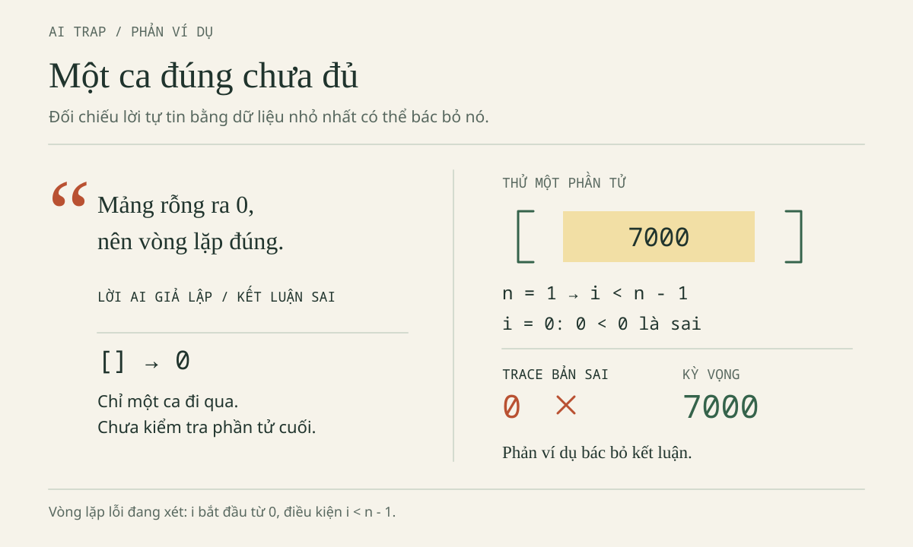
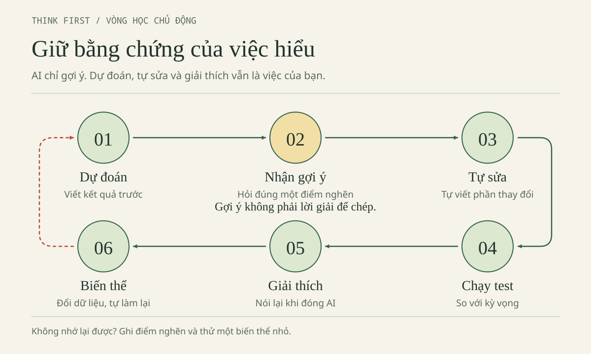

# CHƯƠNG 3 · HỌC CHỦ ĐỘNG: DÙNG AI MÀ KHÔNG LẠM DỤNG

Chương 2 đã trình bày cách dùng AI có kiểm soát: chuẩn bị môi trường, giao việc có giới hạn, đọc diff và nghiệm thu bằng kiểm thử. Tuy vậy, một chương trình chạy đúng sau khi được AI hỗ trợ chưa chứng minh rằng người học đã nắm kiến thức mà bài tập nhắm tới. Mục 1.1 đã phân biệt dùng đúng và lạm dụng; chương này biến sự phân biệt đó thành thói quen cụ thể.

Cần nói rõ: "lạm dụng" ở đây không có nghĩa là dùng AI là xấu. Lạm dụng nghĩa là giao cho AI chính phần việc đang cần luyện, chẳng hạn nhờ AI viết vòng lặp trong đúng bài học về vòng lặp. Khi người học giữ vai trò quyết định, AI giúp học nhanh hơn: AI hỗ trợ, người học quyết định. Chương rèn luyện bốn thao tác: dự đoán trước khi hỏi hoặc chạy chương trình, tự sửa lỗi, kiểm chứng bằng ca kiểm thử, và vận dụng vào biến thể mới khi đã đóng cửa sổ chat. Các bài có thể thấy khó lúc đầu; điều đó là bình thường, và mỗi bài đều có cách thu nhỏ để bắt đầu.

Các nhân vật, tình huống và hội thoại trong chương là hư cấu, dùng để minh họa, không phải quy định của Trường. Quyền dùng AI trong bài nộp do từng học phần quy định.

## Mục tiêu học tập

Sau chương này, người học có thể:

- Phân biệt việc tận dụng AI để học với việc giao cho AI chính phần việc đang cần luyện; nhận ra những kết luận vượt quá bằng chứng trong một câu trả lời tự tin.
- Ghi dự đoán về đầu vào, kỳ vọng và giả thuyết trước khi hỏi AI hoặc chạy chương trình; trace bằng tay một vòng lặp và sự thay đổi giá trị, kiểu dữ liệu qua từng lượt.
- Lần ngược luồng dữ liệu trong một ứng dụng Web nhỏ và giải thích lại bằng lời, kèm vị trí trong mã và ví dụ cụ thể.
- Tự quan sát khả năng nhớ lại sau khi học và viết kết luận đúng mức bằng chứng.
- Hoàn thành trọn một nhiệm vụ lập trình nhỏ trong 25 phút không dùng AI.
- Tách bản vá lỗi khỏi phần xác thực dữ liệu (validation), lập bảng kiểm thử với kỳ vọng ghi trước, và tự làm biến thể của bài toán.

## Tình huống mở đầu

Sau Chương 2, Minh (năm nhất, học C++) đã sửa vòng lặp và chương trình in đúng tổng **60000**. Tuy vậy, khi Lan hỏi kết quả sẽ thế nào nếu danh sách chỉ có một khoản, Minh chưa trả lời được nếu không hỏi lại AI. Lan (năm hai, học Web, lập trình hướng đối tượng, cấu trúc dữ liệu và giải thuật, cơ sở dữ liệu) gặp vấn đề tương tự: giao diện Web đã hoạt động, nhưng Lan chưa giải thích được vì sao giá trị đọc từ ô nhập phải qua hai bước chuyển kiểu và kiểm tra. Mục tiêu đặt ra cho cả hai không phải là có câu trả lời dài nhất, mà là **tự giải thích được ít nhất một điều khi không còn nhìn lời giải**. Đó cũng là cách để AI thật sự giúp học nhanh hơn.

## Cấu trúc chương và cách sử dụng

Mục này giúp người học biết nên bắt đầu từ đâu và chuẩn bị gì. Hãy chọn một nhánh (C++ năm nhất hoặc Web năm hai) để thực hành sâu và đọc nhánh còn lại để đối chiếu; không cần hoàn thành mọi hoạt động trong một buổi.

**Chuẩn bị.** Các thao tác được thực hiện trong thư mục gốc của bộ tài liệu (`AI-Student-Handbook`), trên bản sao bài làm `bai-lam/nam-1-cpp` và `bai-lam/nam-2-web` đã tạo ở Bài thực hành 01 (mục 2.1, [Chương 2](chapter-02.md)); thư mục `vi-du` chỉ dùng để tham khảo. Nếu chưa có bản sao, cần thực hiện mục 2.1 trước. Ghi chép đặt trong vở hoặc trong tệp `bai-lam/nam-1-cpp/ghi-chep-02.txt` đã tạo ở Chương 2. Chương không yêu cầu cài đặt, đổi cấu hình, đăng nhập, gọi API hay truy cập mạng. Nếu không có công cụ AI, có thể dùng các hội thoại hư cấu trong chương làm phiếu gợi ý và ghi rõ rằng đã học bằng phiếu.

## 3.1. Bẫy câu trả lời tự tin (AI Trap)

### Hợp đồng dữ liệu: căn cứ đánh giá thay cho cảm giác

Mục này giúp người học có căn cứ để đánh giá một câu trả lời tự tin của AI thay vì dựa vào cảm giác. Ứng dụng mẫu ViSinhVien dùng bộ dữ liệu **hoàn toàn giả định** dưới đây, làm điểm tựa để tính tay.

| id | title | amount | category |
| --- | --- | ---: | --- |
| 1 | Cơm trưa | 35000 | `an-uong` |
| 2 | Xe buýt | 7000 | `di-lai` |
| 3 | Vở ghi | 18000 | `hoc-tap` |

**Hợp đồng dữ liệu** là tập điều kiện mà đầu vào phải thỏa mãn và kết quả phải bảo đảm. Đây không phải điều mà AI được tự ý thay đổi để việc viết mã thuận tiện hơn.

| Phần hợp đồng | Quy định của bài |
| --- | --- |
| Tiền | `amount` là số nguyên VND từ 1 đến 1000000000; không lưu dưới dạng chuỗi có dấu phân cách. |
| Danh sách | Tối đa 500 khoản. Danh sách rỗng hợp lệ và có tổng bằng 0. |
| Tổng | Bộ mẫu có tổng 60000; giá trị cực đại là `500 × 1000000000 = 500000000000`. |
| C++ năm nhất | Chỉ dùng `vector<long long>` chứa tiền; không yêu cầu class `Expense`. |
| Web năm hai | Mỗi `Expense` có các trường `id`, `title`, `amount`, `category`. |
| `id` (Web) | Số nguyên an toàn, dương, không trùng trong danh sách. |
| `title` (Web) | Chuỗi; sau `trim()` có độ dài từ 1 đến 80 **đơn vị UTF-16**, tính theo `.length` của JavaScript. |
| `category` (Web) | **Chuỗi** thuộc tập `an-uong`, `di-lai`, `hoc-tap`, `khac`; mảng `['khac']` không hợp lệ. |

Trong C++, kiểu `long long` đủ chứa tổng cực đại, còn kiểu số nguyên có dấu 32 bit thì không. Trong JavaScript, 500000000000 nằm trong miền số nguyên an toàn của `Number`, có giới hạn trên là 9007199254740991. Tuy nhiên, "biểu diễn được" khác với "được phép": số âm biểu diễn được nhưng vi phạm hợp đồng về tiền. Độ dài tính theo đơn vị UTF-16 cũng không phải lúc nào cũng bằng số ký tự nhìn thấy, vì một số ký hiệu được tính bằng hai đơn vị.

Bản Web gồm HTML và JavaScript, lưu dữ liệu bằng `localStorage`; ứng dụng không có backend, không có đăng nhập thật và không tích hợp SQLite. Bài SQL và SQLite dùng cùng bộ dữ liệu là một bài cơ sở dữ liệu riêng. Demo Web hiện tại chạy **đúng**: khi chưa có dữ liệu lưu, demo khởi tạo ba khoản với tổng **60000**. Vì vậy, không được chẩn đoán các lỗi mà cẩm nang dựng có chủ đích trong mảng lab thành lỗi của demo.

### Bẫy: đúng một kết quả rồi kết luận đúng cho mọi trường hợp

Phiếu trả lời dưới đây là *tình huống hư cấu*, được viết sai có chủ đích để phân tích:

> “Đã đổi cận vòng lặp và thấy 60000, vậy chương trình xử lý mọi đầu vào an toàn. Ở Web cứ dùng `Number` cho mọi giá trị là đủ. Muốn tổng theo nhóm thì lọc trước, dữ liệu nhóm khác không liên quan.”

Yêu cầu: chưa viết lại hàm. Gạch chân ba kết luận trong phiếu; với mỗi kết luận, nêu một đầu vào cần thử để kiểm tra. Một câu trả lời chỉ gồm nhận xét "AI có thể sai" mới nhắc lại một khẩu hiệu, chưa phải là phản biện kỹ thuật.

### Đáp án bẫy AI — Ba kết luận vượt quá bằng chứng

Kết luận thứ nhất vượt quá bằng chứng vì đổi cận chỉ sửa lỗi bỏ sót khoản cuối; các đầu vào như `{0}` hoặc danh sách 501 khoản vẫn cần validation riêng. Kết luận thứ hai sai vì `Number("")` trả về 0: chuỗi rỗng chuyển kiểu được nhưng không phải giá trị hợp lệ. Kết luận thứ ba sai vì lọc trước có thể che khoản sai: nếu một khoản thuộc nhóm `di-lai` có tiền ở dạng chuỗi thì yêu cầu tính tổng nhóm `hoc-tap` phải bị từ chối. Cách xử lý đúng là tách từng yêu cầu, tìm phản ví dụ và xác định phạm vi kiểm thử, thay vì tranh luận về giọng văn của AI.

### Sáu tình huống: ranh giới nằm ở nhiệm vụ đang luyện

Phần này giúp xác định lúc nào AI đang hỗ trợ việc học và lúc nào AI đang làm thay. **Tận dụng AI để học** là giữ phần học cần thiết ở phía người học. **Giao việc học cho AI** là để AI suy nghĩ thay ở chính phần đang cần luyện. Không thể chỉ nhìn đoạn mã do AI gợi ý mà kết luận về việc dùng đúng hay lạm dụng; ranh giới phụ thuộc vào mục tiêu của từng bài. Việc dùng AI không sai; điều cần tránh là để AI làm đúng phần người học đang cần luyện.

| Tình huống | Tận dụng để học | Dấu hiệu giao việc học cho AI | Vùng xám cần kiểm tra |
| --- | --- | --- | --- |
| 1. Minh gặp lỗi biên dịch | Gửi thông báo lỗi và đoạn mã tối thiểu; tự giải thích nguyên nhân sau khi nhận gợi ý. | Dán cả bài và thay bằng lời giải mà không đọc. | Một bản vá rất nhỏ vẫn có thể bị cấm trong bài đánh giá không cho dùng AI. |
| 2. Minh học vòng lặp | Xin câu hỏi gợi mở về chỉ số, tự trace ba khoản. | Xin vòng lặp hoàn chỉnh rồi học thuộc. | Được xem mẫu không đồng nghĩa với được nộp thuật toán do AI xây dựng. |
| 3. Lan đọc tài liệu tiếng Anh | Nhờ giải nghĩa thuật ngữ và đối chiếu với câu gốc. | Chỉ đọc bản tóm tắt rồi nhận là đã đọc tài liệu. | Dịch hỗ trợ khác với viết hộ phần phân tích được chấm điểm. |
| 4. Lan thiết kế test | Tự tính kỳ vọng, nhờ tìm loại ca còn thiếu. | Nhận cả hàm lẫn kỳ vọng test từ cùng một câu trả lời. | Học phần có thể cho phép sinh test nhưng yêu cầu khai báo. |
| 5. Minh và Lan làm giao diện | Sinh phần khung không phải trọng tâm rồi tự nối dữ liệu. | Không biết nút Lưu gọi hàm nào nhưng nhận là đã làm chủ Web. | Nếu học phần đang dạy HTML, khung sinh sẵn có thể bỏ qua chính mục tiêu bài học. |
| 6. Chuẩn bị bài nhóm | Thống nhất cách dùng hỗ trợ; mỗi thành viên giải thích được phần việc được giao. | AI hoàn thành phần chưa làm nhưng nhóm báo là tự làm hoàn toàn. | Quy tắc nhóm, cách ghi nhận hỗ trợ và cách đánh giá có thể khác nhau giữa các học phần. |

Trước khi mở cửa sổ chat, người học nên viết một câu xác định phạm vi: “Bài đang luyện __; AI chỉ hỗ trợ __; tôi tự chứng minh __.” Với bài hiện tại, Minh chọn điều kiện dừng của vòng lặp, còn Lan chọn đường đi của kiểu dữ liệu. Nếu quyền sử dụng AI chưa rõ, cần đọc hướng dẫn của học phần và hỏi giảng viên trước khi dùng cho bài nộp. Việc khai báo không biến một cách dùng bị cấm thành được phép.

### Vibe coding có kiểm soát: dựng nhanh, tiếp nhận chậm

Trong chương này, **vibe coding** là cách mô tả mong muốn bằng ngôn ngữ tự nhiên, nhận mã do AI sinh ra và điều chỉnh qua nhiều lượt trao đổi. Cách làm này hữu ích khi cần dựng nhanh để thử ý tưởng, nhưng việc chương trình chạy được không tự chứng minh rằng người làm hiểu chương trình.

Lan có thể nhận hàng trăm dòng mã rồi liên tục yêu cầu “sửa hết”. Cách làm có kiểm soát đi theo hướng ngược lại. Trước hết, cần biết vai trò của từng tệp: `index.html` chứa giao diện, `data.js` xử lý dữ liệu, `app.js` nối sự kiện và lưu trữ. Sau đó, chọn một vấn đề, dự đoán, nhận một thay đổi, kiểm tra vài ca rồi mới đi tiếp. Không thêm framework, dịch vụ hay chức năng đăng nhập để giải quyết lỗi tiền ở dạng chuỗi.

Hiểu chương trình không có nghĩa là thuộc mọi API. Người học được phép tra cứu tên phương thức, nhưng phải trả lời được bốn câu hỏi:

1. Đoạn mã nhận dữ liệu gì, thuộc kiểu nào, từ đâu?
2. Đoạn mã trả về hoặc thay đổi điều gì?
3. Đoạn mã dựa vào điều kiện nào của hợp đồng dữ liệu?
4. Nếu bỏ một điều kiện, có thể tạo ca nào khiến đoạn mã cho kết quả sai?

Ví dụ, với `localStorage.setItem`, Lan cần biết phương thức này lưu chuỗi, có thể thất bại, và ứng dụng không được báo là đã lưu bền khi thực tế chỉ cập nhật bộ nhớ. Với `vector`, Minh cần biết ba phần tử có chỉ số 0, 1, 2. Quên tên API thì tra cứu; còn khi không biết vì sao thiếu phần tử cuối thì phải trace.



## 3.2. Dự đoán trước khi hỏi (Think First)

### Phiếu dự đoán trước khi gửi câu hỏi

Mục này giúp người học hỏi AI hiệu quả hơn bằng cách có sẵn điểm bám. Người học vẫn được hỏi khi chưa có lời giải. Tuy vậy, một mô tả sơ bộ như “cộng từ khoản đầu đến khoản cuối”, cùng một lần thử với một khoản, sẽ tạo chỗ bám để gợi ý của AI phát huy tác dụng.

| Điều cần ghi | Minh điền trước khi hỏi | Nếu chưa biết |
| --- | --- | --- |
| Đầu vào | `35000, 7000, 18000`, số nguyên | Chép đúng dữ liệu và kiểu dữ liệu đang có. |
| Kỳ vọng | 60000, do cộng đủ ba khoản | Tính tay ca một khoản trước. |
| Hiện tượng | Dự đoán cận lỗi cho 42000; chưa chạy | Ghi “chưa chạy”; không dùng kết quả in trong sách như kết quả đã chạy. |
| Giả thuyết | Có thể chưa cộng khoản Vở ghi | Ghi nơi nghi ngờ, chưa khẳng định nguyên nhân. |
| Điều cần hỗ trợ | Một câu hỏi về chỉ số | Không yêu cầu cùng lúc giải thích, sửa cả bài và sinh test. |

Bài thực hành 03 (mục 2.3) đã xử lý lỗi cận và việc build; mục này rèn luyện việc **giữ từng bước suy nghĩ**. Nếu đã nhớ lời giải, người học cần tự giải thích một ca mới thay vì nhắc lại đáp án cũ.

### Hội thoại C++: người học phải tự đi qua từng lượt

Đoạn mã dưới đây là **mã lỗi có chủ đích** trong `loi-bo-sot.cpp`. Biến `amounts` là `std::vector<long long>{35000, 7000, 18000}`, còn `total` là `long long` khởi tạo bằng 0.

```cpp
int n = static_cast<int>(amounts.size());
for (int i = 0; i < n - 1; ++i) { // CỐ Ý SAI
    total += amounts[i];
}
```

Yêu cầu: trước khi mở phần đối chiếu, tự ghi giá trị `n`, các chỉ số hợp lệ và từng lần kiểm tra điều kiện, kể cả lần kiểm tra sai khiến vòng lặp dừng. Lưu ý rằng `size()` trả về số lượng phần tử, không phải chỉ số cuối. Với ba khoản mẫu, việc dùng `int n` không có rủi ro. Tuy nhiên, `loi-bo-sot.cpp` **chưa** kiểm tra giới hạn 500 khoản; phiên bản kiểm tra số lượng trước khi ép sang `int` được trình bày ở mục 3.6. Không được suy ra rằng mọi phép ép kích thước về `int` đều an toàn.

### Đáp án hội thoại C++ (tình huống hư cấu)

**Minh:** Em tính tay được 60000. Với cận đang đọc, em dự đoán kết quả là 42000. Em nghi thiếu khoản Vở ghi nhưng chưa biết phải sửa thế nào.

**Người hướng dẫn:** Chưa sửa vội. Ba phần tử có chỉ số nào?

**Minh:** 1, 2, 3… Em nhầm: vector bắt đầu từ 0, vậy là 0, 1, 2.

**Người hướng dẫn:** Khi đó `n` và điều kiện ở lượt đầu bằng bao nhiêu?

**Minh:** `n = 3`, nên `n - 1 = 2`. Lượt đầu `0 < 2` đúng, tổng thành 35000.

**Người hướng dẫn:** Em tự đi tiếp, kể cả lượt không được chạy.

**Minh:** `i = 1`, `1 < 2` đúng, tổng thành 42000. Đến `i = 2`, `2 < 2` sai. Vòng lặp dừng khi chưa đọc 18000. Phép cộng không sai; chỉ thiếu một số hạng.

| Lần kiểm tra | i | Điều kiện lỗi | Khoản được cộng | total sau kiểm tra |
| --- | ---: | --- | --- | ---: |
| 1 | 0 | `0 < 2`: đúng | Cơm trưa 35000 | 35000 |
| 2 | 1 | `1 < 2`: đúng | Xe buýt 7000 | 42000 |
| 3 | 2 | `2 < 2`: sai | Không có | 42000 |

**Người hướng dẫn:** Em muốn đọc những chỉ số nào và không được đọc chỉ số nào?

**Minh:** Đọc 0, 1, 2; không đọc 3. Em đề xuất điều kiện `i < n`. Khi `i = 2`, cộng thêm 18000 thành 60000; tăng lên 3 thì dừng.

**Người hướng dẫn:** Ca chỉ có một khoản Vở ghi và ca danh sách rỗng có giúp kiểm tra đề xuất này không?

**Minh:** Với một khoản: cận cũ kiểm tra `0 < 0`, bỏ luôn khoản duy nhất; cận mới kiểm tra `0 < 1`, cộng 18000. Với danh sách rỗng: cận mới kiểm tra `0 < 0`, tổng giữ 0. Cận cũ với `int n = 0` cũng không lặp, nên riêng ca rỗng không phân biệt được hai cận.

| Đầu vào | Kỳ vọng với cận lỗi | Kỳ vọng với cận đúng |
| --- | ---: | ---: |
| Ba khoản mẫu | 42000 | 60000 |
| Chỉ 18000 | 0 | 18000 |
| Rỗng | 0 | 0 |

Các giá trị trên là **trace thủ công và đầu ra kỳ vọng**, chưa phải bằng chứng đã biên dịch. Việc sửa cận không tự bổ sung kiểm tra tiền hoặc số lượng. Cũng không nên thay bằng `size() - 1` cho “gọn”: kích thước thuộc kiểu không dấu, nên phép trừ 1 khi danh sách rỗng có thể tạo ra giá trị rất lớn (xem giải thích ở Bài thực hành 03, mục 2.3).

Nếu dùng AI đóng vai người hỏi, cần yêu cầu AI chờ câu trả lời và không để AI tự nhận là giảng viên của người học. Giá trị của hội thoại nằm ở câu Minh tự nói ra về chỉ số 2, không nằm ở số lượt trao đổi.

### Phiên học 25 phút có AI hỗ trợ: sáu bước, sáu dấu vết

Phiên học sau giúp luyện thói quen xen kẽ giữa tự làm và hỏi AI. Đây là phiên **có giai đoạn được hỏi AI**, khác thử thách không dùng AI ở mục 3.5. Mỗi phiên chọn một mục tiêu: Minh sửa cận vòng lặp; Lan giải thích hiện tượng tiền ở dạng chuỗi trong lab. Chỉ dùng các phương tiện đã được phép. Nếu không truy cập được AI, thay lượt hỏi bằng phiếu gợi ý hoặc trao đổi với bạn học, và ghi rõ cách đã làm.

| Thời gian | Việc cần làm | Dấu vết cần giữ |
| --- | --- | --- |
| 0–4 phút: tự thử | Đọc đề, phác thảo một cách làm, dù còn thiếu. | Mã tự viết hoặc mô tả thuật toán. |
| 4–7 phút: dự đoán | Tính tay; ghi chỉ số hoặc kiểu dữ liệu ở từng chặng. | Kỳ vọng được viết **trước** khi chạy và trước khi hỏi. |
| 7–11 phút: xin gợi ý | Mỗi lượt một câu hỏi; tự trả lời rồi mới hỏi tiếp. | Câu gợi ý và câu trả lời của người học. |
| 11–16 phút: tự sửa | Chỉ sửa nguyên nhân đã giải thích được. | Dòng đã đổi cùng lý do. |
| 16–21 phút: kiểm chứng | Thử ca thường, ca biên và ca sai theo phạm vi của bản sửa. | Kỳ vọng, kết quả thực tế, kết luận; ghi phần validation còn thiếu nếu có. |
| 21–25 phút: biến thể không AI | Đóng chat, đổi dữ liệu hoặc câu hỏi. | Bài tự làm và những chỗ chưa chắc. |

Ví dụ, Minh dự đoán dãy tổng `0 → 35000 → 42000 → 60000`; Lan vẽ chuỗi “ô nhập → đối tượng → danh sách → tổng”. Người chưa viết được mã vẫn có thể bắt đầu bằng hai dấu vết này. Sau khi mới sửa cận, nếu ca tiền sai chưa bị từ chối thì đó là phần validation còn thiếu cần ghi lại.

Theo quy ước của phiên học, mỗi nút thắt được thử tối đa ba lượt gợi ý. Mỗi lượt phải dẫn đến một hành động tự làm: điền trace, sửa một dòng hoặc nghĩ thêm ca kiểm thử. Nếu vẫn vướng, thu nhỏ bài toán xuống còn một khoản.

### Khi đáp án bị lộ hoặc hết giờ mà chưa xong

Nếu AI viết luôn điều kiện đúng, người học ghi “đã xem lời giải phần cận”, đóng lời giải lại, tự giải thích rồi thử một ca mới. Phần đã bị lộ chỉ được tính là ôn tập. Mẫu prompt P02 (bảng P01–P08 ở cuối mục 3.3 và trong [Thư viện prompt mẫu](prompt-library.md)) có thể yêu cầu AI chỉ đưa ra bảng trống, nhưng không bảo đảm AI tuân thủ.

Nếu mệt, ghi cụ thể tình trạng hiện tại, ví dụ “đã biết chỉ số cuối, chưa biết lập điều kiện”, rồi dừng. Thời lượng làm bài không phải thước đo khả năng tập trung hay năng lực theo đuổi ngành học. Phiên sau nên thu nhỏ nhiệm vụ. Khi hỏi người hướng dẫn, cần mang theo đầu vào, kỳ vọng, kết quả thực tế và những điều đã thử.

## 3.3. Lần ngược luồng dữ liệu và giải thích lại (Reverse Engineering, Explain It Back)

Mục này giúp người học kiểm tra bản thân có thật sự hiểu chương trình hay chỉ thấy nó chạy. Mục ghép hai bước liền nhau. Phần đầu là **lần ngược** (tiếng Anh: *reverse engineering*), tức là đọc ngược chương trình từ kết quả hiển thị về nơi dữ liệu được tạo ra để hiểu luồng xử lý. Phần sau là **giải thích lại** (tiếng Anh: *explain it back*), tức là trình bày bằng lời của chính người học, kèm vị trí trong mã và ví dụ cụ thể. Phần tự đánh giá năng lực cuối chương được trình bày ở mục 3.7.

### Từ con số trên màn hình về nơi dữ liệu được tạo

Trong `bai-lam/nam-2-web`, Lan lần từ tổng hiển thị về hàm `render()`, lời gọi `D.totalExpenses(expenses)`, chỗ gán `expenses`, handler `submit` vô danh và `D.parseAmount` trong `app.js`. Sau đó, Lan mở `data.js` để đọc các hàm và mở `index.html` để kiểm tra form cùng thứ tự nạp script. Cần mô tả đúng mã hiện có: mã dùng callback vô danh, nên không được bịa ra một hàm tên `handleSubmit`.

| Chặng cần lần | Vị trí và vai trò | Kiểu dữ liệu và điều cần giải thích |
| --- | --- | --- |
| Ô nhập | `index.html`, được đọc trong `app.js` | `.value` là chuỗi, kể cả khi người dùng gõ chữ số. |
| Phân tích tiền | `parseAmount` trong `data.js` | Kiểm tra cách viết, chuyển thành số, kiểm tra miền giá trị tiền. |
| Danh sách ứng viên | Handler `submit` trong `app.js` | Ghép khoản mới; `normalizeExpenses` kiểm tra cả danh sách trước khi gán. |
| Tính tổng | `totalExpenses` trong `data.js` | Kiểm tra tiền và số lượng, trả về số; không xác thực toàn bộ schema. |
| Lưu | `save()` trong `app.js` | `JSON.stringify` tạo chuỗi để ghi vào `localStorage`; thao tác ghi có thể lỗi. |
| Hiển thị | `render()` trong `app.js` | Định dạng để hiển thị, không biến tiền đã lưu thành chuỗi có dấu chấm. |
| Đọc lại | Khối khởi tạo trong `app.js` | `JSON.parse` rồi `normalizeExpenses`; JSON hợp lệ chưa chắc đúng schema. |

Trong handler, biểu thức `D.normalizeExpenses([...expenses, khoản_mới])` phải thực hiện thành công trước khi gán lại `expenses`. Dữ liệu sai làm phát sinh lỗi và lỗi được bắt ở tầng giao diện, nên khoản sai không được thêm vào danh sách. Dữ liệu hợp lệ được cập nhật trong bộ nhớ, sau đó ứng dụng mới gọi `save()` và `render()`. Nếu lưu thất bại, khoản vừa thêm vẫn còn trong RAM và không bị hoàn tác, nhưng giao diện phải báo rằng dữ liệu chưa được lưu bền.

### Lab kiểu dữ liệu: dựng lỗi trên bản nháp, giữ nguyên demo đúng

Giữ nguyên `data.js` vì tệp này đang đúng. Trên giấy hoặc vùng nháp, giả lập ba giá trị `amount` là các chuỗi `"35000"`, `"7000"`, `"18000"`, với biến `total` ban đầu là số 0. Mỗi lượt thực hiện `total = total + expense.amount`. Đây là **lab lỗi có chủ đích**, không mô tả trạng thái dữ liệu mẫu của ứng dụng.

Yêu cầu: chưa mở đáp án, lập bảng gồm các cột lượt, `total` trước và kiểu, `amount` và kiểu, `total` sau và kiểu. Giữ nguyên dấu ngoặc kép khi ghi chuỗi; bỏ dấu ngoặc kép sẽ làm mất phần quan trọng nhất của bài.

### Đáp án hội thoại Web (tình huống hư cấu) — Giải thích bằng giá trị và kiểu

**Lan:** Trong lab, em dự đoán kết quả là một chuỗi dài chứ không phải số tiền. Em định thay toán tử cộng.

**Người hướng dẫn:** Trước khi đổi toán tử, em đã biết kiểu của `.value` chưa?

**Lan:** Em từng nghĩ gõ số thì nhận được số. Nhưng giá trị của ô nhập là chuỗi. Muốn quan sát trên Console thì em phải kiểm tra bằng `typeof`, không đoán theo hình dáng.

**Người hướng dẫn:** Vậy ở lượt đầu, vế trái và vế phải là gì?

**Lan:** Số 0 cộng chuỗi `"35000"` thành chuỗi `"035000"`. Tổng đã đổi kiểu ngay từ lượt đầu.

**Người hướng dẫn:** Em làm tiếp hai lượt và ghi cả kiểu.

| Lượt | total trước và kiểu | amount và kiểu | total sau và kiểu |
| --- | --- | --- | --- |
| 1 | `0`, number | `"35000"`, string | `"035000"`, string |
| 2 | `"035000"`, string | `"7000"`, string | `"0350007000"`, string |
| 3 | `"0350007000"`, string | `"18000"`, string | `"035000700018000"`, string |

**Lan:** Sau lượt đầu, chương trình không còn cộng số nữa. Em đang nối các ký tự liên tiếp.

**Người hướng dẫn:** Nên sửa ở đâu để các bước phía sau không phải đoán kiểu?

**Lan:** Ở biên nhập liệu: kiểm tra chuỗi, chuyển thành số, kiểm tra giá trị rồi mới tạo `Expense`. Hàm tổng vẫn phải từ chối tiền sai, vì dữ liệu có thể đến từ đường khác.

**Người hướng dẫn:** Chỉ dùng `Number` có đủ không? Hãy xét chuỗi rỗng và số âm.

**Lan:** Không đủ. `Number("")` cho 0; `Number("-7000")` cho số âm. Cả hai đều không phải khoản hợp lệ. Em cho phép khoảng trắng ở hai đầu, sau đó chỉ nhận chữ số; từ chối dấu chấm, dấu phẩy, chữ cái và ký hiệu mũ.

**Người hướng dẫn:** Khi tải lại trang, dữ liệu đã lưu có cần kiểm tra nữa không?

**Lan:** Có. `localStorage` giữ chuỗi JSON. Parse thành công chỉ chứng minh cú pháp JSON đúng; vẫn phải kiểm tra danh sách, tiền, id, title và category. Khi đọc lỗi, ứng dụng không được âm thầm đổi dữ liệu cũ thành danh sách rỗng rồi ghi đè.

Các kết quả trên là **kỳ vọng suy ra từ trace**. Khi tiền đã ở kiểu số, trace đúng là `0 → 35000 → 42000 → 60000`. Giá trị `42000` ở giữa là tổng trung gian đúng, còn `42000` khi kết thúc vòng lặp C++ lỗi là kết quả sai: cùng một con số nhưng khác thời điểm và khác yêu cầu.

### Giải thích lại (Explain It Back): vượt qua câu “em hiểu rồi”

Yêu cầu: đóng phần hội thoại. Trong khoảng một phút, trình bày đường đi của `"18000"` từ ô nhập đến giá trị số trong danh sách, rồi đến chuỗi JSON; chỉ vào tên hàm tương ứng khi trình bày. Nếu bị kẹt, đánh dấu chặng còn thiếu trước khi mở lại tài liệu. Để tự kiểm tra, mở lại bảng “Chặng cần lần” ở đầu mục này và đánh dấu từng chặng đã trình bày được; chặng nào còn thiếu là nội dung cần ôn tiếp theo. Minh chỉ tham gia phần này với vai trò **review chéo cho Lan**, không chuyển sang làm dự án Web năm hai.

Có thể luyện thêm với câu tiếng Anh sau, **do cẩm nang tự soạn, không phải trích dẫn từ tài liệu chính thức**: “The value of a text input is a string. Convert and validate it before storing an expense amount.” Trong câu này, `value` là giá trị, `string` là chuỗi, `convert` là chuyển kiểu, `validate` là kiểm tra hợp lệ. Sau đó, tự diễn giải cả câu và chọn một trường hợp chuyển kiểu được nhưng không hợp lệ. Khi làm việc với tài liệu thật, cần giữ đoạn gốc và nguồn để đối chiếu; bản dịch không thay thế việc đọc điều kiện áp dụng.

Về lưu trữ, bản demo khởi tạo dữ liệu mẫu trước. Nếu không có bản lưu, demo giữ ba khoản với tổng 60000. Nếu có bản lưu hợp lệ, demo dùng bản lưu đó, kể cả danh sách `[]` với tổng 0. Nếu bước đọc, parse hoặc normalize thất bại, demo đặt `persistent = false`, dùng dữ liệu mẫu trong bộ nhớ và thông báo rằng sẽ không ghi đè dữ liệu cũ. Nếu ghi thất bại, `save()` cũng chuyển sang chế độ bộ nhớ tạm, và các thay đổi sau đó trong phiên không thử ghi tiếp. Nút khôi phục dữ liệu mẫu không tự bật lại quyền lưu.

Khi mở trang qua `file://`, hành vi lưu trữ phụ thuộc vào trình duyệt. Cần kiểm tra việc tải lại trang trên cùng tệp và cùng trình duyệt. Nếu dùng sẵn một máy chủ HTTP, phải giữ cùng **origin**, tức là cùng giao thức, host và cổng; một địa chỉ khác có thể tương ứng với một vùng lưu khác. Không dựng server hoặc backend chỉ để hoàn thành bài đọc này.

### Tám mẫu prompt: chọn đúng một điểm nghẽn

Bảng dưới đây tóm tắt tám mẫu prompt P01–P08. Nội dung đầy đủ của từng mẫu, kèm ngữ cảnh sử dụng và cách xử lý khi đáp án bị lộ, nằm trong [Thư viện prompt mẫu](prompt-library.md). Chương này chỉ trình bày cách chọn mẫu và bằng chứng học tập cần giữ, không yêu cầu chép lại tám khối prompt dài.

| Mẫu | Chức năng và khi dùng | Người học cần chuẩn bị hoặc tự làm | Nếu đáp án bị lộ |
| --- | --- | --- | --- |
| [P01](prompt-library.md) | Hỏi theo lối Socrates, mỗi lượt một câu; dùng khi chưa biết vì sao bỏ sót khoản cuối. | Tự nêu chỉ số, trace và giải thích dòng sửa. | Ghi là đã xem; đóng lại và trace một ca một khoản mới. |
| [P02](prompt-library.md) | Ba tầng gợi ý: vùng cần xem → quan hệ giữa chỉ số và kích thước → bảng trống. | Sau mỗi tầng, báo điều vừa thử; không xin cả ba tầng cùng lúc. | Tự so sánh ca rỗng **và** ca một khoản; riêng ca rỗng chưa phân biệt được hai cận. |
| [P03](prompt-library.md) | Trace giá trị và kiểu trong lab tiền dạng chuỗi. | Điền từng hàng, chỉ ra lượt đầu tiên đổi kiểu. | Che bảng, tự trace với một chuỗi khác. |
| [P04](prompt-library.md) | Review đúng một thay đổi nhỏ. | Chứng minh cận đúng, chọn test, nêu phần validation chưa làm. | Không thay cả tệp; tự so sánh hai cận với `n = 1`. |
| [P05](prompt-library.md) | Viết test trước khi viết mã. | Tự đề xuất ca thường, ca biên, ca sai và tính kỳ vọng. | Đóng lời giải, tự tính ca tối đa 500 khoản. |
| [P06](prompt-library.md) | Giải thích tiếng Anh có đối chiếu với câu gốc. | Diễn giải câu gốc, phân biệt chuyển kiểu với kiểm tra hợp lệ. | Tự phân tích `"35000abc"` bằng lời. |
| [P07](prompt-library.md) | Vấn đáp như người hướng dẫn. | Trả lời bằng ví dụ về chỉ số, kiểu dữ liệu, test và lưu trữ. | Loại câu đã lộ khỏi phần đánh giá độc lập, chuyển sang câu mới. |
| [P08](prompt-library.md) | Giao một biến thể rồi đóng chat. | Tự làm hàm max (C++) hoặc tổng theo nhóm (Web); nêu phần chưa chứng minh được. | Chuyển sang bài đảo thứ tự dữ liệu, chưa xem kết quả. |

Một mẫu prompt không làm thay phần chuẩn bị. P05 không còn hữu ích nếu để AI tính luôn mọi kỳ vọng; P07 không phải công cụ dự đoán điểm học phần. Bốn phút tự thử trong P08 chỉ là một lượt ngắn, không thay thế thử thách 25 phút ở mục 3.5.

## 3.4. Tự quan sát khả năng nhớ lại (Memory Experiment)

### Hai nhiệm vụ gần tương đương, một mục tiêu quan sát

Hoạt động này giúp người học tự quan sát những gì còn nhớ được sau khi học, từ đó chọn cách ôn phù hợp; đây không phải nghiên cứu về tác động của AI lên trí nhớ và không dùng để kết luận quan hệ nhân quả. Hai nhiệm vụ có cùng số khoản, cùng phép cộng và cùng giới hạn chỉ số; tuy vậy, chưa có phép đo nào chứng minh độ khó của chúng là tương đương.

Chuẩn bị giấy, đồng hồ và khoảng 12–15 phút; không cần dùng AI. Cả hai nhiệm vụ dùng cận đúng đã học và chỉ khác thứ tự dữ liệu:

- **Nhiệm vụ A:** `35000, 7000, 18000`. Trong khoảng 90 giây, đọc câu trả lời của Minh về cận `i < n` và bảng “Đầu vào / Kỳ vọng với cận đúng” ở mục 3.2 (dãy tổng `0 → 35000 → 42000 → 60000`), rồi gấp phần đó lại. Ghi rõ rằng nhiệm vụ A đã được đọc lời giải.
- **Nhiệm vụ B:** `18000, 35000, 7000`. Trong khoảng 90 giây, tự viết bảng chỉ số và tổng mà không mở lời giải. Không chạy chương trình trước để lấy kết quả.

Có thể tung đồng xu để chọn thứ tự, hoặc làm B trước A nếu thuận tiện; ghi lại thứ tự thực tế. Việc đổi thứ tự không loại bỏ được ảnh hưởng của luyện tập. Nếu chưa hiểu vòng lặp, làm cả hai nhiệm vụ với trợ giúp và ghi đúng mức hỗ trợ đã nhận; khi đó, hoạt động chỉ nhằm quan sát việc nhớ lại, không so sánh “có AI” với “không AI”.

### Quy trình: tách lúc học khỏi lúc nhớ lại

Sau mỗi nhiệm vụ, che mã và ghi chép, nghỉ khoảng hai phút bằng một việc không liên quan đến bài. Sau đó, trả lời cùng bốn câu hỏi trên giấy trắng:

1. Các chỉ số hợp lệ là gì?
2. Tổng sau mỗi lượt là bao nhiêu?
3. Điều kiện nào làm vòng lặp dừng?
4. Với danh sách một khoản và danh sách rỗng, kết quả ra sao và vì sao?

Không mở kết quả trong khi trả lời. Chỉ sau khi trả lời xong mới đối chiếu và đánh dấu phần cần xem lại.

Nếu hoàn cảnh không cho phép nghỉ đúng thời lượng, ghi lại thời gian thực tế. Ngày hôm sau, có thể trả lời lại bốn câu hỏi trước khi đọc chương; đây là lượt tự kiểm tra bổ sung, không bắt buộc. Chép lại câu vừa đọc không được tính là nhớ lại độc lập.

| Nhiệm vụ | Thứ tự và thời gian thực tế | Hỗ trợ đã xem | Ý tự nhớ được | Ý sai hoặc cần mở lại | Giải thích được ca mới? |
| --- | --- | --- | --- | --- | --- |
| A | … | Bảng đã có lời giải | … | … | … |
| B | … | Tự lập bảng (ghi thêm nếu có hỗ trợ) | … | … | … |
| Lượt hôm sau (nếu làm) | … | Chưa xem lại hoặc đã xem lại | … | … | … |

### Đáp án đối chiếu hoạt động nhớ lại (Memory Experiment)

Nhiệm vụ A có dãy tổng lần lượt là 35000, 42000, 60000; nhiệm vụ B có 18000, 53000, 60000. Với cận `i < n`, cả hai nhiệm vụ đọc các chỉ số 0, 1, 2 và dừng trước chỉ số 3. Danh sách một khoản hợp lệ có tổng bằng chính khoản đó; danh sách rỗng giữ tổng bằng 0. Dãy tổng trung gian khác nhau nhưng tổng cuối không đổi.

Khi đối chiếu, cần xét từng ý: nhớ được con số 60000 chưa chứng minh nhớ được quá trình cộng; nhớ tên kiểu `long long` chưa chứng minh hiểu giới hạn của tổng.

### Viết kết luận đúng mức bằng chứng

Một nhận xét phù hợp (ví dụ hư cấu): “Ở nhiệm vụ A, tôi nhớ tổng cuối nhưng quên lượt dừng; ở nhiệm vụ B, tôi tự viết được ba tổng trung gian. Tôi sẽ luyện điều kiện dừng khi đóng tài liệu.” Không được suy ra rằng “AI làm tôi nhớ kém”.

Nhiều yếu tố có thể ảnh hưởng đến kết quả: kiến thức sẵn có, thứ tự làm, độ quen thuộc, mức độ mệt mỏi, thời gian, việc đã nhìn đáp án và cách tự chấm. Khi không kiểm soát được các yếu tố này và không có nhóm so sánh, người học không thể suy ra quan hệ nhân quả, không tính phần trăm và không gắn nhãn trí nhớ tốt hay xấu. Kết quả chỉ dùng để chọn **hành động học tiếp theo**: luyện nhớ lại, giải thích thành lời hoặc đổi dữ liệu.

## 3.5. Thử thách 25 phút không dùng AI (25-Minute No-AI Challenge)

### Quy tắc của phiên: không dùng AI từ đầu đến cuối

Thử thách này giúp người học biết bản thân tự làm được đến đâu khi không có AI. Chưa làm xong trong 25 phút là bình thường và vẫn có giá trị: điểm nghẽn được ghi lại chính là nội dung cần luyện tiếp. Đây là phiên 25 phút làm việc độc lập, không phải 21 phút có AI cộng thêm bốn phút đóng chat. Trong suốt phiên, đóng hội thoại và không dùng Agent, công cụ sinh mã, phần giải thích hay gợi ý của AI. Dùng một vùng soạn thảo sẵn có không hiển thị gợi ý AI, hoặc làm trên giấy; không đổi cấu hình công cụ chỉ để thực hiện bài. Người học được đọc đề, hợp đồng dữ liệu và ghi chú cú pháp tự viết; không mở đáp án bên dưới và không nhờ người khác làm hộ.

Nếu vô tình nhìn thấy gợi ý, ghi lại thời điểm và phần đã thấy; có thể tiếp tục luyện nhưng không gọi cả phiên là độc lập. Điều cần bảo vệ là chất lượng của bằng chứng, không phải một dấu tích hoàn thành.

**Nhiệm vụ chung:** đếm số khoản có tiền **từ 10000 VND trở lên**. Danh sách đầu vào của bài đếm này **đã được xác nhận hợp lệ** theo hợp đồng dữ liệu, nên chưa cần viết parser hoặc validation mới; tuy vậy, lời giải phải ghi rõ tiền đề này.

- Minh viết hàm `countLargeAmounts(const std::vector<long long>& amounts)`, trả về số lượng kiểu `int`.
- Lan viết hàm `countLargeExpenses(expenses)`, dùng `expense.amount` ở kiểu số, trả về số lượng kiểu `number`. Hàm không đọc DOM hoặc `localStorage`.

Chọn một nhánh. Không đổi nhiệm vụ thành tính tổng hoặc tìm số tiền lớn nhất. Chuẩn bị các ca: ba khoản mẫu, danh sách rỗng, một khoản 10000, một khoản 9999, và ba khoản mẫu theo thứ tự đảo. Với nhánh Web, các đối tượng phải đầy đủ trường và id không trùng; với nhánh C++, chỉ cần vector tiền.

### Phân bổ thời gian để còn chỗ kiểm chứng

| Khoảng phút | Việc tự làm | Sản phẩm nhỏ |
| --- | --- | --- |
| 0–5 | Diễn giải điều kiện “từ 10000 trở lên”; tính kỳ vọng cho các ca. | Bảng kỳ vọng lập trước khi chạy, có cả ca biên bằng 10000. |
| 5–12 | Viết thuật toán bằng lời, rồi viết mã hoặc giả mã. | Một biến đếm, cách duyệt, điều kiện xét từng khoản. |
| 12–18 | Trace từng khoản; nếu có sẵn môi trường thì chạy bản nháp. | Kết quả chạy thực tế hoặc kết quả trace có ghi nhãn, không trộn hai loại. |
| 18–22 | Tự tìm và sửa một điểm sai hoặc thiếu; nếu đã đúng, giải thích vì sao. | Dòng đã đổi kèm lý do, hoặc lập luận bảo vệ mã. |
| 22–25 | Đóng mã, trình bày lại cách làm và ghi điểm nghẽn. | Lời giải thích ngắn và trạng thái cuối phiên. |

Không cần tạo thêm tệp: viết trong vở hoặc vùng nháp của tệp ghi chép hiện có. Nếu thử C++ trong bản sao, giữ lại mã trước khi thay đổi để đối chiếu và không ghi đè bản tham khảo. Nếu không có compiler hoặc môi trường chạy, hoàn thành giả mã và trace, đồng thời đánh dấu phần thực thi là chưa làm.

### Đối chiếu theo bằng chứng, không theo tốc độ

Ghi “có” hoặc “chưa có” cho bốn tiêu chí: (1) phân biệt việc đếm với việc cộng tiền; (2) có kỳ vọng tự tính độc lập; (3) trace hoặc lần chạy được mô tả đúng; (4) giải thích được ca biên 10000 và ca rỗng. Giữ bản tự làm trước khi mở đáp án. Nếu chưa xong, ghi điểm nghẽn cụ thể, chẳng hạn “em tăng tiền thay vì tăng số lượng”, để chọn việc cho phiên sau.

### Đáp án thử thách không dùng AI — Đếm, không cộng tiền

Kỳ vọng: ba khoản mẫu có **2** khoản đạt điều kiện; danh sách rỗng cho **0**; `[10000]` cho **1**; `[9999]` cho **0**; ba khoản mẫu theo thứ tự đảo vẫn cho **2**. Khi gặp khoản 18000, biến đếm không tăng thêm 18000; mỗi khoản thỏa điều kiện chỉ làm biến đếm tăng 1.

Hai hàm dưới đây là lời giải để đọc sau phiên, với giả định đầu vào đã hợp lệ; chúng không thay thế validation ở mục 3.6.

```cpp
int countLargeAmounts(const std::vector<long long>& amounts) {
    int count = 0;
    for (long long amount : amounts) {
        if (amount >= 10000) ++count;
    }
    return count;
}
```

```javascript
function countLargeExpenses(expenses) {
  let count = 0;
  for (const expense of expenses) {
    if (expense.amount >= 10000) count += 1;
  }
  return count;
}
```

Mỗi hàm duyệt danh sách một lần, có thời gian O(n), bộ nhớ phụ O(1) và không thay đổi đầu vào. Biến đếm trong C++ có giá trị tối đa 500 nên kiểu `int` là phù hợp; điều này không mâu thuẫn với yêu cầu **tổng tiền** phải dùng `long long`. Sau khi xem đáp án, việc sửa lại bản nháp là ôn tập có đối chiếu; không ghi lại quá trình thành “tự làm đúng ngay”.

## 3.6. Bài vận dụng: sửa ít, xác thực đủ, thử biến thể (AI Challenge)

Mục này giúp người học ghép các bước ở mục 3.1–3.5 vào một bài sửa lỗi hoàn chỉnh. Bài khá dài; có thể làm từng bước và nghỉ giữa chừng. Mục này đứng trước phần người học tự đánh giá năng lực ở mục 3.7.

### Chuẩn bị: một nhánh, một bản sao, ba loại bằng chứng

Người học chọn nhánh của Minh hoặc nhánh của Lan. Sản phẩm cần nộp gồm mã hoặc bản nháp, bảng kỳ vọng – thực tế và lời giải thích. Các mẫu P04, P05, P08 là hỗ trợ tùy chọn. Làm việc trong thư mục gốc của bộ tài liệu, trên bản sao `bai-lam`. Với nhánh C++, sửa `loi-bo-sot.cpp` và giữ `vi_sinh_vien.cpp` để đối chiếu. Với nhánh Web, giữ bốn tệp trong cùng thư mục và **tái dựng phần lõi trong một lab riêng**, không sửa demo đang đúng.

Ba loại bằng chứng có phạm vi khác nhau: trace là lập luận; test logic kiểm tra hàm; thao tác trên trình duyệt kiểm tra sự kiện, hiển thị và lưu trữ. Không dùng một loại bằng chứng để khẳng định đã hoàn tất cả ba.

### Nhánh Minh: từ bản vá cận đến hợp đồng đầy đủ

**Bước 1 — Vá đúng một nguyên nhân.** Trong bản sao `loi-bo-sot.cpp`, dự đoán kết quả của ba ca trước khi sửa: ba khoản mẫu, một khoản 18000 và danh sách rỗng. Trace rồi đổi cận. Ghi nhận rõ rằng đây là bản vá vòng duyệt trên đầu vào hợp lệ, chưa bổ sung validation.

**Bước 2 — Bổ sung validation như một việc riêng.** Tách hàm `totalExpenses` đặt phía trên `main`, vẫn dùng `vector<long long>`. Kiểm tra số lượng trước khi chuyển `size()` sang `int`, và kiểm tra từng khoản tiền trước khi cộng. Danh sách sai phải làm phát sinh ngoại lệ `std::invalid_argument`; không bỏ qua khoản sai và không trả về 0. Thêm `<stdexcept>` cho ngoại lệ, giữ `<vector>` và `<iostream>`. Nếu bước này quá lớn, chia thành hai lượt nhỏ: lượt thứ nhất chỉ thêm kiểm tra số lượng (quá 500 khoản thì ném lỗi), build và thử; lượt thứ hai mới thêm kiểm tra từng khoản tiền. Bản hoàn chỉnh để đối chiếu nằm ở phần “Đáp án validation C++” cuối mục 3.6, chỉ mở sau khi đã tự thử.

**Bước 3 — Gọi hàm và kiểm tra cả nhánh lỗi.** Trong `main`, gọi hàm với vector đang thử. Đặt lời gọi trong khối `try`, bắt `std::invalid_argument` để báo lỗi và trả về mã khác 0. Trọng tâm ở đây là tiền đã có kiểu `long long`; bài chưa yêu cầu phần nhập từ bàn phím phát hiện mọi chuỗi sai. Khi mở rộng sang nhập liệu, phải kiểm tra cả việc đọc và chuyển đổi có thành công hay không trước khi đưa giá trị vào vector.

**Bước 4 — Chạy đúng bản vừa sửa.** `loi-bo-sot.cpp` không có tùy chọn `--test`. Để thử từng ca, thay vector dữ liệu trong bản sao rồi build lại, hoặc tự viết hàm gọi kiểm thử khi đã hiểu (có thể tham khảo hàm `runTests()` trong `vi_sinh_vien.cpp`). Không thêm `--test` vào lệnh chạy với kỳ vọng chương trình sẽ tự kiểm tra. Dùng `std::vector<long long>(500, 1000000000LL)` để tạo ca cực đại thay vì gõ 500 số.

Khi máy đã có `g++`, chạy lệnh từ thư mục gốc của bộ tài liệu và chọn đúng cú pháp của shell. Trong Bash hoặc Git Bash, toán tử `&&` bảo đảm chương trình chỉ chạy khi build thành công:

```bash
g++ -std=c++17 -Wall -Wextra "bai-lam/nam-1-cpp/loi-bo-sot.cpp" -o "bai-lam/nam-1-cpp/loi-bo-sot.exe" && "./bai-lam/nam-1-cpp/loi-bo-sot.exe"
```

Trong PowerShell, kiểm tra mã thoát của lệnh build trước khi chạy:

```powershell
g++ -std=c++17 -Wall -Wextra "bai-lam/nam-1-cpp/loi-bo-sot.cpp" -o "bai-lam/nam-1-cpp/loi-bo-sot.exe"
if ($LASTEXITCODE -eq 0) { & ".\bai-lam\nam-1-cpp\loi-bo-sot.exe" }
```

Dòng thứ hai phải chạy ngay sau dòng build, vì `$LASTEXITCODE` chỉ phản ánh lệnh chạy ngay trước nó. Đọc output và mã thoát theo hướng dẫn ở Bài thực hành 07 (mục 2.7). Nếu build lỗi thì dừng, không chạy tệp thực thi cũ. Khi dùng IDE, cần Build thành công rồi mới Run đúng đích. Nếu thiếu compiler, thực hiện trace, ghi rõ “chưa thực thi” và không tự cài đặt trên máy dùng chung.

### Nhánh Lan: tái dựng phần lõi, không sửa demo đang đúng

**Bước 1 — Chọn trạng thái xuất phát rõ ràng.** Khi chưa có dữ liệu lưu, demo mở với ba khoản, tổng 60000. Để luyện thao tác thêm khoản Vở ghi từ tổng 42000, làm trên **bản sao với dữ liệu giả có thể thay thế**: xóa riêng dòng Vở ghi bằng nút Xóa của dòng đó rồi thêm lại. Thao tác xóa có thể được lưu, vì vậy không dùng thao tác này với dữ liệu cần giữ. Không xóa toàn bộ kho lưu trữ của trình duyệt để đạt trạng thái của bài.

Phương án không động đến lưu trữ là dùng một mảng lab riêng gồm hai đối tượng Cơm trưa và Xe buýt, có tổng 42000. Khi thêm `{id: 3, title: 'Vở ghi', amount: 18000, category: 'hoc-tap'}`, tổng kỳ vọng là 60000. Lưu ý: nếu thêm Vở ghi vào danh sách đã đủ ba khoản mẫu, tổng sẽ là **78000**, không phải 60000. Nếu trình duyệt đang giữ dữ liệu cũ khác, tính theo dữ liệu thực tế đang hiển thị hoặc chuyển sang mảng lab; không giả định tổng ban đầu.

**Bước 2 — Viết test trước phần lõi.** Quy tắc nhập tiền: sau khi trim, chỉ nhận chuỗi gồm chữ số, rồi kiểm tra giá trị là số nguyên an toàn trong khoảng 1..1e9. Viết cách xử lý trước khi mở đáp án. Tách `parseAmount` khỏi `totalExpenses`; hàm tổng không được “chữa” tiền dạng chuỗi để che lỗi ở nguồn dữ liệu.

**Bước 3 — Hai tầng kiểm tra.** Đối tượng `{amount: 7000}` đủ để thử riêng `totalExpenses`, vì hàm này chỉ kiểm tra mảng, số lượng và tiền. Tuy nhiên, đối tượng đó thiếu `id`, `title` và `category` nên không đủ để thử `normalizeExpenses`. Hàm normalize kiểm tra schema, trả về danh sách mới và cũng không chữa tiền dạng chuỗi.

**Bước 4 — Đọc chỗ nối.** Trong `app.js`, tìm lời gọi `D.parseAmount` và bước gán qua `D.normalizeExpenses`; không thay handler đang đúng bằng mã lab. Khi nhập sai, danh sách, tổng và dữ liệu lưu phải giữ nguyên. Khi nhập hợp lệ mà ghi thất bại, khoản mới có thể được thêm trong RAM, nhưng giao diện phải báo đang dùng bộ nhớ tạm.

**Bước 5 — Kiểm tra trên trình duyệt.** Mở `bai-lam/nam-2-web/index.html`, thêm lại Vở ghi từ trạng thái hai khoản, thử các đầu vào sai, đọc thông báo thêm và lưu, rồi tải lại trang ở cùng địa chỉ. Nếu ứng dụng đang dùng RAM, không kỳ vọng thay đổi còn lại sau khi tải lại.

Bản đầy đủ bọc logic trong một hàm tự gọi và công bố đối tượng `globalThis.ViData`; `app.js` lấy đối tượng này bằng `const D = globalThis.ViData`. Trong Node, API được gán vào `module.exports`, và bộ test dùng `require('./data.js')`. Trang HTML nạp **script thông thường** theo thứ tự:

```html
<script src="data.js"></script>
<script src="app.js"></script>
```

Không thêm `type="module"`, `import`, server hoặc thư viện. `test_data.cjs` là chương trình kiểm thử logic riêng, không gắn vào trang. Nếu máy đã có Node.js, chạy lệnh sau từ thư mục gốc của bộ tài liệu:

```bash
node "bai-lam/nam-2-web/test_data.cjs"
```

Lệnh này dùng được trong cả Bash và PowerShell; cách đọc mã thoát tùy theo shell, như đã trình bày ở Chương 2. **Bộ kiểm thử Web hiện có 34 ca** (đếm theo số dòng `PASS` và dòng tổng kết cuối), gồm các ca cơ bản và một ca hồi quy cho `category` ở dạng mảng. Với bản đúng, kết quả kỳ vọng là `34 passed, 0 failed`; đây chưa phải kết quả trên máy của người học. Bản C++ tham khảo `vi_sinh_vien.cpp` có **9 ca**, chạy bằng tùy chọn `--test` sau khi build; không nhầm bộ này với bản bài làm `loi-bo-sot.cpp`, vốn không có bộ test. Ngoài ra, bộ test tham khảo đạt hết cũng không chứng minh rằng hàm lab tự viết là đúng.

### Bảng kiểm thử: ghi kỳ vọng trước, kết quả thực tế sau

Bảng dưới đây gồm các ca cốt lõi và các ca ranh giới về schema. Cột thực tế để người học tự điền; cần phân biệt “chưa chạy” với “đã chạy, đạt”. Với ca dữ liệu sai, kỳ vọng là **từ chối**, không phải tổng bằng 0. Trong hàm, từ chối nghĩa là phát sinh lỗi; ở giao diện, lỗi được bắt và thay đổi sai không được chấp nhận.

| Ca | Kỳ vọng | Vì sao cần | Thực tế hoặc trạng thái |
| --- | --- | --- | --- |
| Ba khoản mẫu | 60000 | Cộng đủ ba số hạng. | … |
| Chỉ một khoản Vở ghi 18000 | 18000 | Phát hiện lỗi bỏ sót phần tử cuối. | … |
| Rỗng | 0 | Tổng của danh sách hợp lệ không có khoản nào. | … |
| Đảo thứ tự ba khoản | 60000 | Tổng không phụ thuộc thứ tự. | … |
| Một khoản 1; một khoản 1000000000 | Lần lượt: 1; 1000000000 | Cả hai biên đều được chấp nhận. | … |
| 500 khoản, mỗi khoản 1000000000 | 500000000000 | Kiểm tra số lượng và kiểu của tổng. | … |
| 501 khoản, tiền đều hợp lệ | Từ chối | Không chỉ kiểm tra từng khoản tiền. | … |
| Có khoản 0, khoản âm hoặc khoản 1000000001 | Từ chối từng ca | Không bỏ qua khoản sai. | … |
| JS có `amount: "35000"` hoặc `1.5` | Từ chối | Không phải tiền số nguyên hợp lệ. | … |
| Chuỗi nhập `" 35000 "` | Số 35000 | Cho phép khoảng trắng ở hai đầu. | … |
| Nhập `""`, `" "`, `"35.000"`, `"35000abc"` | Từ chối từng ca | Kiểm tra toàn bộ chuỗi, không đọc một phần. | … |
| Nhập `"0"`, `"1000000001"`, `"1e3"` | Từ chối từng ca | Đúng cách viết chưa đủ; ký hiệu mũ không được chấp nhận. | … |
| Schema có id trùng, id bằng 0 hoặc id không an toàn | Từ chối từng ca | Định danh của khoản phải hợp lệ và duy nhất. | … |
| Title toàn khoảng trắng hoặc dài 81 đơn vị UTF-16 | Từ chối từng ca | Kiểm tra sau khi trim, giới hạn 80. | … |
| Title `" Vở ghi "` | Chuẩn hóa thành `"Vở ghi"` | Chuẩn hóa title không làm thay đổi tiền. | … |
| Category `"khac"`, `['khac']`, `"toString"` | Lần lượt: nhận, từ chối, từ chối | Kiểm tra kiểu chuỗi và khóa riêng trong danh mục. | … |

Nếu tạo 500 đối tượng để thử **normalize**, cần dùng id riêng cho từng khoản; nhân bản cùng một id 500 lần chỉ kiểm tra được lỗi trùng id, chưa kiểm tra được biên số lượng hợp lệ. Nếu chỉ thử **totalExpenses**, các đối tượng có trường tiền là đủ theo phạm vi của hàm.

### Đáp án validation C++ — Lõi đầy đủ, không chỉ một dòng cận

Phần lõi sau dựa trên `vi-du/nam-1-cpp/vi_sinh_vien.cpp`. Đặt hàm phía trên `main` trong bản bài làm; không chép đè lên bản tham khảo có `runTests()` và nhánh `--test`.

```cpp
#include <iostream>
#include <stdexcept>
#include <vector>

long long totalExpenses(const std::vector<long long>& amounts) {
    if (amounts.size() > 500) {
        throw std::invalid_argument("Toi da 500 khoan chi");
    }
    long long total = 0;
    int n = static_cast<int>(amounts.size());
    for (int i = 0; i < n; ++i) {
        if (amounts[i] <= 0 || amounts[i] > 1000000000LL) {
            throw std::invalid_argument("Moi khoan: 1 den 1000000000 VND");
        }
        total += amounts[i];
    }
    return total;
}
```

Tham số `const ...&` nhận tham chiếu chỉ đọc nên không sao chép vector. Khi danh sách rỗng, thân vòng lặp không được thực hiện và tổng giữ bằng 0. Hàm kiểm tra số lượng trước phép ép kích thước, kiểm tra tiền trước khi cộng, và không có nhánh “gặp khoản sai thì bỏ qua”. Độ phức tạp thời gian là O(n), bộ nhớ phụ O(1).

Mẫu `main` dưới đây dành cho bản bài làm, có khối bắt lỗi để thử các ca sai. Khi thử dữ liệu khác, chỉ thay vector; các dòng in tên khoản mô tả riêng bộ mẫu, nên cần sửa hoặc bỏ chúng khi đổi dữ liệu để tránh nhãn in ra không khớp.

```cpp
int main() {
    const std::vector<long long> amounts = {35000, 7000, 18000};
    try {
        const long long total = totalExpenses(amounts);
        std::cout << "Com trua: 35000 VND\nXe buyt: 7000 VND\nVo ghi: 18000 VND\n";
        std::cout << "Tong chi tieu: " << total << " VND\n";
        return 0;
    } catch (const std::invalid_argument& error) {
        std::cerr << error.what() << '\n';
        return 1;
    }
}
```

**Kết quả mong đợi** (suy ra từ mã nguồn, chưa thực thi) với bộ mẫu gồm ba dòng tiền và dòng `Tong chi tieu: 60000 VND`. Khi thử ca sai, nhánh bắt lỗi trả về 1 và không in một tổng hợp lệ bằng 0. Hàm này nhận tiền đã ở kiểu số nguyên, nên không thể phát hiện trường hợp một parser lỗi đã biến đầu vào sai thành số hợp lệ từ trước.

### Đáp án validation Web — Tách parse, tổng và schema trong lab

Các hàm lõi `validAmount`, `parseAmount`, `totalExpenses`, `normalizeExpenses` dưới đây dựa trên `vi-du/nam-2-web/data.js` trong thư mục gốc của bộ tài liệu, có kiểm tra **kiểu chuỗi của category**. Lớp vỏ `chapter3Lab` được viết riêng cho chương này để thử độc lập: lớp vỏ không thay `globalThis.ViData`, không truy cập DOM hay bộ lưu trữ và không chép đè `data.js`.

Để thử, mở `bai-lam/nam-2-web/index.html`, nhấn F12 rồi chọn thẻ **Console** (cách mở được trình bày ở Bài thực hành 04, mục 2.4). Lần đầu dán mã, Chrome hoặc Edge có thể chặn và yêu cầu gõ một cụm từ cho phép dán; cần đọc kỹ cảnh báo, chỉ dán khối mã trong cẩm nang này và không dán mã lạ. Đọc khối lab trước rồi nhập một lần; khai báo `var chapter3Lab` cho phép tạo lại lab sau khi sửa. Nếu chưa quen Console, có thể chỉ đọc và trace. Khối mã này tự chứa toàn bộ phần logic, không cần gói bên ngoài.

```javascript
var chapter3Lab = (function () {
  'use strict';
  const MAX_AMOUNT = 1000000000;
  const MAX_ITEMS = 500;
  const categories = Object.freeze({
    'an-uong': 'Ăn uống', 'di-lai': 'Đi lại',
    'hoc-tap': 'Học tập', 'khac': 'Khác'
  });

  function validAmount(amount) {
    return Number.isSafeInteger(amount) && amount > 0 && amount <= MAX_AMOUNT;
  }

  function parseAmount(input) {
    if (typeof input !== 'string' || !/^[0-9]+$/.test(input.trim())) {
      throw new Error('Nhập số nguyên VND, không có dấu chấm, phẩy hay chữ.');
    }
    const amount = Number(input.trim());
    if (!validAmount(amount)) throw new Error('Số tiền phải từ 1 đến 1.000.000.000 VND.');
    return amount;
  }

  function totalExpenses(expenses) {
    if (!Array.isArray(expenses) || expenses.length > MAX_ITEMS) {
      throw new Error('Danh sách tối đa 500 khoản.');
    }
    let total = 0;
    for (const expense of expenses) {
      if (!expense || !validAmount(expense.amount)) {
        throw new Error('amount phải là số nguyên VND hợp lệ.');
      }
      total += expense.amount;
    }
    return total;
  }

  function normalizeExpenses(input) {
    if (!Array.isArray(input) || input.length > MAX_ITEMS) {
      throw new Error('Dữ liệu lưu không đúng định dạng.');
    }
    const ids = new Set();
    return input.map(item => {
      if (!item || !Number.isSafeInteger(item.id) || item.id < 1 || ids.has(item.id) ||
          typeof item.title !== 'string' || !item.title.trim() || item.title.trim().length > 80 ||
          typeof item.category !== 'string' || !Object.hasOwn(categories, item.category) ||
          !validAmount(item.amount)) {
        throw new Error('Một khoản lưu sẵn không hợp lệ.');
      }
      ids.add(item.id);
      return { id: item.id, title: item.title.trim(), amount: item.amount, category: item.category };
    });
  }

  return { parseAmount, totalExpenses, normalizeExpenses, categories };
})();
```

Biểu thức chính quy `/^[0-9]+$/` kiểm tra toàn bộ chuỗi sau khi trim, không nhận dấu chấm, dấu phẩy, chữ cái hay ký hiệu mũ. `parseInt("35000abc", 10)` có thể đọc được phần đầu 35000, nên việc chỉ thêm tham số cơ số (radix) không khắc phục được lỗi nhận hậu tố. `Number.isInteger` kiểm tra số nguyên; ở đây dùng `Number.isSafeInteger` rồi giới hạn riêng miền giá trị tiền. Chuỗi `"0007"` hợp lệ và cho số 7; chuỗi `"0"` đúng cách viết nhưng nằm ngoài miền giá trị.

`Object.hasOwn` kiểm tra khóa riêng của đối tượng nhưng không thay thế việc kiểm tra kiểu: mảng `['khac']` có thể bị ép thành tên khóa `"khac"`. Vì vậy phải giữ điều kiện `typeof item.category !== 'string'`. Tập `Set` lưu các id đã gặp để phát hiện trùng lặp. Hàm normalize trả về các đối tượng mới với title đã trim và không sửa đối tượng đầu vào. Hàm này dùng thêm O(n) bộ nhớ cho danh sách mới và tập id, nên không thể coi mọi phần của quá trình là O(1) về bộ nhớ.

Ví dụ thử sau khi mở bản Web và tạo lab; các chú thích là **kết quả mong đợi**, chưa phải kết quả kiểm thử đã chạy:

```javascript
chapter3Lab.totalExpenses(globalThis.ViData.sampleExpenses()); // kỳ vọng 60000
chapter3Lab.parseAmount(' 35000 ');                            // kỳ vọng số 35000
chapter3Lab.totalExpenses([]);                                // kỳ vọng 0
```

Thử riêng từng ca sai và chờ thông báo lỗi, ví dụ `chapter3Lab.parseAmount('35000abc')` hoặc `chapter3Lab.totalExpenses([{amount: '35000'}])`. Thông báo lỗi trong trường hợp này không có nghĩa là Console bị hỏng; đó là hàm đang từ chối dữ liệu sai. Để kiểm tra hàm không thay đổi đầu vào, ghi lại giá trị JSON trước và sau lời gọi rồi đối chiếu, không chỉ nhìn tổng.

### Biến thể: đóng chat trước khi mở lời giải

**Nhánh Minh:** viết hàm `maxExpense` nhận cùng vector tiền; danh sách rỗng trả về 0; hàm vẫn phải từ chối mọi khoản tiền sai và danh sách quá 500 khoản. Tự dự đoán kết quả cho ba khoản mẫu, một khoản và danh sách rỗng. Không chỉ đổi tên hàm tổng: biến cần giữ là **khoản lớn nhất**, không phải tổng đã cộng.

**Nhánh Lan:** viết hàm `totalByCategory`, nhận danh sách Expense và mã nhóm. Mã nhóm phải là chuỗi thuộc danh mục. Hàm phải kiểm tra **toàn bộ danh sách** trước khi chọn nhóm, gồm schema, tiền và số lượng; bất kỳ khoản sai nào cũng làm lời gọi bị từ chối, kể cả khoản thuộc nhóm khác. Không giả định đầu vào đã được normalize ở nơi khác nếu chữ ký hàm chưa nêu tiền đề đó.

| Biến thể và ca thử | Kỳ vọng cần tự đối chiếu |
| --- | --- |
| Max với ba khoản mẫu; chỉ Vở ghi; rỗng | Lần lượt: 35000; 18000; 0 |
| Max khi có khoản 0, khoản âm, khoản quá 1e9 hoặc có 501 khoản | Từ chối, dù đã gặp một giá trị lớn hợp lệ trước đó. |
| Tổng nhóm `hoc-tap`; nhóm `khac` trên ba khoản mẫu | Lần lượt: 18000; 0 |
| Tổng theo nhóm trên danh sách rỗng, mã nhóm hợp lệ | 0 |
| Chọn `hoc-tap`, khoản `di-lai` có amount dạng chuỗi hoặc 1.5 | Từ chối, không trả về 18000. |
| Chọn `hoc-tap`, khoản ngoài nhóm có id trùng, title rỗng hoặc category dạng mảng | Từ chối từng ca schema. |
| 501 khoản, không khoản nào thuộc nhóm được chọn | Từ chối, không trả về 0. |
| Mã nhóm yêu cầu là `['khac']` hoặc `toString` | Từ chối mã nhóm. |

### Đáp án biến thể max C++ — Kiểm tra hết rồi mới kết luận

Đặt hàm sau `totalExpenses` trong bản bài làm; hàm dùng lại phần validation của hàm tổng. Cách này duyệt danh sách hai lượt nhưng dễ đọc với sinh viên năm nhất, và vẫn có thời gian O(n), bộ nhớ phụ O(1).

```cpp
long long maxExpense(const std::vector<long long>& amounts) {
    totalExpenses(amounts); // Kiểm toàn bộ tiền và số lượng; có thể ném lỗi.
    long long best = 0;
    for (long long amount : amounts) {
        if (amount > best) best = amount;
    }
    return best;
}
```

Giá trị khởi đầu 0 phù hợp vì mọi khoản hợp lệ đều dương; danh sách rỗng giữ kết quả 0 mà không cần truy cập phần tử đầu. Với bộ mẫu, `best` thành 35000 và giữ nguyên khi gặp 7000, 18000. Không được trả về sớm khi gặp 1000000000 trước khi kiểm tra các khoản còn lại, vì danh sách có thể chứa khoản sai ở phía sau. Lời gọi hàm tổng ở đầu là cách tái sử dụng phần kiểm tra, không có nghĩa tổng chính là giá trị lớn nhất. Khi viết test, phải đổi lời gọi sang `maxExpense`; chạy lại hàm tổng rồi cho rằng đã kiểm thử hàm max là sai.

### Đáp án tổng theo category — Xác thực trước, chọn nhóm sau

Hàm lab sau dùng `chapter3Lab` đã tạo ở đáp án Web. Đây là **hàm mở rộng**, chưa có trong API của demo; không được nói rằng bộ 34 test hiện có đã kiểm tra hàm này.

```javascript
function totalByCategory(expenses, category) {
  if (typeof category !== 'string' || !Object.hasOwn(chapter3Lab.categories, category)) {
    throw new Error('Mã nhóm không hợp lệ.');
  }
  const checked = chapter3Lab.normalizeExpenses(expenses);
  const selected = checked.filter(expense => expense.category === category);
  return chapter3Lab.totalExpenses(selected);
}
```

Nếu mã nhóm sai, lời gọi bị từ chối ngay. Khi mã nhóm hợp lệ, normalize kiểm tra toàn bộ danh sách trước khi lọc, nên không có kết quả nhóm nào được trả về từ một danh sách chứa khoản sai. `totalExpenses(selected)` thực hiện phép cộng sau khi schema đã được bảo vệ. Nếu nơi gọi đã có bảo đảm rõ ràng về schema, có thể kiểm tra toàn bộ tiền và số lượng bằng `totalExpenses(expenses)` trước khi lọc; tuy nhiên, **riêng lời gọi đó không đủ chứng minh schema** đối với một hàm nhận dữ liệu bất kỳ.

Ví dụ phản chứng với bộ mẫu: đổi riêng tiền của Xe buýt thành `"7000"` và vẫn yêu cầu nhóm `hoc-tap`. Hàm phải ném lỗi, dù khoản Vở ghi hoàn toàn đúng. Đổi id của Xe buýt thành 1, trùng với Cơm trưa, cũng phải gây lỗi. Nếu lọc `hoc-tap` trước khi normalize, các bằng chứng sai này sẽ biến mất và hàm trả về 18000, trái với hợp đồng.

Với dữ liệu hợp lệ, nhóm `hoc-tap` cho 18000, nhóm `khac` cho 0. Số 0 ở đây có nghĩa là không có khoản nào thuộc nhóm, không phải “gặp lỗi nên trả về 0”. Cách normalize rồi lọc tạo ra danh sách mới, nên toàn hàm có thời gian O(n) và bộ nhớ phụ O(n). Có thể tối ưu sau, nhưng không nên đánh đổi thứ tự kiểm tra chỉ để tiết kiệm một lượt duyệt nhỏ.

## 3.7. Tự đánh giá năng lực cuối chương (Skill Unlocked)

### Ba mức tự đánh giá, không phải nhãn năng lực lâu dài

Mục này giúp người học nhìn lại việc đã làm được gì và chọn việc luyện tiếp. Với mỗi năng lực, chọn một trong ba mức **tự làm**, **cần gợi ý** hoặc **chưa làm**, kèm bằng chứng. “Tự làm” nghĩa là đã đóng chat và không nhìn đáp án. Kết quả là ghi nhận tại thời điểm hiện tại, không phải nhận định về năng lực lâu dài.

| Năng lực | Việc cần làm được | Mức và bằng chứng tự ghi |
| --- | --- | --- |
| Giải thích | Nêu hợp đồng về tiền, số lượng, tổng của danh sách rỗng và tổng cực đại. | … |
| Giải thích | Trace đến 60000 và chỉ ra vì sao cận lỗi dừng ở 42000. | … |
| Giải thích | Phân biệt `35000` với `"35000"` và nêu hệ quả đối với phép `+`. | … |
| Sửa | Chỉ thay phần gây lỗi; tách bản vá cận khỏi validation. | … |
| Sửa | Tự chọn ca một khoản, ca rỗng, ca biên lớn và ca dữ liệu sai. | … |
| Sửa | Phân biệt việc từ chối dữ liệu với một tổng hợp lệ bằng 0. | … |
| Vận dụng | Làm hàm max hoặc tổng theo nhóm mà không che khoản sai ngoài nhóm. | … |
| Vận dụng | Nêu rõ phần đã nhận hỗ trợ, phần tự làm và phần còn cần hỏi. | … |

Chọn một dòng chưa làm được, thu nhỏ ví dụ rồi thử lại. Bài đếm ở mục 3.5 là bước vận dụng nhỏ, chưa thay thế validation ở mục 3.6.

### Câu hỏi ôn tập: tám câu vấn đáp

Có thể nhờ bạn học hỏi lần lượt hoặc dùng mẫu P07; hỏi từng câu rồi chờ trả lời, cho phép dùng giấy và ví dụ. Kết quả không dùng để suy đoán điểm học phần.

| Câu hỏi | Gợi ý để tự lập luận |
| --- | --- |
| 1. Vì sao kết quả đúng là 60000 nhưng cận lỗi cho 42000? | Viết ba số hạng và tìm phép cộng chưa xảy ra. |
| 2. Danh sách ba phần tử có chỉ số cuối là bao nhiêu; vòng lặp dừng khi nào? | Phân biệt số lượng với chỉ số bắt đầu từ 0. |
| 3. Vì sao cần `long long` dù ba khoản đều nhỏ? | Nhân số khoản tối đa với số tiền tối đa. |
| 4. Danh sách rỗng trả về 0 có mâu thuẫn với quy định tiền phải dương không? | Tổng của danh sách và tiền của một khoản là hai đối tượng khác nhau. |
| 5. Vì sao `0 + "35000"` không phải là một tổng hợp lệ? | Nêu kiểu của hai toán hạng và kiểu của kết quả. |
| 6. Chuyển chuỗi thành số đã đủ chưa? | Xét chuỗi rỗng, `"0"`, số âm, giá trị quá giới hạn và hậu tố chữ. |
| 7. Dùng `localStorage` có nghĩa là có tài khoản hoặc CSDL trên máy chủ không? | Chỉ ra nơi dữ liệu nằm, phạm vi origin và trạng thái RAM. |
| 8. Bộ test đạt hết đã chứng minh người học hiểu bài chưa? | Tự giải thích một ca, sửa một lỗi và làm một biến thể mới. |

### Đáp án câu hỏi ôn tập — Những ý cần có, không phải văn mẫu để học thuộc

1. Thiếu khoản Vở ghi 18000 vì chỉ số 2 chưa đi vào thân vòng lặp; 35000 + 7000 bằng 42000.
2. Chỉ số cuối là 2 khi `n = 3`; cận đúng cho phép đọc 0, 1, 2 và chặn chỉ số 3 trước khi truy cập.
3. Tổng tối đa 500000000000 vượt quá phạm vi của số nguyên có dấu 32 bit; cần xét theo hợp đồng, không chỉ theo bộ mẫu nhỏ.
4. Danh sách rỗng không chứa khoản 0 nào; danh sách không có khoản để cộng, nên tổng bằng 0 là hợp lệ.
5. Phép `+` giữa số 0 và một chuỗi tạo ra `"035000"`, có kiểu string, không phải tiền kiểu number.
6. Cần kiểm tra cả cách viết lẫn miền giá trị; chuyển kiểu được là chưa đủ, và hàm tổng vẫn phải từ chối tiền dạng chuỗi.
7. Dữ liệu nằm ở trình duyệt; không có đồng bộ, tài khoản hay backend. Khi đọc hoặc ghi lỗi, ứng dụng có thể chuyển sang RAM. SQLite là một bài riêng.
8. Test chỉ kiểm tra những ca đã chọn trên phần mã đã được gọi; hiểu bài đòi hỏi lời giải thích và khả năng vận dụng mà không nhìn đáp án.

Nếu câu trả lời còn mơ hồ, nên hỏi thêm một ví dụ thay vì kết luận “chưa hiểu gì”. Một câu như “Em chưa biết xử lý JSON sai mà không ghi đè bản cũ” là điểm nghẽn cụ thể để luyện tiếp.

### Chu trình học chủ động và phiếu ba dòng



```text
Chọn mục tiêu + đọc hợp đồng
          ↓
Tự thử → Dự đoán trước hỏi/chạy
          ↓
Xin một gợi ý → Tự trả lời → Tự sửa một điểm
          ↓
Kiểm chứng bằng test
    ├─ Chưa đúng → Ghi điểm nghẽn → Thu nhỏ và thử lại
    └─ Đúng → Biến thể không AI → Ghi chỗ chưa chắc
                                      ↓
                              Chọn việc tiếp theo
```

Cuối mỗi phiên chỉ cần ghi ba dòng. Ví dụ sau là phiếu minh họa hư cấu, không phải kết quả học tập của một sinh viên thật:

```text
Học được: Cận cũ không cho i = 2 đi vào thân vòng lặp.
Chưa chắc: Tôi chưa tự giải thích hết kiểm tra dữ liệu đọc từ JSON.
Việc tiếp: Tự trace ca một khoản và một ca sai ngoài nhóm, chưa mở AI.
```

Cần gọi tên hành động hoặc kiến thức cụ thể; một ghi chép chung chung như “học được nhiều” không giúp phiên sau biết bắt đầu từ đâu. Sản phẩm cuối chương gồm một bài làm nhỏ, bảng kiểm thử có trạng thái thực tế và lời giải thích của chính người học. Để ghép thêm diff, hai lỗi chủ đích và phần khai báo hỗ trợ, người học chuyển sang [Dự án tổng kết](final-boss.md) sau khi đã học đủ các phần liên quan; đề bài ở đó khác với bài sửa cận đơn lẻ và demo Web đúng trong chương này.

### Tóm tắt chương

- Một câu trả lời tự tin của AI cần được đánh giá bằng hợp đồng dữ liệu, phản ví dụ và phạm vi kiểm thử; đúng ở một ca không có nghĩa là đúng với mọi đầu vào.
- Ranh giới giữa tận dụng AI và giao việc học cho AI nằm ở nhiệm vụ đang luyện. Trước khi hỏi, cần xác định phần AI được hỗ trợ và phần người học phải tự chứng minh, đồng thời tuân theo quy định của học phần.
- Dự đoán trước khi hỏi hoặc chạy chương trình, trace từng lượt và tự trả lời từng câu gợi ý là cách giữ quá trình suy nghĩ ở phía người học.
- Lần ngược luồng dữ liệu và giải thích lại bằng lời giúp phát hiện chặng còn thiếu trong hiểu biết, chẳng hạn sự khác biệt giữa `35000` và `"35000"`.
- Kết quả tự quan sát việc nhớ lại chỉ dùng để chọn hành động học tiếp, không dùng để kết luận nhân quả về tác động của AI.
- Thử thách 25 phút không dùng AI và bài vận dụng ở mục 3.6 kiểm tra khả năng tự làm: tách bản vá khỏi validation, ghi kỳ vọng trước khi chạy, từ chối dữ liệu sai thay vì trả về 0, và làm biến thể mới.

Thông điệp của chương: AI hỗ trợ, người học quyết định, và chính điều đó giúp học nhanh hơn. Năng lực đạt được sau chương: tự dự đoán, sửa và kiểm chứng; giải thích được các giá trị 60000, 42000 và hiện tượng nối chuỗi sai. Khi cửa sổ chat đóng lại, người học vẫn còn cách tự làm lại, bằng chứng có thể kiểm tra và một việc tiếp theo cụ thể.

### Gợi ý cho giảng viên — Dẫn nhập chương trong bảy phút

Phần dẫn nhập này có thể dùng trong buổi sinh hoạt lớp hoặc giờ học; sinh viên tham gia tự nguyện, không có kiểm tra bất ngờ. Tiến trình gợi ý:

- Phút 0–1: giới thiệu bộ dữ liệu và mời sinh viên tính tay.
- Phút 1–2: hỏi phần luyện tập nào bị mất nếu AI viết luôn vòng lặp.
- Phút 2–3:15: cho sinh viên tự ghi các chỉ số trước khi trình chiếu trace của Minh.
- Phút 3:15–4:30: đặt số cạnh chuỗi, cho sinh viên dự đoán kết quả của lượt cộng đầu tiên.
- Phút 4:30–5:30: làm mẫu cách hỏi một câu rồi chờ câu trả lời.
- Phút 5:30–6:30: cho sinh viên phác thảo một biến thể độc lập.
- Phút cuối: điền phiếu ba dòng.

Bảy phút chỉ là phần dẫn nhập, không thay thế hai hoạt động 25 phút và không dùng làm phép đo tốc độ.

## Cầu nối sang chương sau

Khi đã biết dùng AI mà vẫn học được, bước tiếp theo là biết ranh giới: dữ liệu nào không nên đưa vào AI, mã nào cần bảo mật, nguồn nào có bản quyền, và cách giữ liêm chính khi nộp bài. Chương 4 trình bày các ranh giới đó, vì dùng có trách nhiệm là điều kiện để được tiếp tục dùng.

## Tài liệu tham khảo

**Tham chiếu trong sách**

- [Chương 2](chapter-02.md): Bài thực hành 01 (mục 2.1) về tạo bản sao bài làm; Bài thực hành 03 (mục 2.3) về lỗi cận vòng lặp và kiểu kích thước không dấu; Bài thực hành 04 (mục 2.4) về cách mở Console; Bài thực hành 07 (mục 2.7) về đọc output và mã thoát.
- [Thư viện prompt mẫu](prompt-library.md): các mẫu P01–P08 dùng trong chương.
- [Dự án tổng kết](final-boss.md): bài tổng hợp gồm diff, hai lỗi chủ đích và khai báo hỗ trợ.
- Mã ví dụ đi kèm: [data.js](../vi-du/nam-2-web/data.js), [app.js](../vi-du/nam-2-web/app.js) (nhánh Web) và [vi_sinh_vien.cpp](../vi-du/nam-1-cpp/vi_sinh_vien.cpp) (nhánh C++).

**Tài liệu kỹ thuật chính thức**

- [MDN Web Docs — Window: localStorage property](https://developer.mozilla.org/en-US/docs/Web/API/Window/localStorage)
- [MDN Web Docs — Number.isSafeInteger()](https://developer.mozilla.org/en-US/docs/Web/JavaScript/Reference/Global_Objects/Number/isSafeInteger)
- [MDN Web Docs — Object.hasOwn()](https://developer.mozilla.org/en-US/docs/Web/JavaScript/Reference/Global_Objects/Object/hasOwn)
- [MDN Web Docs — Origin (thuật ngữ)](https://developer.mozilla.org/en-US/docs/Glossary/Origin)
- [cppreference.com — std::vector](https://en.cppreference.com/w/cpp/container/vector)
- [cppreference.com — std::invalid_argument](https://en.cppreference.com/w/cpp/error/invalid_argument)
