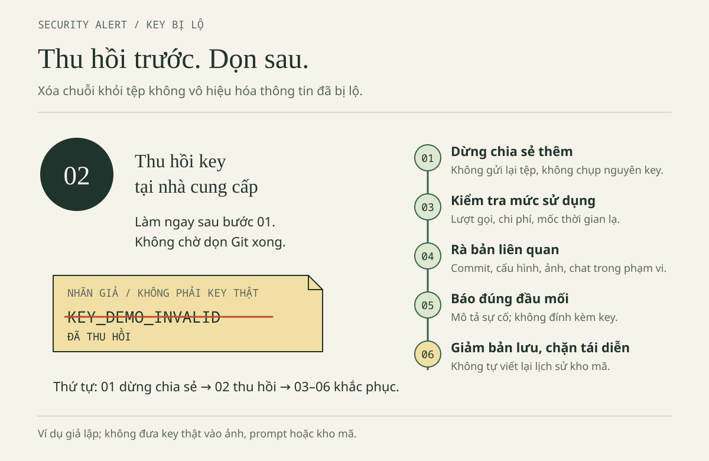

# CHƯƠNG 4 · SỬ DỤNG AI CÓ TRÁCH NHIỆM

Chương 3 đã giúp người học giữ phần học của chính người học khi có AI hỗ trợ: tự dự đoán, tự làm, tự giải thích. Chương 4 đi tiếp một bước: khi sản phẩm đã chạy đúng, người làm ra nó có thật sự làm chủ sản phẩm hay không. Làm chủ không có nghĩa là tự gõ từng ký tự hay tuyệt đối không dùng AI. Đó là biết rõ người học đang dùng công cụ và nguồn nào, được phép dùng trong hoàn cảnh nào, có bằng chứng cho điều đã khẳng định và biết xử lý khi phát hiện sai sót. Đây cũng là nội dung của câu chốt xuyên suốt cuốn sách: **AI hỗ trợ, người học quyết định**. Quyết định bao gồm cả trách nhiệm về hậu quả; vì vậy ranh giới về dữ liệu, bảo mật, bản quyền và liêm chính là điều kiện để người học được tiếp tục dùng AI một cách yên tâm. Một bài tập nhỏ là môi trường an toàn để rèn những thói quen này trước khi sai sót có thể ảnh hưởng đến người khác.

Chương này khép lại phần "dùng AI" của cuốn sách. Sau khi đã hiểu vai trò của AI (Chương 1), biết điều khiển quá trình làm việc (Chương 2), giữ được việc học (Chương 3) và nắm các ranh giới (Chương 4), người học mới đủ cơ sở để chọn công cụ, model và gói dịch vụ ở Chương 5.

Nhân vật, hồ sơ sự cố và hội thoại trong chương là *tình huống hư cấu*. Chương là tài liệu tự học, không phải quy định của Trường Đại học Thủy lợi và không phải tư vấn pháp lý; quyền dùng AI trong bài nộp do từng học phần và giảng viên quyết định.

## Mục tiêu học tập

Sau chương này, người học có thể:

1. Xác định đúng thứ tự xử lý khi một khóa API hoặc bí mật bị lộ: thu hồi trước, dọn các bản lưu sau, báo sự cố bằng mô tả thay vì bằng chính bí mật.
2. Chọn dữ liệu ít nhạy cảm nhất nhưng vẫn đủ để tái hiện vấn đề; phân biệt dữ liệu giả, dữ liệu đã khử nhận dạng và dữ liệu cá nhân.
3. Giới hạn phạm vi giao việc cho Agent, đọc diff và nhận ra dấu hiệu vượt phạm vi, đặc biệt khi số ca kiểm thử giảm.
4. Đánh giá một gói thư viện do AI đề xuất bằng bằng chứng từ registry chính thức trước khi quyết định có thêm phụ thuộc hay không.
5. Phân biệt khai báo với sự cho phép, đặt câu hỏi đúng cho giảng viên và viết khai báo hỗ trợ AI khớp với việc đã làm.
6. Nhận biết giới hạn của việc một kho mã được công khai và của tên giấy phép (MIT, GPL) khi định sử dụng mã của người khác.
7. Giải thích vì sao truy vấn tham số hóa, `textContent` và điều kiện `i < n` là đúng trong ngữ cảnh của chúng, và vì sao một lần chạy thành công không chứng minh tính đúng.

## Tình huống mở đầu

Phiên bản Web của ViSinhVien đã hiển thị đúng tổng **60000**, và Minh định nộp bài ngay. Lan đề nghị kiểm tra ba điều trước khi nộp: nếu giảng viên hỏi một dòng mã từ đâu ra, dữ liệu trong bài là của ai và nhóm đã kiểm tra những gì, thì nhóm có trả lời được hay không. Kết quả 60000 chỉ chứng minh phép cộng đúng với ba khoản mẫu; nó không trả lời được ba câu hỏi đó. Các mục trong chương lần lượt xử lý từng câu hỏi.

## Cấu trúc chương và cách sử dụng

Chương gồm bảy hồ sơ tình huống (Hồ sơ 01 đến Hồ sơ 07, mục 4.1–4.7), một mục phân tích ba lỗi kỹ thuật ở ranh giới dữ liệu (mục 4.8), phần thực hành trước khi nộp (mục 4.9) và các mục tổng kết. Mỗi hồ sơ mở bằng một câu cho biết hồ sơ giúp người học tránh điều gì và kết bằng một nguyên tắc rút ra. Hồ sơ không nhằm gây lo lắng: các sự cố được phân tích để người học hiểu vì sao chúng xảy ra và biết việc cần làm là gì. Mỗi hồ sơ được trình bày theo cùng một khung:

| Phần | Nội dung | Việc của người học |
| --- | --- | --- |
| Tình huống | Dữ kiện của một tình huống hư cấu liên quan đến Minh hoặc Lan | Gạch chân các chi tiết cho thấy có vấn đề |
| Vấn đề cần quyết định | Câu hỏi cần trả lời và các phương án | Chọn **một** phương án và ghi lý do trong một dòng trước khi đọc tiếp |
| Phân tích | Dấu hiệu nhận biết và nguy cơ: ai hoặc điều gì có thể bị ảnh hưởng | Đối chiếu với lý do đã ghi |
| Đáp án | Đánh giá từng phương án, kể cả các phương án sai | Chỉ mở sau khi đã chọn |
| Nguyên tắc rút ra | Một quy tắc ngắn | Áp dụng vào bài tập thật |

Một số hồ sơ có thêm phần mở rộng như quy trình, bảng kiểm hoặc văn bản mẫu, đặt giữa phần Đáp án và phần Nguyên tắc rút ra.

**Bối cảnh chung của các hồ sơ.** ViSinhVien là ứng dụng HTML/JavaScript lưu dữ liệu bằng `localStorage` trong trình duyệt; ứng dụng **không có backend, đăng nhập hay cơ sở dữ liệu máy chủ**. Mỗi khoản chi là một đối tượng `Expense{id,title,amount,category}`. Trường `amount` là số nguyên VND từ 1 đến `1e9`; danh sách có tối đa 500 khoản; danh sách rỗng có tổng bằng 0. Bộ *dữ liệu giả định* chuẩn gồm Cơm trưa 35000, Xe buýt 7000, Vở ghi 18000, tổng **60000 VND**.

Mục 4.8 có thêm ví dụ SQL chạy bằng Python `sqlite3` với cơ sở dữ liệu `:memory:`. Đây là **minh họa riêng**, không phải thành phần của ViSinhVien. Các đoạn mã ngắn trong chương phục vụ việc giải thích; khi thực hành, người học ghi lại kết quả thực sự quan sát được, kể cả kết quả chưa đạt.

**Thứ tự đọc.** Hồ sơ 01 (mục 4.1, khóa bị lộ) được đặt đầu tiên vì xử lý sai thứ tự trong tình huống này gây hậu quả lớn nhất. Khi thời gian hạn chế, nên làm Hồ sơ 01, Hồ sơ 02, Hồ sơ 05 và mục 4.8 trước; các hồ sơ còn lại làm ở buổi sau.

**Chuẩn bị.** Một tờ giấy hoặc tệp `ghi-chep-04.txt` trong thư mục `bai-lam`. Không cần cài đặt, đăng nhập, tạo khóa hay truy cập dịch vụ thật nào. Mọi chuỗi bí mật trong chương là placeholder như `DEMO_KEY_NOT_A_SECRET`, không có quyền truy cập.

## 4.1. Hồ sơ 01 — Khóa API xuất hiện trên GitHub

Hồ sơ này giúp người học tránh một sai lầm rất dễ gặp: tưởng rằng xóa dòng chứa khóa là đã xử lý xong.

### Tình huống

ViSinhVien **không cần API key**. Tuy nhiên, trong một bài tập khác, Minh thử gọi một dịch vụ AI và đặt khóa API trực tiếp trong tệp `config.js`. Tối thứ Sáu, Minh đẩy toàn bộ thư mục lên một kho GitHub công khai để nhờ Lan xem giúp. Sáng hôm sau, Lan phát hiện tệp cấu hình có dòng `API_KEY = ...` và báo lại cho Minh.

Trong chương, khóa chỉ được biểu diễn bằng placeholder `DEMO_KEY_NOT_A_SECRET`. Trong tình huống thật, không chụp lại khóa đầy đủ để làm bằng chứng.

### Vấn đề cần quyết định

Minh nên làm gì **đầu tiên**? Chọn một phương án:

- **A.** Xóa dòng chứa khóa, commit với thông điệp “fix config”, rồi coi như đã xong.
- **B.** Tạo khóa mới, dán vào tệp, để khóa cũ hoạt động thêm vài ngày cho chắc.
- **C.** Dừng chia sẻ thêm, rồi thu hồi hoặc xoay vòng khóa cũ ở nhà cung cấp (hoặc báo ngay cho người có quyền nếu khóa không thuộc tài khoản của Minh).
- **D.** Gửi nguyên khóa vào nhóm chat của lớp để mọi người cùng kiểm tra xem khóa đã bị dùng chưa.
- **E.** Tự viết lại lịch sử Git và ép đẩy (force push) để “xóa sạch”.

### Phân tích

**Dấu hiệu.**

- Một chuỗi có dạng khóa nằm trong tệp đã commit.
- Kho ở chế độ công khai từ tối hôm trước; không xác định được chính xác bao nhiêu người đã xem hoặc clone.
- Minh dự định “xóa dòng đó rồi commit lại là xong”.

**Nguy cơ.** Khóa API cấp quyền sử dụng dịch vụ và có thể phát sinh chi phí dưới tên tài khoản của chủ khóa. Xóa dòng trong tệp **không vô hiệu hóa khóa**: bản cũ vẫn có thể nằm trong lịch sử Git, trong bản clone của người khác, trong bộ nhớ đệm (cache) hoặc trong đoạn chat từng dán. Khóa vẫn còn hiệu lực cho đến khi được thu hồi ở nhà cung cấp.

### Đáp án Hồ sơ 01 — Đánh giá từng phương án

**A — Chưa đủ.** Commit mới chỉ thay đổi phiên bản hiện tại; khóa cũ vẫn hoạt động và vẫn có trong lịch sử. Đây là sai lầm phổ biến nhất vì màn hình trông như đã “sạch”.

**B — Sai thứ tự.** Tạo khóa mới không làm khóa cũ mất hiệu lực; để khóa cũ hoạt động thêm đồng nghĩa với để ngỏ quyền truy cập. Ngoài ra, dán khóa mới vào cùng tệp có thể lặp lại sự cố.

**C — Đúng hướng.** Ưu tiên vô hiệu hóa quyền đã lộ trước khi dọn các bản lưu. Hướng dẫn của GitHub cũng khuyến nghị thu hồi hoặc xoay vòng bí mật trước khi xử lý việc loại bỏ dữ liệu khỏi kho [7]. Nếu khóa thuộc nhóm, trường hoặc nơi thực tập, Minh cần **báo ngay** cho người có quyền thay vì tự tìm cách truy cập tài khoản của người khác.

**D — Không nên.** Gửi khóa vào một kênh khác là tạo thêm một nơi bị lộ. Sự cố cần được báo bằng mô tả, không bằng chính bí mật.

**E — Không tự thực hiện.** Viết lại lịch sử ảnh hưởng đến mọi người đang dùng kho và vẫn không bảo đảm các bản clone hoặc cache biến mất. Việc này cần người quản lý kho quyết định và phối hợp. Chương này **không cung cấp lệnh viết lại lịch sử**.

### Quy trình xử lý sáu bước



1. **Dừng chia sẻ thêm.** Không gửi lại tệp, không chụp nguyên khóa để hỏi nhóm. Nếu người phát hiện là chủ kho, chuyển kho sang chế độ riêng tư (Private) trong phần cài đặt kho. Nếu không phải chủ kho, báo ngay cho chủ kho và không tự xử lý. Không chuyển khóa sang kênh khác để “cất tạm”.
2. **Thu hồi hoặc xoay vòng khóa ở nhà cung cấp.** Dùng chức năng quản lý khóa chính thức nếu khóa thuộc tài khoản của chính người xử lý; nếu không, báo cho người có quyền. **Xác nhận khóa cũ đã bị vô hiệu hóa**: tạo khóa mới nhưng để khóa cũ còn hoạt động là chưa hoàn thành bước này. Việc xác nhận dựa trên **trạng thái “đã thu hồi” hoặc “đã xóa” trong trang quản lý khóa**; **không gọi thử API bằng khóa cũ** để kiểm tra.
3. **Kiểm tra mức sử dụng.** Xem lượt gọi, chi phí và các mốc thời gian bất thường trong trang quản lý tài khoản. “Chưa thấy sử dụng” không chứng minh chưa có ai sao chép khóa. Ghi lại thời điểm phát hiện và phạm vi chia sẻ, không lưu lại bí mật.
4. **Kiểm tra các bản liên quan trong phạm vi được phép**, gồm commit, tệp cấu hình, bản build, ảnh chụp và đoạn chat có liên quan. Không tự truy cập tài khoản hay log của người khác. Khi tìm kiếm, tránh tạo log mới chứa khóa.
5. **Báo đúng đầu mối.** Với bài học, đầu mối là giảng viên hoặc trưởng nhóm; với tài khoản của tổ chức, đó là kênh tiếp nhận sự cố của tổ chức. Nội dung báo gồm thời điểm, dịch vụ, trạng thái thu hồi, phạm vi đã biết và những điểm chưa rõ; **không đính kèm khóa**.
6. **Giảm dữ liệu còn lưu và ngăn tái diễn.** Sau khi đã khống chế quyền truy cập, phối hợp xử lý các bản chứa bí mật theo quy trình phù hợp. Trong tình huống này, kho là **kho cá nhân của Minh**: sau khi khóa đã được thu hồi, Minh hỏi giảng viên trước khi can thiệp vào lịch sử kho và ghi nhận rằng bản clone hoặc cache có thể vẫn còn; đó chính là lý do bước 2 phải làm trước. Đồng thời, thay ví dụ bằng placeholder, loại bỏ nhu cầu dùng khóa thật trong bài và thêm bước rà soát tệp trước khi chia sẻ.

### Mẫu thông báo sự cố

Một thông báo ngắn nhưng đủ thông tin để người nhận có thể hành động:

```text
Em phát hiện lúc [giờ, ngày] một tệp trong [phạm vi chia sẻ] chứa khóa của [dịch vụ].
Em đã dừng chia sẻ. Khóa cũ: [đã thu hồi / đang chờ người có quyền / chưa xác minh].
Thời gian có thể đã lộ: [phạm vi biết được].
Mức sử dụng: [đã kiểm tra gì, kết quả, hoặc chưa kiểm tra].
Nhờ [đầu mối] hướng dẫn xử lý bản đã chia sẻ. Em không đính kèm khóa.
```

Báo sớm không có nghĩa là đã kết luận có tấn công; chưa thấy dấu hiệu lạm dụng cũng không phải lý do để che giấu. Với dữ liệu hoặc hệ thống thật, người có thẩm quyền đánh giá nghĩa vụ thông báo. Không suy ra thời hạn pháp lý từ mẫu này.

### Nguyên tắc rút ra

**Thu hồi trước, dọn sau. Báo sự cố bằng mô tả, không bằng bí mật.** Việc báo sớm và làm đúng thứ tự là cách quyết định của người học trở thành trách nhiệm cụ thể. Sau sự cố, Lan và Minh tìm nguyên nhân khiến tệp thừa lọt vào bản chia sẻ, rồi thêm bước “rà danh sách tệp trước khi đẩy” vào quy trình. Sửa một bước cụ thể trong quy trình có giá trị hơn lời hứa “lần sau cẩn thận”.

**Câu hỏi tự kiểm tra.** Minh đã xóa tệp `config.js` và tạo khóa mới. Việc quan trọng nhất còn thiếu là gì? Trả lời trong một câu, sau đó đối chiếu với bước 2 của quy trình.

## 4.2. Hồ sơ 02 — Dữ liệu cá nhân trong cửa sổ chat

Hồ sơ này giúp người học tránh đưa dữ liệu cá nhân vào cửa sổ chat khi không cần thiết.

### Tình huống

Để nhờ AI tìm lỗi tính tổng, Minh định gửi **ảnh chụp bảng chi tiêu thật** của bản thân trong tháng. Ảnh có tên quán ăn quen, giờ giao dịch, mã sinh viên xen giữa các dòng, số tài khoản ngân hàng bị che một nửa, và góc màn hình còn hiện email sinh viên. Minh cho rằng chỉ cần đổi tên của bản thân thành “Sinh viên A” là dữ liệu đã được ẩn danh.

### Vấn đề cần quyết định

Minh nên gửi gì cho AI để tìm lỗi? Chọn một phương án:

- **A.** Gửi ảnh nguyên bản, với giả định rằng dịch vụ AI không lưu dữ liệu.
- **B.** Đổi tên thành “Sinh viên A”, giữ các cột khác rồi gửi.
- **C.** Tự tạo ba khoản giả 35000, 7000, 18000 cùng đoạn hàm tính tổng, rồi gửi phần đó.
- **D.** Che thông tin bằng một lớp hình chữ nhật trong tệp chỉnh sửa, rồi gửi chính tệp chỉnh sửa gốc.

### Phân tích

**Dấu hiệu.**

- Lỗi cần sửa (bỏ sót khoản cuối) **có thể tái hiện bằng ba khoản giả**; không cần dữ liệu thật.
- Tên đã được đổi nhưng mã sinh viên, giờ, địa điểm và email vẫn còn nguyên.
- Ảnh chụp màn hình chứa nhiều thông tin hơn vùng có lỗi.

**Nguy cơ.** Người biết bối cảnh vẫn có thể nhận ra “Sinh viên A” từ các trường còn lại. Ảnh có thể làm lộ email, tab trình duyệt hoặc đường dẫn chứa tên. Lớp che trong tệp chỉnh sửa có thể bị gỡ. Lịch sử chat có thể giữ lại đoạn đã dán ngay cả khi người dùng đã xóa đoạn đó khỏi mã.

**Phân loại dữ liệu trước khi dán.** Quy tắc thực hành là **chọn dữ liệu ít nhạy cảm nhất nhưng vẫn đủ để tái hiện vấn đề.**

| Nhóm dữ liệu | Cách hiểu khi làm bài | Ví dụ và lựa chọn |
| --- | --- | --- |
| Dữ liệu giả hoặc tổng hợp | Được tạo mới cho mục đích thử nghiệm, không phải hồ sơ thật được sửa sơ qua | 35000, 7000, 18000; địa chỉ liên hệ giả `demo001@example.invalid` |
| Dữ liệu đã khử nhận dạng hoặc ẩn danh | Đã được xử lý để không còn xác định được một người, kể cả khi liên kết với dữ liệu khác | Chỉ gọi là ẩn danh khi đã đánh giá lại khả năng nhận diện; **không mặc định là ẩn danh sau khi bỏ tên** |
| Dữ liệu cá nhân, nhạy cảm hoặc bí mật | Liên quan đến một người, đời sống riêng tư, tài khoản hoặc quyền truy cập | Mã sinh viên, ảnh hồ sơ, lịch sử chi tiêu thật, mật khẩu, khóa API: không đưa vào ví dụ công khai |

Bảng này là công cụ sàng lọc trong học tập, không thay thế việc phân loại pháp lý chi tiết. Khóa API cần được bảo vệ vì cấp quyền truy cập, dù bản thân chuỗi khóa không nhận diện một người. Dữ liệu đã công khai ở nơi khác cũng không đương nhiên phù hợp để thu gom và gửi cho một dịch vụ AI.

### Đáp án Hồ sơ 02 — Đánh giá từng phương án

**A — Không có căn cứ.** Cách một dịch vụ lưu trữ, sử dụng lại hoặc cho phép người xem xét nội dung phụ thuộc vào điều khoản, gói dịch vụ và thiết lập, là những điều Minh chưa kiểm tra. Quan trọng hơn, bài tập không cần dữ liệu thật.

**B — Chưa phải ẩn danh.** Mã sinh viên, giờ, quán quen và email vẫn đủ để người quen nhận ra. Thay tên bằng một mã cố định trong khi vẫn giữ bảng đối chiếu cũng chưa phải là ẩn danh hoàn toàn.

**C — Phương án tốt nhất.** Ba khoản giả vẫn đủ để tái hiện lỗi bỏ sót khoản cuối (kết quả 42000 thay vì 60000). Dữ liệu được tạo mới từ đầu, không liên hệ với bất kỳ ai.

**D — Rủi ro kỹ thuật.** Lớp che có thể bị gỡ khỏi tệp gốc. Nếu thật sự cần dùng ảnh, cần **xuất ảnh phẳng**, chỉ cắt đúng vùng có lỗi, rồi mở lại ảnh đầu ra để kiểm tra.

### Căn cứ pháp lý cần biết

> **Mốc đối chiếu: 29/10/2026.** Thông tin dưới đây *chưa kiểm chứng* lại sau mốc này. Tại mốc đối chiếu, chương tham chiếu Luật Bảo vệ dữ liệu cá nhân số 91/2025/QH15 của Quốc hội và Nghị định số 356/2025/NĐ-CP của Chính phủ, cùng có hiệu lực từ ngày 01/01/2026 [1][2]; theo Điều 42 Nghị định số 356/2025/NĐ-CP, Nghị định số 13/2023/NĐ-CP đã hết hiệu lực. Về sở hữu trí tuệ, chương tham chiếu Văn bản hợp nhất số 67/VBHN-VPQH ngày 23/03/2026 của Văn phòng Quốc hội, thể hiện các sửa đổi theo Luật số 131/2025/QH15 có hiệu lực từ ngày 01/04/2026 [3]. Nội dung này mang tính định hướng học tập, **không phải ý kiến pháp lý**. Trước khi áp dụng cho dữ liệu, hợp đồng hoặc sản phẩm thật, cần mở văn bản gốc và hỏi ý kiến người có thẩm quyền.

Luật Bảo vệ dữ liệu cá nhân có các quy định về khái niệm và khử nhận dạng, nguyên tắc xử lý theo phạm vi và mục đích, sự đồng ý và việc xử lý dữ liệu trong hoạt động AI. Tuy vậy, không nên rút gọn thành “mọi hoạt động xử lý đều phải xin đồng ý”, vì luật có các trường hợp ngoại lệ tại Điều 19 [1]. Ngược lại, người học cũng không nên tự suy diễn rằng bài tập đang làm chắc chắn thuộc trường hợp ngoại lệ. **Khi bài tập không cần dữ liệu thật, dùng dữ liệu giả là cách giảm vấn đề ngay từ khâu thiết kế.**

### Những nơi thông tin dễ bị bỏ sót: ảnh, chat và lịch sử

- **Ảnh:** email ở góc màn hình, đường dẫn chứa tên, tab trình duyệt, khóa hiển thị trong bảng điều khiển.
- **Chat:** đoạn đã dán rồi xóa khỏi mã vẫn có thể còn trong lịch sử hội thoại.
- **Git, bản sao lưu, log, bản xuất dự án:** có thể chứa thông tin nằm ngoài màn hình hiện tại.

Việc kiểm tra không dừng ở tệp đang mở. Với ví dụ cần chuỗi bí mật, dùng `DEMO_KEY_NOT_A_SECRET` và ghi rõ đó là placeholder.

### Nguyên tắc rút ra

**Dữ liệu giả không phải là dữ liệu thật đã đổi tên, mà là dữ liệu được tạo mới.** Trước khi hỏi “gửi cho AI như thế nào?”, cần hỏi “lỗi này cần tối thiểu dữ liệu gì để tái hiện?”.

## 4.3. Hồ sơ 03 — Agent sửa và xóa ngoài phạm vi

Hồ sơ này giúp người học tránh nhận kết quả của Agent chỉ vì màn hình kiểm thử có màu xanh.

### Tình huống

Lan giao cho Agent yêu cầu: “Sửa lỗi tổng tiền trong `bai-lam/nam-2-web`.” Agent báo đã hoàn thành. Khi mở diff, Lan thấy hàm tính tổng đã được sửa, nhưng đồng thời `index.html` bị đổi giao diện, tệp `test_data.cjs` trong bản sao bị xóa hai ca đang thất bại, và Agent đề nghị chạy lệnh cài một gói định dạng mã. Màn hình kiểm thử lúc này toàn màu xanh. Việc xóa ca kiểm thử là chi tiết hư cấu; tệp đi kèm cẩm nang vẫn đủ 34 ca.

### Vấn đề cần quyết định

Lan nên xử lý kết quả của Agent như thế nào? Chọn một phương án:

- **A.** Chấp nhận toàn bộ vì kiểm thử đã đạt.
- **B.** Dừng Agent, quay về checkpoint đã tạo trước khi giao việc (Bài thực hành 06, mục 2.6), rồi chỉ áp dụng lại phần sửa hàm tính tổng sau khi đã đọc và hiểu diff của phần đó.
- **C.** Yêu cầu Agent “khôi phục lại như cũ” mà không kiểm tra nó khôi phục những gì.
- **D.** Giữ các thay đổi, chỉ tự gõ lại hai ca kiểm thử đã bị xóa theo trí nhớ.

### Phân tích

**Dấu hiệu.**

- Diff chạm vào các tệp nằm ngoài mục tiêu.
- Số ca kiểm thử **giảm** đúng bằng số ca đang thất bại.
- Có lệnh cài đặt không được yêu cầu.
- Báo cáo “đã xong” không nêu ca kiểm thử nào bị xóa.

**Nguy cơ.** Kiểm thử đạt vì các ca khó bị xóa là bằng chứng giả. Thay đổi giao diện không được yêu cầu làm việc review khó hơn. Gói lạ có thể mang rủi ro chuỗi cung ứng (xem Hồ sơ 04, mục 4.4). Nhận toàn bộ thay đổi đồng nghĩa với việc Lan nhận trách nhiệm cho cả những phần chưa đọc.

Tùy công cụ, chế độ và thiết lập, một Agent có thể đọc nhiều tệp, gọi lệnh và gửi nội dung tới dịch vụ bên ngoài. Không nên mặc định rằng dữ liệu “nằm trên máy” thì không thể đi vào ngữ cảnh được gửi ra ngoài. Câu prompt “chỉ sửa tệp X” là một **yêu cầu**, không phải hàng rào kỹ thuật; quyền thực tế nằm ở thiết lập và các hộp xác nhận mà người dùng đã đồng ý.

### Đáp án Hồ sơ 03 — Đánh giá từng phương án

**A — Sai.** Kiểm thử đạt sau khi xóa các ca thất bại không chứng minh hàm đúng. Phần thay đổi hữu ích không hợp thức hóa phần nằm ngoài phạm vi.

**B — Đúng.** Checkpoint là đường quay lại đã được chuẩn bị trước. Sau khi quay về, Lan so sánh với diff, giữ đúng một thay đổi được giao và chạy lại **đầy đủ** bộ kiểm thử gốc (34 ca cho bản Web tham khảo). Nhật ký làm việc cần ghi lại rằng lượt chạy Agent đầu tiên đã vượt phạm vi; không xóa lượt đó để hồ sơ trông gọn đẹp.

**C — Khôi phục mù.** Phương án này lại giao quyền cho chính công cụ vừa vượt phạm vi mà không có bằng chứng về trạng thái sau khi khôi phục. Nếu không có checkpoint, cần dừng lại, giữ nguyên hiện trạng và đối chiếu từng tệp với bản `vi-du` chỉ đọc.

**D — Chưa ổn.** Ca kiểm thử gõ lại theo trí nhớ có thể khác ca gốc. Thay đổi giao diện và đề nghị cài gói vẫn còn nguyên.

### Hợp đồng giao việc cần có trước khi chạy Agent

```text
Phạm vi: chỉ sửa hàm tính tổng trong bai-lam/nam-2-web/data.js.
Không sửa, xóa hoặc đổi tên tệp khác. Không xóa hoặc sửa ca test.
Không cài gói, đổi cấu hình, commit, đẩy mã hay truy cập mạng.
Trước khi sửa: nêu giả thuyết, dòng dự kiến đổi, ca test sẽ chạy.
Sau khi sửa: báo diff, số ca chạy, số ca đạt/không đạt, phần chưa kiểm.
Nếu bị chặn hoặc cần quyền mới: dừng và hỏi, không tìm đường vòng.
```

### Nguyên tắc rút ra

**Tạo checkpoint trước, đọc diff sau, nhận thay đổi từng phần.** Số ca kiểm thử phải giữ nguyên hoặc tăng; khi thấy số ca giảm, cần dừng lại và hỏi “ca nào đã biến mất và vì sao?”.

## 4.4. Hồ sơ 04 — Gói thư viện do AI đề xuất

Hồ sơ này giúp người học tránh cài một gói thư viện chỉ vì AI đề xuất với giọng chắc chắn.

### Tình huống

Minh hỏi AI cách định dạng số tiền cho dễ đọc. AI trả lời với giọng chắc chắn, đưa ra lệnh cài một gói có tên rất giống một thư viện quen thuộc, kèm lời khẳng định “chạy lệnh này là xong”. Minh chưa từng nghe tên gói này.

### Vấn đề cần quyết định

Minh nên làm gì với lệnh cài đặt được đề xuất? Chọn một phương án:

- **A.** Chạy lệnh ngay, vì AI đã gợi ý thì hẳn là ổn.
- **B.** Hỏi AI “gói này có an toàn không?” rồi làm theo câu trả lời.
- **C.** Kiểm tra xem bài có thật sự cần thêm phụ thuộc hay không. Nếu cần, đối chiếu tên, phiên bản, người duy trì, kho nguồn, giấy phép, dấu hiệu bảo trì và cảnh báo bảo mật trên registry chính thức; **không cài gói trong bài này**.
- **D.** Cài vào một thư mục tạm “để thử”, sau đó xóa.

### Phân tích

**Dấu hiệu.**

- Tên gói gần giống một thư viện phổ biến nhưng khác vài ký tự, là dấu hiệu của kỹ thuật đặt tên gần giống để đánh lừa người cài (tiếng Anh: *typosquatting*).
- Câu trả lời không dẫn tới registry chính thức, không nêu người duy trì hay kho nguồn.
- Lệnh cài đặt tải mã từ mạng rồi chạy ngay.
- Bài hiện tại **không cần thêm phụ thuộc** để định dạng tiền; API có sẵn của trình duyệt đã đáp ứng được.

**Nguy cơ.** Gói không tồn tại, gói bị đặt tên nhầm hoặc gói độc hại có thể chạy script ngay khi cài đặt. Script cài đặt có thể đọc biến môi trường, tệp cấu hình và khóa. Lockfile giúp cố định phiên bản nhưng **không biến một gói độc hại thành đáng tin** [6].

### Đáp án Hồ sơ 04 — Đánh giá từng phương án

**A — Sai.** Sự tự tin không phải là bằng chứng. Tên gói do mô hình sinh ra có thể không tồn tại hoặc đã bị nhắm tới để đánh lừa người dùng.

**B — Lập luận vòng tròn.** Cùng một nguồn vừa đề xuất vừa tự chứng nhận. Bằng chứng phải đến từ registry và kho nguồn, không phải từ lời khẳng định.

**C — Đúng.** Câu hỏi đầu tiên luôn là “bài có cần thêm phụ thuộc không?”. Với một ứng dụng HTML/JavaScript nhỏ, câu trả lời thường là không. Hoạt động trong chương chỉ dừng ở việc **lập bảng kiểm chứng, không thực hiện cài gói**. Nếu chưa xác minh được, cần bỏ đề xuất và dùng giải pháp đã hiểu rõ.

**D — Vẫn là chạy mã.** Cài “để thử” vẫn thực thi script trên máy. Xóa thư mục sau đó không hoàn tác được những gì script đã làm.

### Bảng kiểm chứng gói thư viện

Bảng dưới đây để trống và chỉ được điền khi bài thật sự cần thêm phụ thuộc.

| Câu hỏi | Bằng chứng cần có | Đã kiểm? |
| --- | --- | --- |
| Tên gói chính xác? | Trang gói trên registry chính thức của hệ sinh thái | |
| Phiên bản dự định dùng? | Số phiên bản, ngày phát hành | |
| Ai duy trì? | Tài khoản nhà phát hành, lịch sử phát hành | |
| Kho nguồn? | Liên kết kho mã, khớp với registry | |
| Giấy phép? | Tệp giấy phép của gói | |
| Có script cài đặt không? | Nội dung trường script trong manifest | |
| Có cảnh báo bảo mật? | Trang tư vấn bảo mật của hệ sinh thái | |
| Có phụ thuộc bắc cầu lạ? | Danh sách phụ thuộc, lockfile | |

Không tự tạo URL registry để điền cho đủ cột. Một cột để trống trung thực có giá trị hơn một dòng “đã kiểm” không có căn cứ.

### Nguyên tắc rút ra

**Không cài gói chỉ để tỏ ra chủ động.** Mỗi phụ thuộc được thêm vào là thêm một bên mà dự án phải tin tưởng; cần chắc chắn rằng phụ thuộc đó thật sự cần thiết.

## 4.5. Hồ sơ 05 — Bài tập hoàn toàn do AI làm

Hồ sơ này giúp người học tránh nhầm giữa "được tham khảo" và "được để AI làm thay", cũng như tránh khai báo không khớp với việc đã làm.

### Tình huống

Đề bài ViSinhVien ghi: “Được tham khảo tài liệu”, không nhắc đến AI. Minh dán toàn bộ đề vào cửa sổ chat và nhận về đầy đủ `index.html`, `data.js`, `app.js` cùng một bài giải thích. Minh sửa vài chỗ, chương trình chạy được, và Minh định ghi trong phần khai báo: “Có tham khảo ý tưởng từ AI.”

### Vấn đề cần quyết định

Minh nên xử lý bài làm và phần khai báo như thế nào? Chọn một phương án:

- **A.** Nộp nguyên bài, khai báo “có tham khảo ý tưởng”.
- **B.** Hỏi giảng viên bằng một tin nhắn mô tả **đúng việc đã làm**; trong lúc chờ, tiếp tục phần chắc chắn được phép và không mặc định rằng im lặng là đồng ý.
- **C.** Xóa hết, tự viết lại từ đầu theo trí nhớ về mã do AI sinh ra.
- **D.** Không khai báo, vì “ai cũng dùng”.

### Phân tích

**Dấu hiệu.**

- Đề không nói rõ về AI; “tham khảo tài liệu” **không đồng nghĩa** với “được để AI viết hộ”.
- Toàn bộ chức năng chính do AI sinh ra.
- Lời khai báo thể hiện mức hỗ trợ thấp hơn thực tế.
- Minh không giải thích được vì sao bước kiểm tra `amount` được đặt ở vị trí đó.

**Nguy cơ.** Đây là vấn đề **học thuật**, và cách xử lý phụ thuộc vào yêu cầu của học phần; chương này không thay thế quy định của Trường. Có ba hậu quả có thể xảy ra: người học mất phần luyện tập mà môn học nhắm tới; khai báo sai làm mất tính trung thực; người học không bảo vệ được bài khi được hỏi.

### Đáp án Hồ sơ 05 — Đánh giá từng phương án

**A — Khai báo không khớp.** Nếu AI sinh toàn bộ hàm, khai báo phải ghi rõ AI đã sinh bản nháp của hàm, không được đổi thành “chỉ tham khảo ý tưởng”. Khai báo không thay thế sự cho phép.

**B — Đúng hướng.** Tin nhắn cần mô tả hành động cụ thể để giảng viên có thể trả lời:

```text
Thưa thầy/cô, với bài ViSinhVien, em dự định tự viết phần thêm khoản chi và tính tổng.
Em muốn dùng AI để giải thích lỗi JavaScript và gợi ý ca kiểm thử cho amount,
sau đó tự sửa và chạy kiểm tra. Em không định gửi dữ liệu thật hoặc nhờ AI làm toàn bộ bài.
Phạm vi này có được phép không ạ? Nếu được, nhóm cần khai báo ở đâu và giữ bằng chứng nào?
Nếu không, em sẽ dùng tài liệu môn học theo hướng dẫn.
```

**C — Trung thực nhưng lãng phí.** Viết lại theo trí nhớ vẫn là tái tạo sản phẩm do công cụ làm ra, và người học vẫn có thể bỏ lỡ phần cần học. Cách làm đúng là hỏi về phạm vi, sau đó **tự làm lại phần cốt lõi trên cơ sở hiểu rõ**.

**D — Không nên.** Những lý do như “các sinh viên khác cũng dùng” hay “chỉ dùng bản miễn phí nên không tính” đều không phải căn cứ học thuật. Không khai báo là làm sai lệch thông tin về đóng góp.

### Bảng phân loại tình trạng cho phép

Bảng dưới đây **không phải quy định của Trường**; bảng giúp đặt câu hỏi đúng, không dùng để tự cho phép.

| Tình trạng | Ví dụ trong bài ViSinhVien | Việc cần làm |
| --- | --- | --- |
| Đã được cho phép | Đề ghi được dùng AI gợi ý ca kiểm thử, phải khai báo | Dùng đúng phần được phép, lưu lại phần hỗ trợ và tự kiểm tra |
| Đã bị cấm | Bài kiểm tra yêu cầu tự viết, không dùng công cụ sinh mã | Không nhờ AI tạo lời giải hay sửa mã trong thời gian làm bài |
| Chưa rõ | Đề cho tham khảo tài liệu nhưng không nói về AI | Hỏi giảng viên trước; không biến giả định thành sự cho phép |
| Có điều kiện | Được hỗ trợ giải thích nhưng không được sinh toàn bộ chức năng | Tách câu hỏi giải thích khỏi yêu cầu viết hộ |

Với bài nhóm, cả nhóm cần biết phạm vi được phép: một thành viên đưa mã do AI sinh vào nhánh chung có thể ảnh hưởng đến bản nộp của tất cả thành viên.

### Nguyên tắc rút ra

**Khai báo là mô tả, không phải xin phép.** Hỏi về phạm vi trước; khai báo sau, đúng với việc đã làm.

## 4.6. Hồ sơ 06 — Đoạn mã không rõ giấy phép

Hồ sơ này giúp người học tránh dùng mã của người khác khi chưa rõ quyền sử dụng.

### Tình huống

Minh tìm thấy một giao diện đẹp trên GitHub. Vì trang kho mở được mà không cần đăng nhập, Minh định chép một tệp vào ViSinhVien. Kho này **không có tệp LICENSE**.

### Vấn đề cần quyết định

Minh có nên dùng tệp này không, và nếu không thì nên làm gì? Chọn một phương án:

- **A.** Chép vì kho công khai, và ghi nguồn ở cuối bài.
- **B.** Tự viết lại một bảng khoản chi đơn giản mà Minh hiểu rõ; bỏ phần giao diện chưa rõ quyền.
- **C.** Đổi tên biến và màu sắc để “không ai nhận ra”.
- **D.** Nhờ AI viết lại giao diện đó từ ảnh chụp màn hình.

### Phân tích

**Dấu hiệu.**

- Kho không có giấy phép, hoặc chỉ có tên giấy phép mà người dùng chưa đọc điều kiện.
- Mã có giấy phép nhưng ảnh và phông chữ đi kèm có điều kiện khác.
- Minh cho rằng “ghi nguồn là đủ”.

**Nguy cơ.** Việc một kho được công khai **không** tự động trao quyền sao chép, phân phối hay tạo tác phẩm phái sinh [8]. Ghi nguồn là yêu cầu học thuật; ghi nguồn không thay thế quyền sử dụng. Sản phẩm chứa đoạn mã không rõ quyền có thể phải gỡ bỏ hoặc gây tranh chấp khi công bố.

### Đáp án Hồ sơ 06 — Đánh giá từng phương án

**A — Không đủ.** Không có giấy phép nghĩa là không có cơ sở để coi mã là được tự do sao chép. Đường dẫn nguồn không tạo ra quyền sử dụng.

**B — Đúng trong bối cảnh bài này.** Sản phẩm kém bóng bẩy hơn nhưng nhóm biết nguồn gốc của từng phần. Đây là cách loại bỏ một vấn đề không cần thiết, không phải thái độ phòng thủ đến mức không dám học hỏi từ người khác.

**C — Vẫn là sao chép.** Thay tên biến hay màu sắc không xóa bỏ nghĩa vụ và không thay đổi bản chất của việc sử dụng tác phẩm của người khác.

**D — Chưa chắc không có vấn đề.** Đầu ra có thể gần giống thiết kế gốc; nhãn “do AI tạo” không tự chứng minh nguồn gốc hay quyền sở hữu độc quyền. Cần kiểm tra nguồn nếu công cụ có dẫn nguồn, và kiểm tra điều khoản của công cụ đang sử dụng.

### Đọc tên giấy phép là chưa đủ

| Tình huống | Điều cần hiểu | Hành động thực tế |
| --- | --- | --- |
| Mã mang giấy phép MIT | Có quyền sử dụng rộng, nhưng phải giữ thông báo bản quyền và giấy phép theo điều kiện của MIT | Giữ nội dung cần thiết khi sao chép; lưu nguồn và phiên bản |
| Mã mang giấy phép GPL | **Không** phải giấy phép “cấm thương mại”; nghĩa vụ phụ thuộc phiên bản, việc chuyển giao và quan hệ với tác phẩm phái sinh | Đọc đúng phiên bản GPL được áp dụng; hỏi người có chuyên môn nếu chưa xác định được nghĩa vụ |
| Kho không có giấy phép rõ ràng | Không có cơ sở để coi là được tự do sao chép | Không đưa vào bản nộp chỉ bằng cách thêm đường dẫn |
| AI đưa ra một đoạn mã | Nhãn “do AI tạo” không tự chứng minh nguồn gốc hay quyền sử dụng | Kiểm tra nguồn nếu có, điều khoản công cụ và dấu hiệu sao chép; thay thế phần chưa rõ quyền |

Với MIT, ghi nguồn theo yêu cầu học thuật và giữ thông báo giấy phép là hai việc khác nhau. Với GPL, không kết luận chỉ dựa vào số dòng đã chép, cũng không khẳng định “thấy GPL là không được dùng”. Cần xét văn bản giấy phép cụ thể; chương này không quyết định tính tương thích giấy phép cho sản phẩm thật.

Về pháp luật Việt Nam, chương tham chiếu Điều 22 và khoản 3 Điều 25 của Văn bản hợp nhất Luật Sở hữu trí tuệ [3] (mốc đối chiếu và lưu ý kiểm chứng nêu tại Hồ sơ 02, mục 4.2): chương trình máy tính được bảo hộ, và lý do “sao chép để học” không tự động là ngoại lệ cho mọi trường hợp. Điều này không cấm học từ tài liệu; nó nhắc người học kiểm tra quyền trước khi đưa mã của người khác vào bài nộp hoặc sản phẩm được phân phối.

### Thẻ nguồn: điền ngay khi chọn tài nguyên

| Thành phần định dùng | Nguồn và phiên bản | Giấy phép và việc phải giữ | Quyết định |
| --- | --- | --- | --- |
| Ví dụ: đoạn CSS bố cục | URL cụ thể đã mở, ngày xem | Tên giấy phép, tệp LICENSE, điều kiện giữ thông báo | Dùng có điều kiện, hỏi thêm hoặc không dùng |

Cần dẫn đúng phiên bản đã dùng, không chỉ trang chủ. Cần phân biệt **tham khảo ý tưởng thuật toán** với **sao chép cách biểu đạt cụ thể**. Khi chưa rõ, khai báo nguồn và hỏi người chấm; không đổi vài chữ để che dấu vết.

### Nguyên tắc rút ra

**Công khai không phải là giấy phép.** Một sản phẩm đơn giản mà người làm hiểu rõ có giá trị hơn một giao diện đẹp không rõ nguồn gốc.

## 4.7. Hồ sơ 07 — Khai báo thiếu và ba tầng trách nhiệm

Hồ sơ này giúp người học tránh một khai báo quá chung chung và hiểu ai chịu trách nhiệm ở mỗi tầng khi nộp bài có AI hỗ trợ.

### Tình huống

Bài nộp của nhóm ghi: “Có sử dụng AI để tham khảo.” Thực tế, AI đã sinh bản nháp hàm `parseAmount` và gợi ý bảy ca kiểm thử; Lan chép một đoạn CSS từ một kho không rõ giấy phép. Minh không chạy kiểm thử trên máy mà chỉ đọc mã. Khi giảng viên hỏi “phần này em kiểm chứng thế nào?”, cả hai không trả lời được.

### Vấn đề cần quyết định

Nhóm cần sửa khai báo và bài nộp như thế nào? Chọn một phương án:

- **A.** Giữ câu khai báo chung chung; nộp kèm toàn bộ lịch sử chat để “đầy đủ”.
- **B.** Viết lại khai báo theo đúng việc đã làm: công cụ, thời điểm, phần được sinh, phần nhóm sửa, những gì đã chạy và chưa chạy, nguồn của đoạn CSS. **Loại bỏ hoặc thay thế đoạn CSS chưa rõ quyền** rồi ghi rõ phần đã loại, không giữ lại chỉ vì đã ghi nguồn. Bổ sung phần còn thiếu nếu còn thời gian; nếu không, ghi đúng trạng thái.
- **C.** Ghi “tự làm 100%” vì nhóm đã gõ lại vài dòng.
- **D.** Bỏ đoạn CSS khỏi bài nhưng không nhắc đến trong khai báo.

### Phân tích

**Dấu hiệu.**

- Một câu khai báo chung chung, không phân biệt phần AI gợi ý, phần AI sinh nội dung và phần nhóm sửa.
- Không nêu đã chạy gì và trên phiên bản nào.
- Ghi “đã xác minh” trong khi chỉ đọc mã.
- Không nhắc đến nguồn của đoạn CSS.

**Nguy cơ.** Người chấm không đánh giá được đóng góp thật. Khi bị hỏi trực tiếp, nhóm không giải thích được; đó là dấu hiệu mất phần học, không chỉ là lỗi trình bày. Về lâu dài, thói quen khai báo cao hơn thực tế sẽ theo người học sang báo cáo thực tập và công việc.

### Đáp án Hồ sơ 07 — Đánh giá từng phương án

**A — Quá tải và rủi ro.** Một câu chung chung không đủ thông tin, còn việc nộp toàn bộ lịch sử chat có thể kéo theo dữ liệu riêng tư không cần thiết. Khai báo cần mô tả đủ để giảng viên đánh giá, theo hình thức giảng viên yêu cầu.

**B — Đúng.** Một khai báo tốt phân biệt rõ: AI gợi ý gì, sinh nội dung nào, nhóm thay đổi gì và đã kiểm chứng đến đâu. Đoạn CSS chưa rõ quyền phải được **loại khỏi bài**, không chỉ ghi nguồn: thêm dòng ghi nguồn không biến mã không rõ giấy phép thành mã được phép dùng. Nếu mới đọc mã mà chưa chạy, cần ghi “đã rà soát bằng đọc mã; chưa chạy kiểm thử”, không ghi “đã xác minh”. Nhóm có thể bổ sung bằng chứng chạy kiểm thử ngay trên **bản sao của nhóm**: từ thư mục gốc `AI-Student-Handbook`, chạy `node "bai-lam/nam-2-web/test_data.cjs"`, chép nguyên dòng tổng kết cuối cùng và exit code (Bash: `echo $?`; PowerShell: `$LASTEXITCODE`; chạy ngay sau lệnh, xem [Chương 2](chapter-02.md)), đồng thời ghi rõ máy và phiên bản Node đã dùng. Với bản demo tham khảo chưa sửa, dòng cuối là `34 passed, 0 failed`; bản của nhóm có thể cho kết quả khác nếu mã đã thay đổi, và khi đó phải ghi đúng con số thực tế.

**C — Sai.** Gõ lại vài dòng không biến phần được sinh hàng loạt thành phần tự làm. Tính trung thực nằm ở mức độ khớp giữa lời khai và hành động.

**D — Che giấu một phần.** Loại bỏ đoạn không rõ quyền là đúng, nhưng vẫn cần nêu rõ phần đã loại và lý do nếu hình thức khai báo yêu cầu.

### Gửi khai báo bổ sung khi bài đã nộp

Nếu đến khi bài **đã nộp** nhóm mới phát hiện khai báo còn thiếu, nhóm nên chủ động gửi một tin nhắn ngắn cho giảng viên thay vì chờ bị hỏi:

```text
Thưa thầy/cô, bài [môn, mã bài] nhóm em đã nộp ngày [ngày].
Khai báo AI trong bài còn thiếu: [AI sinh nháp parseAmount, gợi ý 7 ca test].
Bảy ca gợi ý là ca riêng, không nằm trong 34 ca của bộ tham khảo.
Nhóm đã [chạy 34 ca / mới đọc mã], và đã [loại đoạn CSS chưa rõ quyền].
Em gửi khai báo sửa lại đính kèm. Nhóm em sẵn sàng giải thích phần đã làm.
```

Bảy ca kiểm thử do AI gợi ý là ca riêng, không thuộc 34 ca của bộ tham khảo; không cộng gộp hai con số này khi báo cáo.

### Ba tầng trách nhiệm

Minh đặt câu hỏi: nếu AI viết sai thì người nộp bài có phải chịu toàn bộ trách nhiệm không? Để trả lời, cần tách ba tầng trách nhiệm, với mục tiêu không đổ lỗi cho công cụ nhưng cũng không nhận bừa mọi lỗi.

| Tầng | Câu hỏi cần trả lời | Nhóm kiểm soát được | Không nên khẳng định |
| --- | --- | --- | --- |
| Học thuật | Bài có đúng yêu cầu môn học không; đóng góp và khai báo có trung thực không? | Hỏi phạm vi dùng AI, giải thích mã, ghi nguồn, ghi kết quả thật | Mọi việc dùng AI đều là đạo văn; hoặc khai báo thì chắc chắn được chấp nhận |
| Nghề nghiệp | Sản phẩm có được rà soát đúng vai trò và cảnh báo đúng giới hạn không? | Kiểm tra dữ liệu, báo lỗi, yêu cầu người phù hợp duyệt thay đổi | Có AI hỗ trợ thì người làm không còn trách nhiệm; hoặc một người luôn gánh mọi lỗi của nhóm |
| Pháp lý | Có vấn đề về dữ liệu, quyền tác giả, hợp đồng hay quyền truy cập cần xem xét không? | Ngừng hành vi có vấn đề, giữ thông tin cần thiết, báo đầu mối có thẩm quyền | Tự kết luận có tội, mức phạt hay bồi thường từ một ví dụ trong lớp |

Không có một câu “chịu 100% trách nhiệm pháp lý” áp dụng cho mọi sinh viên và mọi đầu ra của AI. Người nộp bài phải giải thích được việc đã làm và mức độ kiểm tra; kết luận về kỷ luật hay pháp lý phụ thuộc vào quy định, vai trò và tình tiết cụ thể.

### Chia vai mà không tạo khoảng trống

Minh phụ trách phần nhập và tính tổng; Lan rà soát phần hiển thị và nguồn; cả hai cùng xem lại bản nộp. Câu **“Lan đã xem” phải nói rõ đã xem gì**: xem diff, đọc hàm hay chạy ứng dụng. Với `textContent`, bằng chứng là diff và việc quan sát thấy chuỗi `<b>Vở</b>` hiển thị nguyên văn. Với giới hạn 500 khoản, phải thử đúng tại giới hạn đó; ảnh chụp tổng 60000 không chứng minh được điều này.

### Diễn đạt mức chắc chắn bằng ngôn ngữ kiểm chứng

| Cách nói cần tránh | Cách nói có thể kiểm chứng |
| --- | --- |
| “An toàn tuyệt đối” | “Đã sửa chỗ hiển thị; ca `<b>Vở</b>` đạt, ca giới hạn 501 khoản chưa chạy” |
| “Không có dữ liệu nhạy cảm” | “Đã rà các tệp X, Y và hai ảnh Z; không thấy email hay khóa thật” |
| “AI bảo là MIT” | “Đã mở tệp LICENSE trong kho, ghi lại tên và phiên bản” |
| “Đã test xong” | “Chạy bộ test trên bản sao bằng Node [phiên bản đã dùng]; [số] đạt, [số] không đạt; chưa thử trên trình duyệt khác” |

Nêu giới hạn giúp người đọc đối chiếu, nhưng không được dùng để che đi việc cốt lõi chưa làm. Khi phát hiện lỗi, cần ghi tác động và cách khắc phục; không âm thầm sửa kết quả cũ.

### Mẫu khai báo AI

Mẫu dưới đây chỉ được điền bằng thông tin đúng với thực tế.

```text
Bài/nhóm: ViSinhVien — [thành viên và vai trò].
Phạm vi được phép: [hướng dẫn của bài hoặc phản hồi giảng viên; nếu chưa rõ, ghi đang chờ].
Công cụ và thời điểm: [tên, phiên bản nếu biết, ngày dùng].
Hỗ trợ thực tế: [giải thích, gợi ý, sinh nháp phần nào; tệp/hàm liên quan].
Đóng góp của nhóm: [ai viết lại gì, lựa chọn nào được giữ hoặc bỏ và lý do].
Dữ liệu đã cung cấp: [bộ dữ liệu giả, đoạn mã cần thiết; không dán bí mật].
Nguồn và giấy phép: [nguồn thật đã dùng, điều kiện cần giữ, phần đã loại vì chưa rõ].
Kiểm chứng: [đã chạy gì, trên bản nào, kết quả; phần chỉ đọc mã; phần chưa xác minh].
Giới hạn: HTML/JavaScript dùng localStorage, không backend/đăng nhập; chỉ phục vụ học tập
với dữ liệu giả. SQL là minh họa Python sqlite3 riêng trong :memory:.
```

Ví dụ điền mẫu cho tình huống của Hồ sơ 07. Đây là **ví dụ minh họa, không phải lời khai để sao chép**:

```text
Bài/nhóm: ViSinhVien — Minh (nhập, tính tổng), Lan (hiển thị, nguồn).
Phạm vi được phép: theo hướng dẫn học phần; đang chờ xác nhận cho phần sinh mã.
Công cụ và thời điểm: trợ lý AI qua chat, dùng ngày [ngày].
Hỗ trợ thực tế: sinh bản nháp parseAmount trong data.js; gợi ý bảy ca test;
  không sinh phần render hay handler submit.
Đóng góp của nhóm: viết lại parseAmount để từ chối hậu tố; giữ totalExpenses;
  bỏ đoạn CSS nghi không rõ giấy phép.
Dữ liệu đã cung cấp: ba khoản giả 35000, 7000, 18000; không dán dữ liệu thật.
Nguồn và giấy phép: không còn mã ngoài; CSS chưa rõ quyền đã loại khỏi bài.
Kiểm chứng: chạy node bai-lam/nam-2-web/test_data.cjs trên bản sao của nhóm
  (Node [phiên bản]) — [chép nguyên dòng tổng kết, ví dụ 34 passed, 0 failed];
  phần hiển thị mới đọc mã, chưa thử trên trình duyệt khác.
Giới hạn: localStorage, không backend, dữ liệu giả; SQL chỉ là minh họa riêng.
```

### Nguyên tắc rút ra

**Khai báo tốt là bản đồ đóng góp, không phải lời xin lỗi hay lời tự khen.** AI hỗ trợ, người học quyết định, và người quyết định là người giải thích được việc đã làm. Khai báo được viết để người khác kiểm tra lại được, không phải để bài trông đẹp hơn.

## 4.8. Ba lỗi kỹ thuật ở ranh giới dữ liệu: SQL, XSS và C++

Ba lỗi trong mục này có chung một gốc: người viết mã không nắm rõ **hợp đồng ở ranh giới**, tức các điều kiện mà dữ liệu phải thỏa mãn khi đi qua một lớp của chương trình, và tin vào một lần chạy may mắn. Không cần thử chuỗi phá hoại để hiểu bất kỳ lỗi nào trong số này.

### 4.8.1. SQL: giá trị là dữ liệu, không phải cấu trúc câu lệnh

**Phạm vi ví dụ.** SQL trong mục này chạy riêng bằng Python `sqlite3` với `:memory:`; ViSinhVien không gửi SQL và không có backend. Tệp minh họa là `vi-du/minh-hoa-sqlite.py`. Không đưa minh họa này vào sơ đồ kiến trúc của ứng dụng Web.

Giả sử bảng minh họa có các cột `id`, `title`, `amount`, `category`. Lan cần tìm một khoản có tên thử là `Vở O'Reilly`. Dấu nháy trong tên là dữ liệu bình thường, nhưng cách nối chuỗi dưới đây đưa nó vào cú pháp SQL:

```python
# Mẫu KHÔNG nên dùng; chỉ đọc để nhận diện vấn đề.
query = "SELECT title,amount FROM expenses WHERE title = '" + title + "'"
```

Với tên có dấu nháy, câu lệnh có thể sai cú pháp. Nghiêm trọng hơn, việc nối trực tiếp dữ liệu không tin cậy vào câu lệnh có thể cho phép dữ liệu **làm thay đổi ý nghĩa của câu SQL**; đây là gốc của lỗi chèn mã SQL (tiếng Anh: *SQL injection*). Chỉ một tên hợp lệ cũng đủ cho thấy chương trình đang trộn lẫn hai vai trò: dữ liệu và mã lệnh.

Cách viết đúng trong ngữ cảnh Python `sqlite3`:

```python
# Rút gọn từ vi-du/minh-hoa-sqlite.py; ở đó biến kết nối tên là connection,
# tạo bằng sqlite3.connect(":memory:").
rows = connection.execute(
    'SELECT title, amount FROM expenses WHERE title = ?',
    (title,)
).fetchall()
```

Dấu `?` là vị trí giữ chỗ cho giá trị được gắn riêng. `(title,)` là tuple một phần tử: **dấu phẩy tạo ra tuple**, còn `(title)` chỉ là một biểu thức trong ngoặc. Thiếu dấu phẩy sẽ làm sai cấu trúc đối số. Trình điều khiển cơ sở dữ liệu tách giá trị khỏi cấu trúc SQL, nên dấu nháy trong `Vở O'Reilly` không cần được xử lý bằng các mẹo ghép chuỗi.

OWASP khuyến nghị ưu tiên truy vấn tham số hóa cho tình huống này [4]. Tuy vậy, **tham số giá trị không thể thay thế tùy ý tên bảng, tên cột hay từ khóa sắp xếp**. Nếu chương trình cho phép chọn cách sắp xếp, cần ánh xạ lựa chọn của người dùng sang một tập tên cột định sẵn; đó là trường hợp cần danh sách cho phép (allowlist) cho phần cấu trúc.

Chạy minh họa từ thư mục gốc của dự án:

```bash
python "vi-du/minh-hoa-sqlite.py"
```

Nếu lệnh `python` không chạy, thử `py` trên Windows hoặc `python3` trên macOS và Linux; trên Windows, gõ `python` khi chưa cài Python có thể mở Microsoft Store thay vì chạy chương trình. Nếu không có Python, ghi “chưa chạy, thiếu Python” và đọc tiếp phần giải thích; đây là minh họa khái niệm, không phải điều kiện để hoàn thành chương.

Dòng đáng chú ý nhất trong kết quả là `Tra cuu tham so: [("Vở O'Reilly", 12000)]`: dấu nháy đi qua truy vấn như dữ liệu bình thường. Các dòng `PASS reject amount` cho thấy ràng buộc của bảng từ chối số âm, số 0, số thập phân và số vượt `1e9`.

Khi ghi chép, cần ghi rõ đây là **fixture SQL riêng**; không thêm dữ liệu này vào bộ ba khoản chuẩn rồi vẫn tuyên bố tổng 60000. Truy vấn tham số hóa cũng không tự giải quyết vấn đề phân quyền, rò rỉ qua log hay mọi lỗi nghiệp vụ.

### 4.8.2. XSS: hiển thị tên khoản chi dưới dạng văn bản

Để giao diện linh hoạt hơn, Minh thử gán tên khoản chi bằng `innerHTML`. Lan kiểm tra bằng đầu vào vô hại `<b>Vở</b>` và đặt câu hỏi: người dùng chỉ nhập một cái tên, tại sao ứng dụng lại diễn giải nó thành thẻ HTML? Nếu giao diện hiển thị chữ Vở in đậm, trình duyệt đang phân tích đầu vào như HTML. Ví dụ này **không chạy mã độc**, nhưng làm lộ ra vị trí mà dữ liệu đã bị gán thêm ý nghĩa. Đây là gốc của lỗi chèn mã kịch bản liên trang (tiếng Anh: *Cross-Site Scripting*, viết tắt XSS).

Cách đúng cho một ô bảng cần hiển thị tên dưới dạng văn bản:

```javascript
const td = document.createElement('td');
td.textContent = expense.title;
```

Khi `expense.title` là `<b>Vở</b>`, *kết quả mong đợi* là ô bảng hiển thị chính chuỗi **`<b>Vở</b>`**, gồm cả dấu ngoặc nhọn, không phải chữ Vở in đậm. `td` là tên biến trong đoạn minh họa; trong tệp `app.js` đi kèm, ô bảng có tên biến `cell`. Có thể tìm dòng `cell.textContent = value` trong hàm `render`; `value` lần lượt là tên khoản, nhãn nhóm hoặc số tiền đã định dạng. Không đổi phép gán này thành `innerHTML` cho tên khoản chi.

OWASP liệt kê `textContent` là một cách an toàn để đưa dữ liệu vào vị trí nhận văn bản trong DOM thông thường [5]. Phạm vi “văn bản thông thường” rất quan trọng: biện pháp bảo vệ cho ô bảng **không** tự động áp dụng cho URL, thuộc tính sự kiện, CSS hay chuỗi mã JavaScript. Nếu sau này ứng dụng có thêm đường dẫn, cần kiểm soát loại URL và ngữ cảnh riêng. Nếu thật sự cần hiển thị HTML phong phú, đó là một yêu cầu mới, đòi hỏi cơ chế làm sạch (sanitize) phù hợp.

Cũng không nên suy luận rằng dữ liệu nằm trong `localStorage` trên máy của chính người dùng thì đáng tin. Người dùng có thể sửa kho lưu trữ, dữ liệu cũ có thể đến từ một phiên bản lỗi, và máy tính có thể được dùng chung. Cần kiểm tra dữ liệu khi nhập, khi đọc lại và khi đưa ra giao diện, theo trách nhiệm của từng lớp.

### 4.8.3. C++: hai lỗi cận khác nhau, bỏ sót và vượt biên

Trong bài năm nhất bằng C++, Minh dùng một `std::vector<long long>` chứa ba số tiền `35000, 7000, 18000`; tổng đúng là **60000**. Với `n` phần tử, chỉ số hợp lệ là từ `0` đến `n - 1`. Có hai cách viết sai cận vòng lặp, và hai cách này **không thuộc cùng một loại lỗi**.

**Lỗi 1: cận quá hẹp, bỏ sót khoản cuối.** Đây là lỗi được đặt có chủ đích trong tệp `vi-du/nam-1-cpp/loi-bo-sot.cpp`:

```cpp
// Trích đoạn rút gọn; chú thích tiếng Việt do chương thêm vào để giải thích.
int n = static_cast<int>(amounts.size());   // n = 3
for (int i = 0; i < n - 1; ++i) {           // CỐ Ý SAI: chỉ chạy i = 0, 1
    total += amounts[i];
}
// Tệp in: Tong chi tieu: 42000 VND — thiếu Vở ghi 18000.
```

Chương trình **không đọc ra ngoài vector**, nên đây không phải hành vi không xác định. Chương trình chạy ổn định và luôn cho kết quả 42000, một kết quả sai nhưng trông hợp lý, nên dễ bị bỏ qua nếu không tính tay trước. Cách sửa là dùng điều kiện `i < n` (phần lần vết chi tiết ở mục 3.2 của Chương 3). Kết quả `Tong chi tieu: 42000 VND` đã được xác nhận bằng cách biên dịch và chạy thật tệp ví dụ của cẩm nang.

**Lỗi 2: cận quá rộng, vượt biên.** Khi viết `i <= n`, lượt lặp cuối đọc `amounts[3]`, một chỉ số không tồn tại. Truy cập ngoài biên bằng `operator[]` dẫn đến **hành vi không xác định** (tiếng Anh: *undefined behavior*).

Hành vi không xác định **không có nghĩa là chương trình chắc chắn sẽ dừng đột ngột (crash)**. Chương trình có thể trông như chạy đúng, đọc ra giá trị lạ hoặc có biểu hiện khác. Một lần chạy không báo lỗi không chứng minh truy cập đó hợp lệ. Không chạy thử truy cập sai rồi lấy việc “máy vẫn chạy bình thường” làm bằng chứng.

Khi đọc một vòng lặp duyệt mảng, cần đối chiếu điều kiện `i < n`, không phải `i < n - 1` (bỏ sót) và không phải `i <= n` (vượt biên). Khi chỉ số đến từ đầu vào, cần kiểm tra miền giá trị trước khi truy cập. Có thể tìm hiểu `vector::at()` để biết cơ chế báo lỗi ngoài biên của hàm này, nhưng vẫn phải xử lý đầu vào và lỗi một cách phù hợp.

Bài học chung của cả ba ví dụ JavaScript, SQL và C++: **nắm rõ hợp đồng ở ranh giới, không tin vào một lần chạy may mắn.**

## 4.9. Thực hành trước khi nộp: kiểm tra, sửa và lưu bằng chứng

### Bài tập: rà soát một kho ViSinhVien giả định

**Yêu cầu.** Rà soát bản nộp của Minh và Lan bằng dữ liệu giả; không truy cập tài khoản thật, không cài gói, không tạo khóa. Các lỗi trong bảng dưới đây là **phiếu tình huống**, không phải kết luận về kho ví dụ đi kèm cẩm nang.

Thực hiện lần lượt các bước:

1. Đối chiếu đặc tả.
2. Đọc luồng nhập, kiểm tra, lưu và hiển thị.
3. Xem xét nguồn và phạm vi sử dụng AI.
4. Phân loại vấn đề.
5. Sửa lỗi.
6. Ghi bằng chứng.

Nếu chỉ đọc mã, đánh dấu phần chạy thử là **chưa thực hiện**.

| Vấn đề trong kho giả định | Mức xử lý | Cách sửa hoặc quyết định | Bằng chứng cần thu |
| --- | --- | --- | --- |
| Tổng mẫu khác 60000 | Chặn nộp | Rà soát bước chuyển đổi số và tính tổng | Đầu vào; tổng trước và sau khi sửa |
| Nhận 0, số âm, số thập phân hoặc tiền vượt `1e9` | Chặn nộp | Kiểm tra đúng hợp đồng của `amount` | Các ca bị từ chối; ca nhận 1 và `1e9` |
| Nhận khoản thứ 501 hoặc tổng của danh sách rỗng khác 0 | Chặn nộp | Sửa giới hạn và giá trị tổng ban đầu | Kết quả thử với 500 khoản, 501 khoản và danh sách rỗng |
| Hiển thị tên bằng `innerHTML` | Chặn nộp | Dùng `cell.textContent` như trong `app.js` | Diff; `<b>Vở</b>` hiển thị nguyên văn |
| Có dữ liệu thật không cần thiết hoặc khóa thật | Chặn nộp | Dừng chia sẻ; xử lý theo Hồ sơ 01 (mục 4.1); dùng dữ liệu giả | Ghi nhận quá trình xử lý, không đính kèm bí mật |
| Mã chưa rõ giấy phép | Chặn nộp phần đó | Loại bỏ, thay thế hoặc xác minh quyền | Nguồn, giấy phép hoặc phần thay thế |
| Chưa rõ phạm vi dùng AI | Hỏi giảng viên | Hỏi cụ thể; không mặc định là được phép | Phản hồi của giảng viên hoặc trạng thái chờ |
| Khai báo sai mức hỗ trợ của AI | Chặn nộp | Khai báo đúng và theo hướng dẫn của môn học | Khai báo khớp với đóng góp |
| Gói do AI đề xuất chưa được xác minh | Chặn đưa gói vào bản nộp | Không cài; xác minh hoặc bỏ | Registry, người duy trì, nguồn, giấy phép |
| Màu nút hoặc khoảng cách chưa đẹp | Cải thiện sau | Ưu tiên yêu cầu cốt lõi | Danh sách cải tiến |

Mức “chặn nộp” **không** có nghĩa là hủy cả bài: nhóm có thể loại phần chưa rõ hoặc thu hẹp chức năng nếu bài vẫn đáp ứng yêu cầu. Việc đã hỏi giảng viên không có nghĩa là được bỏ qua vấn đề trong lúc chờ. Màu sắc có thể cải thiện sau; dữ liệu thật trong ảnh thì không thể để sau.

### Ghi bằng chứng ngắn gọn và đối chiếu được

Mỗi bản ghi bằng chứng gồm sáu thành phần: **mục tiêu, đầu vào, kết quả mong đợi, kết quả quan sát, trạng thái và phiên bản mã được kiểm tra.** Ví dụ:

```text
Mục tiêu: tổng ba khoản giả.
Đầu vào: 35000, 7000, 18000.
Mong đợi: 60000.
Quan sát: [điền sau khi chạy].
Trạng thái: chưa chạy / đạt / không đạt.
Bản mã: bai-lam/nam-2-web, [ngày hoặc checkpoint đã chạy].
```

Fixture SQL được ghi riêng; ảnh chụp chỉ giữ vùng cần thiết.

Hai bộ kiểm thử đi kèm cẩm nang **không được cộng gộp**: `vi-du/nam-2-web/test_data.cjs` có **34 ca** cho phần dữ liệu Web (33 ca ban đầu cộng một ca hồi quy cho lỗi `category` dạng mảng), còn lệnh `vi_sinh_vien.exe --test` của bản C++ (biên dịch từ bản sao `bai-lam/nam-1-cpp/vi_sinh_vien.cpp` theo lệnh ở Chương 2) chỉ in **9 ca**. Dự án tổng kết có bộ ca riêng (cấp Bronze 9 ca, cấp Silver 12 ca), cũng không cộng vào hai bộ trên. Số ca kiểm thử không đồng nghĩa với việc đã chạy hay với bảo đảm chất lượng. Người học cần đối chiếu bộ kiểm thử thực sự nhận được, ghi cách chạy, số ca thực sự được thực thi và kết quả. Khi chưa có xác nhận, ghi “chưa xác minh”.

### Rubric tự đánh giá bốn tiêu chí

Mỗi tiêu chí được chấm từ 0 đến 2 điểm, tối đa 8 điểm. Đây là rubric luyện tập, **không phải thang điểm chính thức của Trường**; điểm tổng cao không bù được một vấn đề thuộc mức chặn nộp.

| Tiêu chí | 0 điểm | 1 điểm | 2 điểm |
| --- | --- | --- | --- |
| 1. Trung thực học thuật và nguồn | Không rõ phạm vi, đóng góp hoặc nguồn | Có khai báo nhưng còn mơ hồ | Phạm vi rõ ràng; phần hỗ trợ, nguồn và quyền được ghi đúng |
| 2. Dữ liệu và quyền truy cập | Dùng dữ liệu thật không cần thiết hoặc cấp quyền quá rộng | Đã giảm dữ liệu nhưng chưa rà soát đủ các bản chia sẻ | Dùng dữ liệu giả; đã rà soát ảnh và tệp; quyền phù hợp với công việc |
| 3. Tính đúng và đọc mã an toàn | Không đối chiếu hợp đồng; nhầm SQL là backend của ứng dụng | Biết cách sửa nhưng bằng chứng còn thiếu | Đã đối chiếu các giới hạn, cách hiển thị văn bản và ranh giới của ví dụ |
| 4. Kiểm chứng và xử lý vấn đề | Tuyên bố đạt mà không có căn cứ | Ghi được một phần kết quả và việc còn thiếu | Bằng chứng truy lại được; ưu tiên đúng; báo cáo trung thực |

### Câu hỏi tự kiểm tra

**1.** Đề chỉ ghi “tham khảo tài liệu”. Minh khai báo đầy đủ việc AI đã sinh hàm. Việc dùng AI như vậy đã chắc chắn được phép chưa?

**2.** Lan bỏ tên trong dữ liệu chi tiêu thật nhưng giữ mã sinh viên, giờ và địa điểm; ảnh vẫn còn email. Dữ liệu này đã là dữ liệu giả hoặc dữ liệu ẩn danh chưa?

**3.** Câu SQL nối chuỗi bị lỗi với tên `Vở O'Reilly`. Có nên xóa dấu nháy khỏi tên để sửa lỗi không?

**4.** Chuỗi `<b>Vở</b>` hiển thị in đậm; vòng lặp C++ dùng `i <= n` vẫn chạy xong. Bài đã đạt yêu cầu chưa?

**5.** Nhận định “kho công khai không có giấy phép thì được chép, còn GPL cấm thương mại” có đúng không?

**6.** Minh đã commit khóa thật, sau đó xóa tệp, tạo khóa mới và định ép đẩy lịch sử. Quy trình xử lý còn thiếu gì?

### Đáp án câu hỏi tự kiểm tra

**1. Chưa.** Khai báo không thay thế sự cho phép. Cần hỏi giảng viên về việc đã làm; không đổi lời khai thành “gợi ý nhẹ”; chưa mặc định phần đó là hợp lệ.

**2. Chưa.** Các trường còn lại vẫn có thể giúp nhận diện người. Cần tạo dữ liệu giả mới, loại bỏ ảnh chứa thông tin thật và kiểm tra bản gửi cuối cùng.

**3. Không.** Dùng `execute('SELECT title,amount FROM expenses WHERE title = ?', (title,))`; dấu phẩy tạo tuple một phần tử. Kiểm tra bằng fixture SQL riêng trong `:memory:`, không thêm backend cho ứng dụng Web.

**4. Chưa.** Tên phải hiển thị nguyên văn bằng `textContent` trong ô bảng. Riêng phần C++ ở mục 4.8.3: vòng lặp chạm tới chỉ số `n` (viết `i <= n`) là vượt biên; hành vi không xác định không nhất thiết gây crash. Cần sửa theo hợp đồng, không dựa vào may mắn.

**5. Cả hai vế đều sai.** Việc công khai không tự cấp quyền sử dụng. GPL không cấm thương mại; nghĩa vụ phụ thuộc vào giấy phép cụ thể và cách chuyển giao, kết hợp mã.

**6.** Cần dừng chia sẻ; thu hồi khóa và xác nhận khóa cũ đã bị vô hiệu hóa; kiểm tra mức sử dụng trong phạm vi được phép; rà soát các bản liên quan; báo đầu mối và phối hợp giảm các bản còn lưu. Không tự viết lại lịch sử.

### Danh sách kiểm tra trước khi nộp

Chỉ đánh dấu **sau khi đã thực hiện**, không đánh dấu theo dự định.

**A. Các mục chặn nộp nếu chưa xử lý**

- [ ] Không còn khóa thật hoặc dữ liệu cá nhân không cần thiết trong tệp, ảnh và nội dung sẽ chia sẻ; sự cố đã phát hiện được báo và xử lý phù hợp.
- [ ] Ba khoản giả cho tổng đúng 35000 + 7000 + 18000 = 60000; danh sách rỗng có tổng 0; `amount` là số nguyên dương, không quá `1e9`; tối đa 500 khoản.
- [ ] Tên khoản chi được hiển thị như văn bản bằng `textContent` (`cell.textContent` trong `app.js`); đã ghi trạng thái kiểm tra với chuỗi `<b>Vở</b>`.
- [ ] Không đưa vào bài đoạn mã chưa rõ quyền hoặc phụ thuộc chưa được kiểm chứng; giữ các thông báo giấy phép cần thiết.
- [ ] Khai báo AI đúng với việc đã làm; không nhận là tự viết phần được sinh nháp, không ghi đã kiểm thử khi chưa kiểm thử.
- [ ] Phần kiểm chứng bắt buộc theo yêu cầu của bài đã có kết quả thật; lỗi trọng yếu không bị che bằng điểm rubric.

**B. Các mục cần hỏi giảng viên hoặc người phụ trách khi chưa rõ**

- [ ] Đã làm rõ phạm vi dùng AI, mức hỗ trợ trong nhóm và hình thức khai báo; phần chưa rõ được ghi ở trạng thái chờ.
- [ ] Đã hỏi về nguồn, giấy phép hoặc dữ liệu thật nếu bài bắt buộc sử dụng mà nhóm chưa xác định được điều kiện.
- [ ] Các việc ngoài quyền của nhóm, như xử lý tài khoản của tổ chức hay lịch sử của kho chung, được chuyển đến đúng đầu mối.

**C. Các mục cải thiện sau, không làm sai lệch mô tả hiện tại**

- [ ] Ghi riêng việc chỉnh giao diện và mở rộng tính năng, không lẫn với các yêu cầu an toàn cốt lõi.
- [ ] Nêu rõ bản Web không có backend; SQL là minh họa riêng; không giới thiệu `localStorage` như nơi bảo vệ dữ liệu tài chính thực tế.
- [ ] Giữ lượng bằng chứng tối thiểu đủ để đối chiếu; tránh tạo thêm ảnh, log hoặc bản sao chứa dữ liệu thừa.

## 4.10. Ranh giới giữa bài tập và sản phẩm thật

Các bước kiểm tra trong trình duyệt giúp bài tập nhất quán, nhưng **không phải** là hàng rào đủ cho một hệ thống tài chính. `localStorage` không cung cấp đăng nhập, phân quyền hay khả năng bảo vệ dữ liệu tài chính trước mọi người dùng cùng môi trường. ViSinhVien là sản phẩm học tập với dữ liệu giả, **không được giới thiệu như một ứng dụng tài chính an toàn**.

Khi xây dựng một dịch vụ thật có máy chủ, cần thiết kế xác thực, phân quyền, kiểm tra dữ liệu phía máy chủ và các biện pháp vận hành phù hợp. Máy chủ không được tin vào các điều kiện chỉ được kiểm tra ở trình duyệt. Nội dung này là ranh giới kiến thức giúp nhận ra những việc mới cần làm, **không phải** yêu cầu bổ sung backend vào bài hiện tại.

## 4.11. Tự giảng lại nội dung chương trong sáu phút

Hoạt động này dành cho người học muốn kiểm tra mức độ hiểu bằng cách trình bày lại nội dung chương cho người khác; việc tham gia là tự nguyện. Giảng viên cũng có thể dùng dàn ý này khi tổng kết chương.

- **Phút 1.** Nêu tình huống Minh định nộp bài vì tổng đã đúng. Đặt câu hỏi: “Kết quả 60000 chứng minh được gì và chưa chứng minh được gì?” Chốt lại hai điểm: ứng dụng không có backend, dữ liệu là dữ liệu giả.
- **Phút 2.** Đọc tin nhắn hỏi giảng viên trong Hồ sơ 05. Nhấn mạnh rằng phạm vi dùng AI tùy theo từng môn học; khai báo không thay thế giấy phép và không thay thế sự cho phép.
- **Phút 3.** Dùng hai chuỗi vô hại `Vở O'Reilly` và `<b>Vở</b>` để giải thích việc tách dữ liệu khỏi cú pháp. Không biểu diễn tấn công, không ngụ ý rằng SQL là một phần của bản Web.
- **Phút 4.** Phân loại một ảnh chứa email và một đoạn mã không có giấy phép. Đặt câu hỏi về cách giảm dữ liệu, giảm quyền và giảm phụ thuộc.
- **Phút 5.** Trình bày thứ tự xử lý khóa bị lộ: dừng chia sẻ → thu hồi hoặc xoay vòng → kiểm tra mức sử dụng → rà soát các bản liên quan → báo đầu mối → giảm các bản còn lưu. Nhấn mạnh rằng xóa tệp không vô hiệu hóa khóa.
- **Phút 6.** Chọn hai dòng thuộc mức “chặn nộp” trong bảng ở mục 4.9 và yêu cầu bằng chứng cụ thể. Kết thúc bằng ba câu hỏi: “Em biết gì, chưa xác minh gì, bước tiếp theo là gì?”

## 4.12. Tóm tắt chương

**Tóm tắt.** Làm chủ ViSinhVien là hiểu đặc tả, biết quyền sử dụng nguồn và công cụ, kiểm soát dữ liệu được đưa ra ngoài, kiểm chứng đường đi của đầu vào và khai báo trung thực. `textContent`, truy vấn tham số hóa và kiểm tra giới hạn là các biện pháp đúng **trong ngữ cảnh cụ thể**, không phải giải pháp bảo đảm mọi hệ thống đều an toàn. Khi có sự cố, cần ưu tiên khống chế quyền đã bị lộ và báo đúng người, không chỉ xóa những dấu vết nhìn thấy được.

**Năng lực đạt được.** Sau chương này, người học có thể nhận ra một sự cố liên quan đến dữ liệu, quyền truy cập hoặc nguồn gốc trong vòng ba phút; chọn đúng hành động cần ưu tiên; viết được khai báo hỗ trợ AI khớp với việc đã làm; và giải thích được vì sao `textContent`, truy vấn tham số hóa và điều kiện `i < n` là đúng trong ngữ cảnh của chúng.

**Chuyển tiếp.** Sau Chương 5, [Dự án tổng kết: Xây dựng, kiểm thử, giải thích](final-boss.md) kết hợp hai lỗi chủ đích, diff, kiểm thử, khai báo và phần bảo vệ vấn đáp trong một bài nộp.

## Cầu nối sang chương sau

Đến đây, người học đã nắm vai trò của AI, cách dùng có kiểm soát, cách giữ việc học và các ranh giới cần tôn trọng. Chương 5 giúp chọn AI, model và gói dịch vụ phù hợp với nhiệm vụ, mức rủi ro và ngân sách, để quyết định chọn công cụ có cơ sở thay vì dựa vào danh tiếng.

## Tài liệu tham khảo

Thông tin trong danh mục được đối chiếu tại mốc **29/10/2026** và *chưa kiểm chứng* lại sau mốc này. Các văn bản pháp luật được dùng để định hướng và xác định văn bản áp dụng; tình huống thật cần được người có thẩm quyền đánh giá. Cần mở văn bản gốc trước khi trích dẫn.

1. Quốc hội. [Luật Bảo vệ dữ liệu cá nhân số 91/2025/QH15](https://congbaocdn.chinhphu.vn/CongBaoCP/VanBan/2025/6/45578/57730-1-2025971-97291-2025-qh15.pdf). Nội dung liên quan: khái niệm, khử nhận dạng, nguyên tắc xử lý, sự đồng ý, các trường hợp ngoại lệ và xử lý dữ liệu trong hoạt động AI.
2. Chính phủ. [Nghị định số 356/2025/NĐ-CP](https://congbaocdn.chinhphu.vn/180507251028987904/2026/1/17/356signed-1768638052103952849513.pdf). Nội dung liên quan: văn bản triển khai tại mốc đối chiếu; Điều 42 về hiệu lực và việc Nghị định số 13/2023/NĐ-CP hết hiệu lực.
3. Văn phòng Quốc hội. [Văn bản hợp nhất số 67/VBHN-VPQH ngày 23/03/2026 Luật Sở hữu trí tuệ](https://congbaocdn.chinhphu.vn/180507251028987904/2026/4/10/469197-1775632354_v1_1775783230_signed.pdf). Nội dung liên quan: bảo hộ chương trình máy tính và giới hạn của ngoại lệ liên quan.
4. OWASP. [SQL Injection Prevention Cheat Sheet](https://cheatsheetseries.owasp.org/cheatsheets/SQL_Injection_Prevention_Cheat_Sheet.html). OWASP Cheat Sheet Series. Nội dung liên quan: truy vấn tham số hóa và danh sách cho phép đối với phần cấu trúc.
5. OWASP. [Cross Site Scripting Prevention Cheat Sheet](https://cheatsheetseries.owasp.org/cheatsheets/Cross_Site_Scripting_Prevention_Cheat_Sheet.html). OWASP Cheat Sheet Series. Nội dung liên quan: vị trí nhận dữ liệu an toàn như `textContent` và bảo vệ theo ngữ cảnh.
6. OWASP. [Software Supply Chain Security Cheat Sheet](https://cheatsheetseries.owasp.org/cheatsheets/Software_Supply_Chain_Security_Cheat_Sheet.html). OWASP Cheat Sheet Series. Nội dung liên quan: đánh giá phụ thuộc và rủi ro chuỗi cung ứng phần mềm.
7. GitHub. [Removing sensitive data from a repository](https://docs.github.com/en/authentication/keeping-your-account-and-data-secure/removing-sensitive-data-from-a-repository). GitHub Docs. Nội dung liên quan: thu hồi hoặc xoay vòng bí mật trước; giới hạn của việc xóa dữ liệu khỏi lịch sử và các bản sao.
8. GitHub. [Licensing a repository](https://docs.github.com/en/repositories/managing-your-repositorys-settings-and-features/customizing-your-repository/licensing-a-repository). GitHub Docs. Nội dung liên quan: ý nghĩa của giấy phép và giới hạn quyền khi kho chỉ được công khai.

**Tham chiếu trong sách.** [Chương 2](chapter-02.md): Bài thực hành 06 (mục 2.6) về checkpoint và đọc diff; các bài thực hành về chạy bộ kiểm thử và đọc exit code. [Chương 3](chapter-03.md): mục 3.2 về lần vết vòng lặp. [Chương 5](chapter-05.md): chọn công cụ, model và gói dịch vụ. [Dự án tổng kết](final-boss.md): bài nộp tổng hợp, đứng sau Chương 5.
