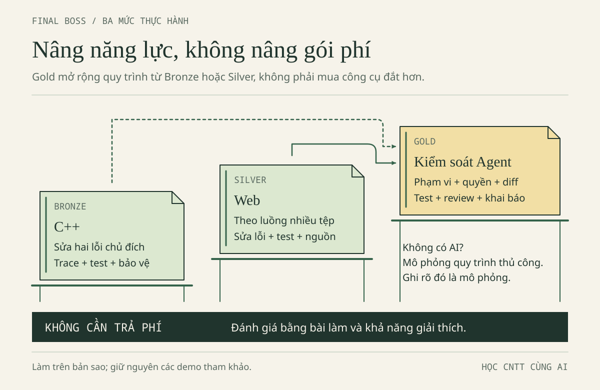

# FINAL BOSS · BUILD IT. TEST IT. EXPLAIN IT.

**Bổ sung biên tập.** Đây là dự án tổng kết để ghép năng lực của bốn chương, không phải một ứng dụng mới vượt quá sức sinh viên. “Boss cuối” không phải AI mạnh nhất; đó là ba câu hỏi: **Em làm gì? Em biết nó đúng bằng cách nào? Nếu không mở chat, em còn giải thích được gì?**

Minh và Lan có một cuộc hẹn: mỗi người mang một bản ViSinhVien đã kiểm chứng đến buổi chia sẻ. Không ai được mở đầu bằng “AI bảo là đúng”. Trên bàn phải có code, bảng test và lời giải thích. Nếu phát hiện thiếu bằng chứng, nhóm ghi thiếu và bổ sung, không dùng giao diện đẹp để lấp chỗ trống.



## 1. Chọn cấp độ theo năng lực cần luyện

| Lộ trình | Ai nên chọn? | Sản phẩm phải có | Không yêu cầu |
|---|---|---|---|
| BRONZE · C++ cơ bản | Năm nhất, đang học biến/vòng lặp/vector | Hàm cộng có kiểm tra đầu vào, hai bản vá, test và giải thích chỉ số/kiểu | Web, class Expense, tài khoản AI trả phí |
| SILVER · Web có luồng dữ liệu | Năm hai, đã biết JS/HTML | Sửa hai lỗi logic biệt lập; kiểm lại form → data → DOM và lưu trữ trong demo đúng | Backend, đăng nhập, đồng bộ, ví điện tử |
| GOLD · Quy trình Agent có kiểm soát | Đã hoàn thành Bronze hoặc Silver và muốn luyện giao việc | Toàn bộ sản phẩm cấp nền + phạm vi quyền, kế hoạch, diff, log, nghiệm thu | Thêm framework, thuê máy chủ, mua gói đắt hơn |

Gold không có nghĩa “code nhiều hơn”. Nó có nghĩa bạn chứng minh được Agent không được tự mở rộng nhiệm vụ và bạn biết từ chối thay đổi không có căn cứ. Nếu không có quyền dùng Agent, làm bài diễn tập quy trình trên giấy và ghi **mô phỏng, chưa thực thi Agent**; không nhận đã đạt phần bằng chứng chạy Agent thật.

Thời lượng gợi ý: Bronze 60–90 phút; Silver 90–120 phút; Gold thêm 30–45 phút cho quy trình. Có thể chia nhiều phiên. Đây không phải thước đo tốc độ hay năng lực lâu dài.

## 2. Mười yêu cầu của bản nộp

1. Viết yêu cầu chức năng bằng lời của mình: tổng phải làm gì, đầu vào nào bị từ chối, việc gì không thuộc phạm vi.
2. Chọn công cụ phù hợp và nói lý do. Nếu không dùng AI, ghi lựa chọn đó; nếu dùng, xác nhận phạm vi môn cho phép.
3. Mô tả cấu trúc dữ liệu: Bronze `vector<long long>`; Silver `Expense(id,title,amount,category)` và đường đi của `amount`.
4. Thực hiện phần triển khai trong phạm vi đã chọn. Ghi phần AI gợi ý, phần tự viết; không sửa demo tham khảo để hợp thức hóa đáp án.
5. Sửa tối thiểu hai lỗi gốc trong bộ đề chủ đích dưới đây, mỗi lỗi có hiện tượng, nguyên nhân và phản ví dụ riêng.
6. Đọc diff: từng dòng đổi giải quyết yêu cầu nào? Có tệp, phụ thuộc hoặc quyền nào tăng lên không?
7. Chạy kiểm thử có kỳ vọng độc lập; giữ lần thất bại và lần chạy lại, không chỉ chụp màn hình xanh cuối cùng.
8. Rà dữ liệu cá nhân, key, thư viện, giấy phép và ngữ cảnh hiển thị. Không dùng dữ liệu thật để bài “trông thực tế”.
9. Khai báo đúng mức hỗ trợ AI theo mẫu thỏa thuận học tập và hướng dẫn môn.
10. Giải thích sản phẩm, trả lời một ca biến thể không AI và nêu giới hạn chưa kiểm chứng.

**Hợp đồng chung:** dữ liệu giả 35000 + 7000 + 18000 = 60000; tiền nguyên VND từ 1 đến 1000000000; tối đa 500 khoản; rỗng trả 0; tổng cực đại 500000000000. Số tiền nguyên trong C++ không phải parser hoàn chỉnh của mọi chuỗi gõ bàn phím. Bản SQLite riêng không là backend và không áp đầy đủ hợp đồng danh sách này.

## 3. Chuẩn bị bài làm, không ghi đè ví dụ đúng

Mở thư mục gốc **AI-Student-Handbook** trong trình soạn thảo. Dùng trình quản lý tệp tạo `bai-lam/final-boss`, rồi sao chép các tệp cần thiết từ `vi-du/final-boss` vào đó. Đừng chạy lệnh sao chép mà chưa hiểu đích; ở bài này thao tác bằng giao diện là đủ.

| Tệp nguồn đề | Vai trò | Trạng thái ban đầu |
|---|---|---|
| [bronze.cpp](../vi-du/final-boss/bronze.cpp) | C++ có hai lỗi gốc và 9 ca test | Có lỗi chủ đích, test chưa thể xanh hết |
| [silver.cjs](../vi-du/final-boss/silver.cjs) | Hai hàm JS có hai lỗi gốc | Có lỗi chủ đích; không gắn vào demo Web |
| [test_silver.cjs](../vi-du/final-boss/test_silver.cjs) | 12 ca kiểm riêng cho đề Silver | Không đổi đáp án test để làm code qua |

Bộ đề này **khác** demo tham khảo `vi-du/nam-1-cpp/vi_sinh_vien.cpp` (9 ca) và `vi-du/nam-2-web/test_data.cjs` (34 ca ở bản mới, tăng từ 33 ca gốc do thêm regression test cho kiểu `category`). Không dùng ba con số lẫn nhau. Tệp `loi-bo-sot.cpp` ở chương 2 chỉ có một lỗi cận và không có `--test`; đó không phải toàn bộ đề Final Boss.

Tạo một tệp ghi chú `ghi-chep.txt` trong bài làm. Nội dung tối thiểu: điểm xuất phát, phạm vi, hai lỗi đang xét, test kỳ vọng, lệnh đã chạy, kết quả thực, phần AI hỗ trợ, phần chưa biết. Không lưu key hoặc dữ liệu riêng tư trong ghi chú.

## 4. BRONZE · Một vòng lặp, hai quyết định sai

**Bối cảnh:** Người viết đã biết phải kiểm tra đầu vào, nhưng chương trình vẫn cộng thiếu tiền và từ chối một khoản hợp lệ ở sát giới hạn. Hai lỗi nằm trong hai quyết định khác nhau; sửa được tổng mẫu không có nghĩa lỗi thứ hai biến mất.

### THINK FIRST — dự đoán trước lần chạy đầu

Đọc `bronze.cpp` trong bản sao, chưa mở đáp án. Ghi kỳ vọng cho ba khoản, rỗng, một khoản 7000, một khoản 1000000000, 500 khoản tối đa, 0, -1, 1000000001 và 501 khoản. Với ca bị từ chối, kỳ vọng là từ chối chứ không phải một tổng.

Trace riêng vòng cộng. Sau đó đọc vòng kiểm tra miền; không ghép cả hai vòng thành một ý mơ hồ “code xử lý số tiền”. Thử trả lời: điều kiện nào cho phép biên lớn nhất và điều kiện nào quyết định lượt cuối có được cộng?

**Cách đọc bộ chạy test:** `check(tên, đầu_vào, tổng_kỳ_vọng, từ_chối)` là một hàm nhỏ để đối chiếu. Khi đối số cuối là `true`, test chờ hàm báo `std::invalid_argument`; số `0` ở vị trí trước đó không phải tổng cần trả. Ví dụ `check("tu choi 0", {0}, 0, true)` yêu cầu **từ chối khoản 0**, không chấp nhận nó rồi cộng ra 0. Nếu bỏ đối số cuối, mặc định là `false`: test chờ một tổng hợp lệ. Lambda là cách khai báo hàm hỗ trợ ngay trong `main`; bạn chưa cần tự viết lại bộ chạy này, chỉ sửa `totalExpenses` và thêm một lời gọi `check` theo mẫu khi đã hiểu.

### Build và chạy đúng bản sao

Các lệnh sau chạy từ **gốc AI-Student-Handbook**, không đứng trong thư mục `bai-lam/final-boss`. Cần `g++` C++17. Nếu không có compiler, trace trên giấy và ghi chưa chạy; không cài phần mềm lên máy phòng lab khi chưa được phép.

Bash/Linux hoặc Git Bash:

```bash
g++ -std=c++17 -Wall -Wextra "bai-lam/final-boss/bronze.cpp" -o "bai-lam/final-boss/bronze.exe"
```

Xem exit code ngay bằng `echo $?`. **Chỉ khi build thành công**, chạy:

```bash
"./bai-lam/final-boss/bronze.exe"
echo $?
```

PowerShell:

```powershell
g++ -std=c++17 -Wall -Wextra "bai-lam/final-boss/bronze.cpp" -o "bai-lam/final-boss/bronze.exe"
$LASTEXITCODE
```

Chỉ khi mã build là 0:

```powershell
& ".\bai-lam\final-boss\bronze.exe"
$LASTEXITCODE
```

Test ban đầu có FAIL là dấu hiệu đề đang phát huy tác dụng. Không đổi dữ liệu kỳ vọng, không xóa test, không coi exit khác 0 của đề lỗi là lỗi máy. Sau mỗi bản vá, lưu tệp, build lại thành công rồi mới chạy lại. Dùng executable cũ sau build lỗi làm mất giá trị của toàn bộ bằng chứng.

### Kế hoạch sửa hai bước

Bước một: chọn một lỗi, dự đoán hành vi nào sẽ đổi sau bản vá; một test có thể vẫn FAIL vì lỗi còn lại che kết quả. Chỉ đổi một quyết định, chạy lại và xem cả nguyên nhân thất bại, không chỉ đếm PASS. Bước hai: đối chiếu các test còn lỗi để tìm quyết định thứ hai. Cuối cùng đọc diff và giải thích vì sao không cần thay kiểu dữ liệu, cài thư viện hay viết lại toàn chương trình.

**Đích sau sửa:** cả 9 ca đạt; chưa coi đó là chứng minh mọi đầu vào tưởng tượng đều được xử lý. Hãy thêm một test do bạn tự nghĩ, ví dụ một khoản 1 VND hoặc đảo thứ tự ba khoản. Ghi test bổ sung riêng để không nhầm số ca gốc.

### Đáp án Bronze — mở sau khi tự thử

Hai lỗi gốc là cận `i < n - 1` bỏ phần tử cuối và điều kiện `amount >= 1000000000LL` từ chối cả biên hợp lệ. Bản vá tương ứng là `i < n` và từ chối khi `amount > 1000000000LL`. Vẫn giữ `amount <= 0` và kiểm tra số lượng.

Nếu chỉ sửa vòng cộng, ca tiền tối đa vẫn bị từ chối: kỳ vọng 7 PASS, 2 FAIL. Nếu chỉ sửa miền tiền, ca một khoản vẫn cộng 0: bộ đếm vẫn 5 PASS, 4 FAIL. Hai ca biên đã chuyển từ “bị từ chối nhầm” sang “cộng sai”, nhưng số FAIL không cho thấy sự thay đổi đó. Để phân biệt, ghi lời gọi bị ném ngoại lệ hay trả tổng nào; đừng kết luận bản vá vô dụng chỉ vì bộ đếm đứng yên. Đây là lý do không dùng một lần thấy 60000 để khẳng định toàn bộ chức năng đúng.

Với bản đề chưa sửa, từ mã có thể dự đoán 5 PASS, 4 FAIL; sau hai bản vá là 9 PASS, 0 FAIL. Đây là **kỳ vọng để đối chiếu**; kết quả thực thi của phiên xuất bản nằm trong báo cáo kiểm tra, còn bạn phải ghi kết quả máy mình. Bài không yêu cầu xây parser nhập bàn phím hay kiểm tra ký tự `35000abc` trong C++.

## 5. SILVER · Dữ liệu phải đi đúng từ đầu đến cuối

**Bối cảnh:** Một hàm xử lý tiền dùng parser quá dễ dãi; hàm cộng lại đọc sai tên trường. Khi thử trên màn hình, hai lỗi có thể che nhau. Vì thế Lan bắt đầu với test logic biệt lập, rồi mới quay lại kiểm giao diện.

### Bài logic có hai lỗi chủ đích

Sao chép cả `silver.cjs` và `test_silver.cjs` vào cùng `bai-lam/final-boss`. Đọc test trước; lập bảng riêng cho `parseAmount` và `totalExpenses`. Việc ô nhập chỉ cho bàn phím số không bảo vệ dữ liệu lấy từ kho lưu hoặc gọi hàm trực tiếp.

Chạy từ gốc dự án, với Node.js có sẵn:

```bash
node "bai-lam/final-boss/test_silver.cjs"
```

Ngay sau đó, Bash dùng `echo $?`, PowerShell dùng `$LASTEXITCODE`. Kỳ vọng ban đầu có lỗi, không chạy `npm install` vì đề dùng thư viện chuẩn Node. Trong bảng, giữ nguyên kiểu: `"35000"` là chuỗi, `35000` là số.

| Nhóm test | Cần chứng minh | Ví dụ phản chứng |
|---|---|---|
| Parse đúng toàn chuỗi | Không nhận một phần rồi bỏ hậu tố | `35000abc`, `1.5`, `1e3` đều phải từ chối |
| Parse đúng miền | Sau chuyển số vẫn kiểm dương, nguyên, giới hạn | Rỗng, 0, quá 1e9 |
| Cộng đúng trường | Dữ liệu chứa `amount`, không tự phát sinh `value` | Ba khoản phải 60000, một khoản 7000 |
| Danh sách đúng hợp đồng | Rỗng 0, tối đa 500, không chấp nhận amount chuỗi | 501 khoản, `{amount:'35000'}` |

Sửa từng lỗi và dự đoán nhóm test bị tác động. Không sửa file test để bỏ qua lỗi. Sau khi 12 ca có sẵn đạt, tự thêm ca `"1000000001"` và ca `" 7000 "`; ghi số test mới bạn thực sự chạy, không nói nguyên bộ vẫn là 12 ca.

### Quay về luồng Web tham khảo

Bộ Silver là bài Node riêng, **không tự động trở thành ứng dụng Web**. Nếu chưa làm chương 2, dùng trình quản lý tệp sao chép **cả thư mục** `vi-du/nam-2-web` sang `bai-lam/nam-2-web`; giữ `index.html`, `data.js`, `app.js` cùng thư mục. Sau khi giải được hai hàm, mở `bai-lam/nam-2-web/index.html` để theo luồng form → handler → `parseAmount` → `normalizeExpenses` → lưu → `render`. Demo Web tham khảo đã có logic đúng; không chép `module.exports` của bài Node vào trình duyệt.

Từ ba khoản mẫu 60000, thêm Bánh mì 15000 để mong đợi 75000. Nếu dữ liệu cũ khác, khôi phục mẫu chỉ sau khi xác nhận đó là dữ liệu giả có thể thay, hoặc tính kỳ vọng từ tổng thực tế đang có. Thử chuỗi `35000abc`: tổng không được tăng. Thêm tên `<b>Vở</b>`: tên hiển thị nguyên văn, không thành HTML.

Tải lại trang và đọc thông báo lưu. Khi đang fallback RAM, không đòi dữ liệu tồn tại sau reload; nút khôi phục mẫu không tự bật lại persistence trong phiên. Ghi trình duyệt, địa chỉ đang mở và thông báo thấy được. `file://` có hành vi localStorage phụ thuộc trình duyệt; không kết luận toàn bộ ứng dụng hỏng chỉ vì mở một địa chỉ khác.

**Đích Silver:** giải thích được hai lỗi logic, có test riêng và biên bản thử Web; chỉ ra khác biệt giữa hàm tính tiền, schema bốn trường và DOM. Không cần viết backend để “nâng cấp” bài.

### Đáp án Silver — mở sau khi tự thử

Lỗi thứ nhất: `parseInt` có thể đọc đầu chuỗi và bỏ phần còn lại. Thêm kiểm tra toàn chuỗi chữ số sau `trim`, rồi chuyển bằng `Number`; vẫn giữ kiểm tra số nguyên an toàn và miền tiền. Thêm radix 10 vào `parseInt` không sửa được lỗi nhận hậu tố.

Lỗi thứ hai: reducer cộng `item.value` trong khi dữ liệu chỉ có `amount`; cần cộng `item.amount`. `undefined` khi đọc trường thiếu là một giá trị khác với `NaN` sinh ra trong phép cộng số. Không chữa bằng cách đặt `undefined` thành 0 vì nó che hợp đồng trường bị sai.

Kỳ vọng bộ 12 ca: bản đề 6 PASS, 6 FAIL; bản sửa 12 PASS, 0 FAIL. Trình duyệt vẫn phải kiểm riêng. Cụm “test logic xanh” không đủ để kết luận nút thêm, nút xóa, `textContent` và lưu trữ đều đúng.

## 6. GOLD · Một Agent, một phạm vi, một lần nghiệm thu

Chỉ chọn sau khi hiểu yêu cầu Bronze/Silver. Bạn làm người điều phối, không đưa quyền toàn bộ máy để đổi lấy tốc độ.

1. **Khóa phạm vi:** nêu đúng bản sao và tên file; cấm cài gói, sửa config/quyền, xóa file, commit/push/publish hoặc gọi dịch vụ. Kiểm cơ chế quyền thật của công cụ, không chỉ viết lệnh cấm trong prompt.
2. **Yêu cầu kế hoạch trước:** Agent chỉ đọc và đề xuất test. Nếu đề xuất chuyển cả bài sang framework mới, từ chối và giải thích vì sao ngoài nhiệm vụ.
3. **Duyệt một thay đổi:** dùng P10 trong Prompt Library đã điền đủ. Không cấp phép mơ hồ “làm mọi thứ cần thiết”.
4. **Theo dõi bằng chứng:** file nào được đọc/sửa, lệnh nào thực thi, exit code, cả lần thất bại. Báo cáo ý định không thay kết quả quan sát.
5. **Đọc diff trước nhận:** so với checkpoint của bản sao; tệp ngoài phạm vi là lý do dừng. Không khôi phục hàng loạt làm mất thay đổi hợp lệ của người khác.
6. **Nghiệm thu độc lập:** bạn tự chạy lại test, tự giải thích hai lỗi và một ca biến thể. Nếu thiếu công cụ, ghi việc chưa kiểm thay vì mượn kết quả chạy của nơi khác.

| Mốc | Agent được làm | Người học phải quyết định | Bằng chứng |
|---|---|---|---|
| Trước sửa | Đọc trong phạm vi, đề xuất | Kế hoạch và quyền có phù hợp? | Kế hoạch đã xem |
| Khi sửa | Đúng file đã duyệt | Có cần dừng vì ngoài phạm vi? | Diff và nhật ký |
| Khi test | Lệnh được cho phép | Kết quả có đúng bản mã? | Command, output, exit |
| Khi nhận | Báo phần xong/chưa xong | Có đủ căn cứ nghiệm thu? | Test tự chạy, vấn đáp |

Không có Agent? Đóng vai “người giao việc” và nhờ bạn học phản biện kế hoạch. Bằng chứng đó có giá trị luyện tập nhưng phải nhãn mô phỏng; phần vận hành công cụ thật để trạng thái chưa thực hiện.

## 7. Bảng nghiệm thu và rubric 100 điểm

Rubric này phục vụ luyện tập, không là thang điểm chính thức của TLU. Nếu môn có rubric riêng, dùng rubric môn. Điểm cao không bù việc lộ key, dữ liệu cá nhân, không được phép dùng AI hoặc khai báo sai.

| Tiêu chí | Điểm tối đa | Đạt tối đa khi | Thiếu bằng chứng thì |
|---|---:|---|---|
| Yêu cầu chức năng và phạm vi | 10 | Nêu hợp đồng, giới hạn và việc không làm | Mơ hồ: tối đa 4 |
| Chọn công cụ có lý do | 5 | Gắn lựa chọn với tác vụ, chi phí/quyền | Chỉ nói “mạnh nhất”: tối đa 1 |
| Cấu trúc dữ liệu | 10 | Nói đúng kiểu, trường, ranh giới kiểm tra | Nhầm chuỗi/số hoặc C++/Web: tối đa 4 |
| Triển khai và phân chia đóng góp | 10 | Code của bản sao, phần AI/tự làm rõ | Chép không giải thích: tối đa 3 |
| Hai lỗi và nguyên nhân | 15 | Hai bản vá với phản ví dụ độc lập | Sửa được một lỗi: tối đa 7 |
| Kiểm tra thay đổi | 10 | Diff có mục đích, không thay ngoài phạm vi | Không có trước/sau: tối đa 3 |
| Kiểm thử có kỳ vọng | 15 | Giữ lần sai, build/test bản mới, biên/rỗng/sai | Chỉ một ca mẫu: tối đa 4 |
| Riêng tư, bảo mật, giấy phép | 10 | Dữ liệu giả, quyền tối thiểu, nguồn rõ | Có blocker: chưa nghiệm thu |
| Khai báo AI trung thực | 5 | Công cụ/việc hỗ trợ/phần tự làm/chưa kiểm | Khai sai: chưa nghiệm thu |
| Giải thích và biến thể không AI | 10 | Tự trả lời bằng trace/test, biết giới hạn | Chỉ đọc lại lời AI: tối đa 3 |
| **Tổng** | **100** | Không có điều kiện chặn nộp | Điểm số không thay bằng chứng |

Đối với người làm hoàn toàn không AI, chấm sự phù hợp của lựa chọn và khai báo thật, không trừ điểm vì không mua dịch vụ. Với Gold, mức điểm tương ứng phải dựa bằng chứng vận hành Agent thật hoặc ghi chưa đạt phần đó khi chỉ mô phỏng.

## 8. Buổi bảo vệ ngắn

**Phút 1:** mô tả đầu vào–đầu ra và một việc ứng dụng không làm. **Phút 2–3:** giải thích lỗi đầu bằng phản ví dụ nhỏ nhất. **Phút 4–5:** giải thích lỗi thứ hai và test phát hiện nó. **Phút 6:** mở diff, chỉ dòng ngoài thuật toán như validation. **Phút 7:** nói một phần chưa kiểm chứng. **Phút 8:** trả lời câu biến thể do bạn học/giảng viên chọn.

Câu biến thể có thể là: đảo thứ tự có làm tổng đổi không; 500 khoản tối đa cần kiểu tổng nào; tại sao lọc theo nhóm vẫn phải kiểm toàn danh sách; nếu tắt lưu trữ thì chức năng nào còn hoạt động; vì sao thêm 15000 không phải lúc nào tổng cũng thành 75000. Người hỏi không cần làm khó bằng tính năng chưa học.

### SKILL UNLOCKED — dấu hiệu kết thúc

Bạn có một sản phẩm nhỏ cùng một chuỗi bằng chứng có thể lặp lại. Bạn không phải nhớ mọi cú pháp, nhưng phải biết truy câu hỏi về đúng tệp, đúng dữ liệu, đúng phép thử. Nếu ngày mai công cụ AI không dùng được, bảng trace, test và khả năng giải thích vẫn ở lại với bạn.
