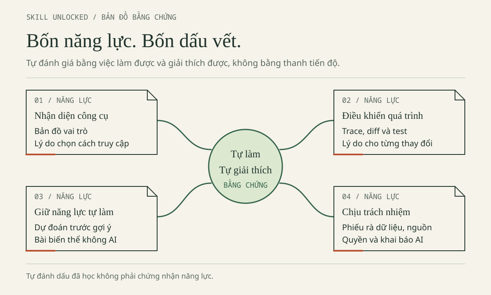

# HỌC CNTT CÙNG AI

**Cẩm nang tự học và tra cứu dành cho sinh viên năm 1–2 Khoa Công nghệ thông tin, Trường Đại học Thủy lợi.**

## Một bữa trưa, một câu hỏi nhỏ

Sau bữa trưa, Minh mở máy: “Hôm nay mình đã chi bao nhiêu?” Bạn học năm nhất, biết biến và vòng lặp C++, nhưng thường muốn hỏi AI ngay khi thấy lỗi. Lan học năm hai, đã gặp Web, OOP, cấu trúc dữ liệu và cơ sở dữ liệu; bạn dựng được giao diện nhưng còn lúng túng khi lỗi đi qua nhiều tệp. Hai bạn cùng làm **ViSinhVien**, ứng dụng ghi những khoản chi nhỏ.

**Nhân vật, hội thoại và dữ liệu đều hư cấu**, không phải khảo sát sinh viên TLU hay bảng giá thực tế.

| Khoản chi | Nhóm | Số nguyên lưu trong code | Hiển thị |
|---|---|---:|---:|
| Cơm trưa | Ăn uống | `35000` | 35.000 đ |
| Xe buýt | Đi lại | `7000` | 7.000 đ |
| Vở ghi | Học tập | `18000` | 18.000 đ |
| **Tổng đối chiếu** | | **`60000`** | **60.000 đ** |

Minh gặp bản C++ kết thúc ở `42000`; Lan muốn biết tiền đi từ ô nhập đến tổng thế nào. Bạn sẽ cùng hai người dự đoán, kiểm tra một thay đổi nhỏ, rồi giải thích vì sao nó đúng. Không cần mua dịch vụ AI để bắt đầu.

## Hai lộ trình, một cách học

**Theo Minh — C++ trước:** nhận diện công cụ ở Chương 1; đọc vòng lặp, trace và sửa lỗi bỏ khoản cuối ở Chương 2; tự làm biến thể ở Chương 3; chuẩn bị bản nộp trung thực ở Chương 4. Chưa học Web/SQL thì để lại, không cần cài thêm cho nhánh C++.

**Theo Lan — lần theo Web:** sau Chương 1, theo `amount` từ biểu mẫu qua xử lý đến hiển thị/lưu trữ ở Chương 2; tự giải thích kiểu dữ liệu và làm biến thể ở Chương 3; rà quyền, dữ liệu, nguồn ở Chương 4. Khi Lan cùng Minh xem C++, đó là đọc chéo, không đổi nhánh của Minh.

Không cần hoàn thành cả hai ngay. Một hàm tự giải thích được có giá trị hơn cả ứng dụng chép lại mà chưa hiểu.



*Bổ sung biên tập — bản đồ chọn việc luyện tiếp, không phải chứng nhận tự động. Bảng mục tiêu bên dưới cũng trình bày bằng chữ các bằng chứng cần giữ.*

## Hợp đồng chung của ViSinhVien

`amount` là **số nguyên VND từ 1 đến 1.000.000.000 (`1e9`), kể cả hai đầu**. Tối đa **500 khoản**; danh sách rỗng hợp lệ, tổng bằng **0**. Từ chối khoản bằng 0, số âm, số thập phân (như 1.5) hoặc vượt trần. Dấu chấm trong “35.000 đ” chỉ để hiển thị.

Hai nhánh dùng cùng tiền mẫu nhưng **khác cấu trúc dữ liệu**:

- C++ dùng `std::vector<long long>` chứa `{35000, 7000, 18000}`: chỉ có các số tiền, chưa có tên, nhóm, mã.
- Web dùng danh sách đối tượng `Expense` có **bốn trường**:

```json
{"id": 1, "title": "Cơm trưa", "amount": 35000, "category": "an-uong"}
```

`id` nhận diện khoản; `title` là tên; `amount` là tiền; `category` là mã nhóm, không phải nhãn hiển thị. Ô nhập Web trả chuỗi: chuyển đổi không thay kiểm tra hợp lệ. Hàm tính tổng cũng không thay kiểm đủ bản ghi khi đọc/lưu.

Tổng cực đại `500000000000` nằm trong miền số nguyên an toàn của JavaScript và biểu diễn được bằng `long long`. Đây là quy ước học tập, không phải thiết kế cho mọi hệ thống tài chính; đổi giới hạn/đơn vị tiền thì phải xét lại.

Web chỉ có HTML, JavaScript, `localStorage`, **không backend/đăng nhập**. SQLite là minh họa Python riêng dùng `:memory:`, không phải cơ sở dữ liệu của Web. Không nhập sao kê, chi tiêu thật hay thông tin cá nhân.

## Mục tiêu đi cùng bằng chứng

Đây là mục tiêu cẩm nang, **không thay CLO hoặc thang điểm học phần**. Chọn một dòng để tự kiểm, không đánh dấu chỉ vì đã đọc hết.

| Mục tiêu | Chỗ học | Bằng chứng do bạn tạo |
|---|---|---|
| Phân biệt model, provider, ứng dụng | Chương 1 | Bảng nhận diện công cụ, ghi điều chưa xác định. |
| Chọn cách dùng hợp túi tiền | Chương 1 | Tính lại chi phí từ giả định, nêu giới hạn so sánh. |
| Giao việc nhỏ, đủ ngữ cảnh | Chương 1–2 | Yêu cầu có mục tiêu, dữ liệu, phạm vi, tiêu chí kiểm tra. |
| Đọc lỗi, diff, kiểm thử | Chương 2 | Trace lỗi `42000/60000`; kiểm rỗng/một phần tử; theo `amount`. |
| Học chủ động | Chương 3 | Bài biến thể tự làm khi không mở AI. |
| Giải thích phần mình làm | Chương 3 | Trả lời “vì sao?”, “đổi yêu cầu thì sao?”, ghi chỗ còn vướng. |
| Bảo vệ dữ liệu, rà mã/phụ thuộc | Chương 4 | Quyết định về dữ liệu gửi, điểm hiển thị, truy vấn SQL, gói đề xuất. |
| Khai báo, kiểm quyền, xử lý sự cố | Chương 4 | Bản khai đúng hỗ trợ, câu hỏi cho giảng viên, thứ tự xử lý key lộ. |

## Cách đọc và tự học

**Trước buổi chia sẻ:** đọc mở đầu, phần nhận diện công cụ và mang một câu hỏi thật; chưa cần cài phần mềm. **Trong buổi:** dự đoán trước khi xem chạy mẫu/đáp án, ghi chỗ hiểu sai thay vì chỉ chụp màn hình.

**Sau buổi:** chọn nhiệm vụ vừa sức trong khoảng 20–25 phút: đọc → dự đoán → thử → đối chiếu → giải thích. Ghi ba dòng: “Mình đã hiểu… / Mình chưa chắc… / Lần tới mình sẽ…”. Thời lượng là gợi ý; chưa xong thì giữ đầu vào, lỗi và bước đang làm, không chấm mình theo tốc độ.

Trong bản HTML, dùng mục lục, tìm mục, chỉnh cỡ chữ và in khi có; mở **Đáp án** sau khi thử. Giữ cả thư mục sách để đọc offline cùng hình và ví dụ. Nguồn ngoài và dịch vụ AI cần mạng; mô phỏng tại chỗ không gọi AI. Không có tài khoản vẫn học bằng đề, trace và phiếu đáp minh họa.

Phân biệt **hội thoại mô phỏng**, **trace**, **đầu ra kỳ vọng** với **kết quả thực sự chạy**. Bản có lỗi chủ đích được giữ để học, không phải demo đúng cần sửa tùy tiện. Tổng trung gian `42000` chưa chứng minh lỗi; phải biết đã duyệt đến đâu. Thiếu môi trường thì ghi **chưa chạy**, không chép kỳ vọng làm quan sát.

## Mở ví dụ nào trước?

Mở gốc `AI-Student-Handbook` khi theo lệnh Chương 2. Giữ `vi-du/` làm tham khảo; tự tạo thư mục `bai-lam/` (chưa có sẵn) theo Chương 2, mục 2.1, rồi sao chép nhánh sang đó trước khi sửa.

| Mở tệp | Mục đích và điều kiện |
|---|---|
| [C++ có lỗi chủ đích](../vi-du/nam-1-cpp/loi-bo-sot.cpp) | Trace tổng thiếu; C++17, không có `--test`. Chưa có compiler thì đọc trace trước. |
| [C++ đúng, có kiểm thử](../vi-du/nam-1-cpp/vi_sinh_vien.cpp) | Đối chiếu sửa lỗi và giới hạn; cần trình biên dịch C++17 như g++. |
| [Web ViSinhVien](../vi-du/nam-2-web/index.html) | Thử khoản giả bằng trình duyệt hiện đại; giữ cùng `data.js`, `app.js`. |
| [Kiểm thử dữ liệu Web](../vi-du/nam-2-web/test_data.cjs) | Kiểm logic, không chứng minh DOM/lưu trữ; cần Node.js hiện đại, không cần `npm install`. |
| [SQLite riêng](../vi-du/minh-hoa-sqlite.py) | Truy vấn tham số hóa với fixture riêng; Python 3 có `sqlite3`, không phải backend Web. |

`localStorage` lưu trong trình duyệt, không trên máy chủ. Quyền lưu khi mở tệp cục bộ tùy trình duyệt; demo có thể báo lỗi và dùng bộ nhớ tạm, mất thay đổi khi kết thúc phiên. Không dùng để giữ dữ liệu lâu dài.

## Nguồn và lời hẹn trước khi học tiếp

Bản nguồn có mốc đối chiếu sản phẩm/pháp lý **29/10/2026**, không bảo đảm còn áp dụng khi bạn đọc. Tra nguồn cuối chương, kiểm ngày, đúng sản phẩm và điều kiện tài khoản. Có hướng dẫn môn mới hơn hoặc điều chưa rõ thì hỏi người phụ trách; lời AI hay một liên kết không thay kiểm chứng.

> **Thỏa thuận học tập:** AI có thể giải thích, tạo giả thuyết, đề xuất code và giúp kiểm tra. Bạn quyết định mục tiêu, phần tự làm, phạm vi chia sẻ và bằng chứng. “AI làm xong” chưa có nghĩa “mình học xong”.

Tiếp tục với [thỏa thuận có mẫu điền](learning-agreement.md), [glossary](glossary.md) hoặc [thư viện prompt](prompt-library.md).

*Ghi chú biên tập: kế thừa câu chuyện, dữ liệu, hai nhánh, mục tiêu, hướng dẫn đọc và thỏa thuận nguồn. Bổ sung biên tập: cảnh bữa trưa, bản đồ năng lực, cách lưu bằng chứng, quy ước bản sao. Cẩm nang không phải quy định TLU, quảng cáo hay tư vấn pháp lý.*
